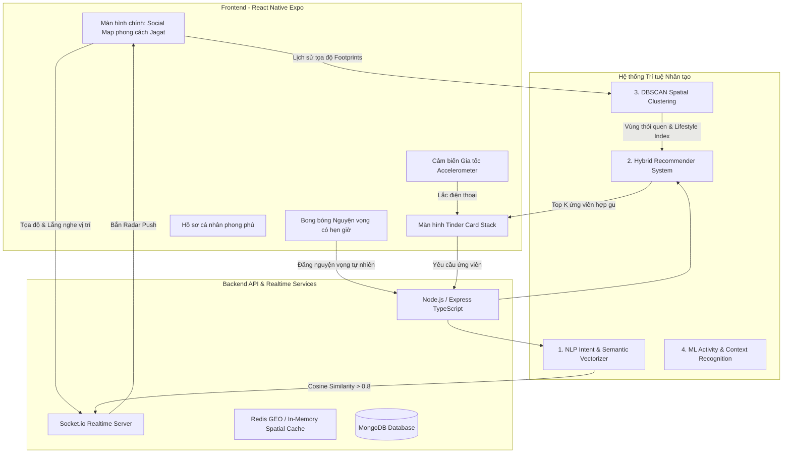

# KẾ HOẠCH TRIỂN KHAI DỰ ÁN: VIVU - LOCATION-BASED AI SOCIAL DISCOVERY
## (LẤY CẢM HỨNG TỪ JAGAT & TINDER CHO ĐỒ ÁN TRÍ TUỆ NHÂN TẠO)

> **Căn cứ tài liệu đặc tả chuẩn:**
> - Kế hoạch AI & Tính năng: [`ai_social_map_plan.md`](file:///C:/Users/Hi/.gemini/antigravity-ide/brain/66f6cc31-dc06-40fa-8874-a6ac30350357/ai_social_map_plan.md)
> - Đặc tả Bản đồ Mạng xã hội: [`docs/HOME_FUNCTIONAL_SPEC.md`](file:///d:/vivudemo1/docs/HOME_FUNCTIONAL_SPEC.md)
> - Đặc tả Matching & Vuốt Tinder: [`docs/VIVU_MATCHING_FUNCTIONAL_SPEC.md`](file:///d:/vivudemo1/docs/VIVU_MATCHING_FUNCTIONAL_SPEC.md)
> - Đặc tả yêu cầu hệ thống tổng thể: [`docs/VIVU_SRS.md`](file:///d:/vivudemo1/docs/VIVU_SRS.md)
>
> **Tôn chỉ sản phẩm:** Bản đồ mạng xã hội tương tác thời gian thực phong cách Jagat kết hợp cơ chế Lắc để Vuốt (Shake to Match) phong cách Tinder, vận hành hoàn toàn trên nền tảng các thuật toán Trí tuệ Nhân tạo (NLP Semantic Matching, Hybrid Recommender System, DBSCAN Spatial Clustering).

---

## 1. TỔNG QUAN KIẾN TRÚC HỆ THỐNG MỚI

---

## 2. BẢNG PHÂN CÔNG THUẬT TOÁN AI (TRỌNG TÂM ĐỒ ÁN TỐT NGHIỆP)

| STT | Thuật toán AI | Vấn đề giải quyết | Đầu vào | Đầu ra |
|:---|:---|:---|:---|:---|
| **AI-1** | **NLP Semantic Matching** *(Sentence-BERT / Word Embeddings)* | Đọc hiểu nguyện vọng tự nhiên (VD: "Thèm trà sữa", "Tìm người chạy bộ") | Chuỗi văn bản nguyện vọng của User | Vector ngữ nghĩa n-chiều; Bắn thông báo Push cho người trong bán kính R có Cosine Similarity > 0.8. |
| **AI-2** | **Hybrid Recommender System** *(Content-Based + Collaborative + Multi-Armed Bandit)* | Xếp hạng ứng viên xuất hiện khi Lắc máy (Shake) để vuốt Tinder | Profile cá nhân, Tags sở thích, Lịch sử vuốt (Like/Dislike) | Điểm số Match (%) và thứ tự hiển thị thẻ vuốt tối ưu nhất. |
| **AI-3** | **DBSCAN Spatial Clustering** *(Density-Based Spatial Clustering)* | Gom cụm bài đăng/người dùng trên bản đồ tránh rối mắt; Phân tích Vết chân (Footprints) | Tập hợp tọa độ GPS thời gian thực và lịch sử | Nhận diện các điểm nóng (Hotspots) và các cụm thói quen sinh hoạt (Home, School, Cafe). |
| **AI-4** | **Activity Recognition (Học máy)** *(Decision Tree / Random Forest)* | Tự động nhận diện ngữ cảnh Live Status kiểu Jagat | Gia tốc kế (X,Y,Z), Tốc độ GPS (km/h), Thời gian | Nhãn trạng thái: `Free & Chilling`, `Deep Work`, `On the Road`, `Sleeping`. |

---

## 3. LỘ TRÌNH THỰC THI CHI TIẾT (ACTION PLAN THEO TỪNG GIAI ĐOẠN)

### 🚀 Giai đoạn 1: Dựng Màn hình chính Bản đồ Mạng xã hội Jagat (P0 - Tuần 1)
*Thay thế bảng tin dạng danh sách cũ bằng Bản đồ tương tác toàn màn hình.*

- [ ] **1.1. Tái cấu trúc Tab Trang chủ (`src/app/(tabs)/index.tsx`):**
  - Chuyển trang chủ thành `JagatMapScreen` chiếm trọn 100% diện tích màn hình.
  - Tích hợp bản đồ Dark Neon phong cách Zenly/Jagat.
  - Xin quyền truy cập GPS thời gian thực (`expo-location`) mượt mà, định vị tâm bản đồ tại vị trí người dùng.
- [ ] **1.2. Custom Map Pins & Hiệu ứng Sóng Radar:**
  - Avatar tròn của chính người dùng nằm ở trung tâm với hiệu ứng sóng Radar tỏa ra theo chu kỳ.
  - Ghim các Avatar người dùng và bạn bè xung quanh với huy hiệu trạng thái (pin, đang online).
- [ ] **1.3. Nút Tạo Nguyện Vọng nổi ở vị trí trung tâm:**
  - Nút tròn phát sáng (Glow) ở góc dưới bản đồ để mở popup đăng nguyện vọng tức thì.

---

### 🚀 Giai đoạn 2: Treo Nguyện Vọng (NOW Beacon) & Radar Thông báo lân cận (P0 - Tuần 2)
*Cơ chế đăng bài phù du có hẹn giờ và phát hiện người cùng chí hướng.*

- [ ] **2.1. Modal đăng "Nguyện vọng tức thì":**
  - Giao diện nhập cảm nghĩ/mong muốn (tối đa 100 ký tự) + Chọn Icon cảm xúc + Chọn thời hạn bốc hơi (1 tiếng, 3 tiếng, 6 tiếng, 24 tiếng).
  - Tự động lấy tọa độ GPS hiện tại gắn vào bài đăng.
- [ ] **2.2. Hiển thị Bong bóng Suy nghĩ (Thought Bubble) trên Map:**
  - Nguyện vọng hiển thị dưới dạng bong bóng nổi trên đầu Avatar người dùng.
  - Chạm vào bong bóng: Bung Card chi tiết nguyện vọng + Nút "Tham gia cùng" / "Bắt chuyện".
- [ ] **2.3. Tích hợp NLP Semantic Matching & Radar Push:**
  - Backend xử lý vector hóa nội dung bài đăng.
  - Quét bán kính xung quanh (sử dụng vị trí địa lý Redis Geo / Haversine).
  - Socket.io gửi thông báo thời gian thực: *"Ở gần bạn đang có người có nguyện vọng tương đồng!"*.

---

### 🚀 Giai đoạn 3: Tính năng Lắc điện thoại (Shake to Match) & Vuốt Tinder (P0 - Tuần 3)
*Màn hình ghép đôi cảm biến gia tốc và thuật toán gợi ý.*

- [ ] **3.1. Cảm biến gia tốc `expo-sensors` (Accelerometer):**
  - Bắt cử chỉ lắc mạnh điện thoại ở bất kỳ màn hình nào.
  - Hiệu ứng âm thanh rung (Haptic feedback) + Màn hình bản đồ mờ dần, mở ra Modal **Tinder Card Stack**.
- [ ] **3.2. Màn hình Tinder Swipe Card:**
  - Thẻ người dùng gồm: Album ảnh đại diện lớn (vuốt ảnh), Tên, Tuổi, Điểm Match AI (%), Khoảng cách, Danh sách Tags sở thích chung.
  - Vuốt Phải (Thích) - Vuốt Trái (Bỏ qua) sử dụng `react-native-reanimated` và `react-native-gesture-handler`.
- [ ] **3.3. Xử lý Match Kép (Double Match / Mutual Like):**
  - Khi 2 người cùng thích nhau: Bung hiệu ứng pháo hoa BUMP kèm câu Ice-Breaker do AI gợi ý -> Mở ngay phòng Chat riêng tư 1-1.

---

### 🚀 Giai đoạn 4: Cải tiến Hồ sơ Cá nhân & Nhận diện Ngữ cảnh AI (P1 - Tuần 4)
*Profile chuẩn phong cách Tinder kết hợp trạng thái Jagat.*

- [ ] **4.1. Màn hình Profile cá nhân đầy đủ:**
  - Cho phép tải lên 3-6 bức ảnh phong cách sống.
  - Nhập Bio, Cung hoàng đạo, Học vấn, Nghề nghiệp, Danh sách 5-10 Tags sở thích (Âm nhạc, Thể thao, Ăn uống, Du lịch).
  - Hiển thị Điểm Uy Tín (Trust Score) và Vết chân khám phá (% thành phố đã đi qua).
- [ ] **4.2. Nhận diện trạng thái tự động (AI Live Status):**
  - Phân tích vận tốc và thời gian dừng để hiển thị huy hiệu: ☕ *Đang chill*, 💻 *Đang bận học*, 🛵 *Đang đi đường*.

---

### 🚀 Giai đoạn 5: Tương tác Bản đồ POPO & Bản đồ Dấu chân Footprints (P1 - Tuần 5)
*Gia tăng tính giải trí và hoàn thiện báo cáo khoa học đồ án.*

- [ ] **5.1. Tương tác ném POPO qua Socket.io:**
  - Bấm vào bạn bè trên map -> Chọn ném Thả tim, Ném dép, Bắn pháo hoa -> Màn hình người kia nổ icon tương ứng.
- [ ] **5.2. Bản đồ Dấu Chân (Fog of War) & DBSCAN:**
  - Vẽ lớp phủ sương mù trên bản đồ, mở sáng các khu vực người dùng đã từng đi qua.
  - Chạy giải thuật DBSCAN để tính toán chỉ số tương đồng lối sống (Lifestyle Overlap Index).

---

## 4. TIÊU CHUẨN KIỂM ĐỊNH KỸ THUẬT (DEFINITION OF DONE)

1. **Không còn màn hình Feed tĩnh cũ:** Bản đồ tương tác là trang chủ tuyệt đối.
2. **Khởi chạy không lỗi:** `npx expo start --tunnel` hoạt động ổn định trên Expo Go của điện thoại thật; backend Node.js tự động xử lý fallback bộ nhớ khi không có Redis local.
3. **Mã nguồn sạch:** `npx tsc --noEmit` và `npx expo lint` không phát sinh lỗi cú pháp hay import gãy vỡ.
4. **Báo cáo đồ án khoa học:** Có đầy đủ sơ đồ kiến trúc, giải thích toán học của Cosine Similarity, Recommender System và DBSCAN để thuyết trình trước hội đồng chấm thi.
