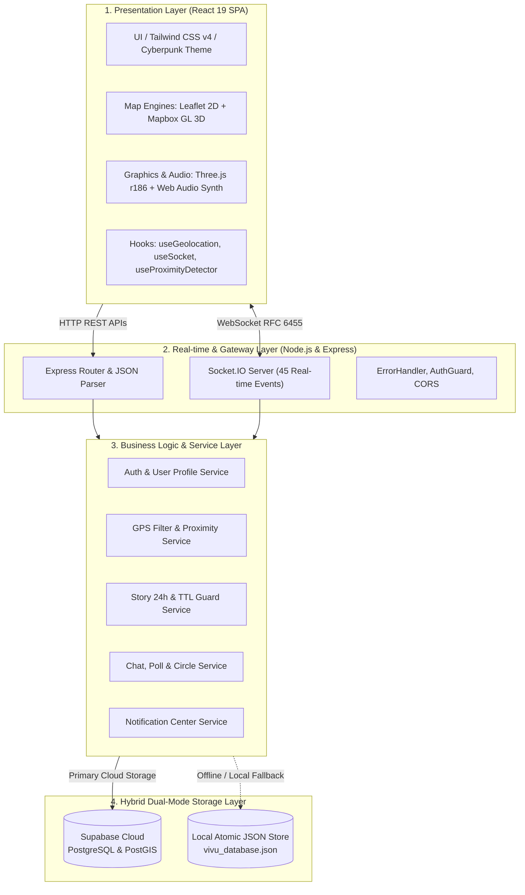
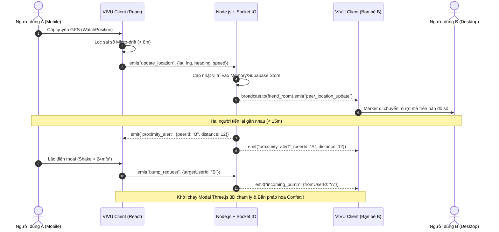

# 🌍 VIVU — Mạng Xã Hội Bản Đồ Thời Gian Thực (Real-Time Social Map)

<p align="center">
  
</p>

<p align="center">
  <em>Nền tảng mạng xã hội không gian thế hệ mới: Kết nối con người qua tọa độ GPS thời gian thực, tương tác cụng ly 3D vật lý và khoảnh khắc định vị 24h.</em>
</p>

<p align="center">
  
  
  
  
  
  
  
  
  
  
</p>

---

## 📌 Mục Lục

1. [Giới Thiệu Tổng Quan](#-giới-thiệu-tổng-quan)
2. [Điểm Nhấn Công Nghệ & Trải Nghiệm](#-điểm-nhấn-công-nghệ--trải-nghiệm)
3. [Danh Mục 11 Tính Năng Cốt Lõi (FR-01 → FR-11)](#-danh-mục-11-tính-năng-cốt-lõi-fr-01--fr-11)
4. [Kiến Trúc Hệ Thống (System Architecture)](#-kiến-trúc-hệ-thống-system-architecture)
5. [Ngăn Xếp Công Nghệ (Tech Stack)](#-ngăn-xếp-công-nghệ-tech-stack)
6. [Cấu Trúc Thư Mục Dự Án](#-cấu-trúc-thư-mục-dự-án)
7. [Hướng Dẫn Cài Đặt & Khởi Chạy (Quickstart)](#-hướng-dẫn-cài-đặt--khởi-chạy-quickstart)
   - [Phương thức 1: Khởi chạy Cục bộ (Local Development)](#phương-thức-1-khởi-chạy-cục-bộ-local-development)
   - [Phương thức 2: Khởi chạy bằng Docker Compose](#phương-thức-2-khởi-chạy-bằng-docker-compose)
   - [Phương thức 3: Kiểm thử GPS trên Thiết bị Di động (Cloudflare Tunnel)](#phương-thức-3-kiểm-thử-gps-trên-thiết-bị-di-động-cloudflare-tunnel)
8. [Cấu Hình Biến Môi Trường (Environment Variables)](#-cấu-hình-biến-môi-trường-environment-variables)
9. [Kiểm Thử & Đảm Bảo Chất Lượng (Quality Assurance)](#-kiểm-thử--đảm-bảo-chất-lượng-quality-assurance)
10. [Tài Liệu Kỹ Thuật Đính Kèm & Bản Quyền](#-tài-liệu-kỹ-thuật-đính-kèm--bản-quyền)

---

## 🌟 Giới Thiệu Tổng Quan

**VIVU** là nền tảng Web App mạng xã hội không gian thời gian thực (Real-time Spatial Social Network), lấy bản đồ tương tác làm trung tâm trải nghiệm. Khác với mạng xã hội truyền thống chỉ xoay quanh Newsfeed tĩnh, VIVU tái định nghĩa phương thức kết nối:

- **Bản đồ là giao diện chính**: Bạn bè, câu chuyện 24h, âm nhạc đang nghe và tâm trạng được thể hiện trực quan ngay trên vị trí thực tế của họ.
- **Hiện diện thực tế (Real-world Presence)**: Thuật toán lọc GPS 4 tầng chống rung giật (Micro-drift Haversine < 8m) và chống sai số vệ tinh.
- **Tương tác vật lý tức thời**: Tính năng **"Cụng ly không gian" (Proximity Bump)** mô phỏng cảm giác chạm điện thoại ngoài đời thực qua con quay gia tốc kế kết hợp 3D Three.js.
- **Khả năng phục hồi ngoại tuyến cao**: Hoạt động mượt mà với mô hình lưu trữ kép — tự động chuyển đổi giữa đám mây **Supabase** và bộ nhớ cục bộ nguyên tử **Atomic JSON** khi mất kết nối mạng.

---

## 🚀 Điểm Nhấn Công Nghệ & Trải Nghiệm

| Đặc Điểm | Giải Pháp Công Nghệ Trong VIVU |
|---|---|
| **Độ trễ thời gian thực** | Socket.IO RFC 6455 Event-driven với 45 sự kiện, triệt tiêu 100% cơ chế HTTP polling cũ. |
| **Không sập WebGL (Zero-WebGL Crash)** | Động cơ bản đồ kép: Leaflet (Google Maps Vector Tiles) làm lớp nền siêu nhẹ + Mapbox GL 3D khi cần góc nghiêng 32°. |
| **Âm thanh thủ tục không tải file** | Web Audio API Synth mô phỏng 12 cảm xúc của linh vật Chibi chỉ bằng vài dòng code sóng âm. |
| **Bền vững dữ liệu nguyên tử** | Bộ lưu trữ `Atomic Write` ghi file qua file tạm `.tmp` kèm sao lưu tự động chống hỏng dữ liệu khi mất nguồn. |
| **Tương tác không gian 3D** | Three.js r186 dựng 2 ly bia va chạm vật lý kèm hiệu ứng hạt bọt và âm thanh stereo 3D. |
| **Tối ưu băng thông ảnh client** | Nén tự động ảnh Story/Avatar về định dạng WebP chất lượng 82% ngay tại máy người dùng trước khi tải lên. |

---

## 🎯 Danh Mục 11 Tính Năng Cốt Lõi (FR-01 → FR-11)

Dự án được đặc tả chi tiết theo chuẩn **IEEE Std 830-1998** trong tài liệu [`docs/SRS.md`](docs/SRS.md):

```
                                      HỆ SINH THÁI TÍNH NĂNG VIVU
 ┌─────────────────────────────────────────────────────────────────────────────────────────────────┐
 │                                                                                                 │
 │   [FR-01] Bản đồ Kép 2D/3D GPS ─────────── [FR-02] Tủ đồ Ghim & Pin Wardrobe                   │
 │   [FR-03] Linh vật Chibi & Sound Synth ──── [FR-04] Tâm trạng & Apple Music CDN                │
 │   [FR-05] Story Định vị 24h & BeReal ────── [FR-06] Định danh VU-XXXX & Kết bạn                │
 │   [FR-07] Chat Thời Gian Thực 1-1 ───────── [FR-08] Vòng Kết Nối Nhóm Riêng (Circles)          │
 │   [FR-09] Bình Chọn Tương Tác (Polls) ───── [FR-10] Cụng Ly Vật Lý 3D (Proximity Bump)         │
 │   [FR-11] Radar Quét Lân Cận (100m - 10km)                                                      │
 │                                                                                                 │
 └─────────────────────────────────────────────────────────────────────────────────────────────────┘
```

1. **FR-01: Bản Đồ 3D GPS & Cơ Chế Định Vị Thời Gian Thực**
   - Định vị GPS độ chính xác cao kết hợp bộ lọc trôi sai số (Micro-drift < 8m) và khử tọa độ giả lập.
   - Chuyển đổi linh hoạt giữa giao diện Vệ tinh Hybrid Google Maps và giao diện Ban đêm Cyberpunk.
2. **FR-02: Ghim Cá Nhân & Tủ Đồ Trang Phục (Pin Wardrobe)**
   - Đổi hình dáng marker trên bản đồ theo chủ đề, khung viền phát sáng và hiệu ứng Pulsing Beacon.
3. **FR-03: Linh Vật Chibi Mascot & Âm Thanh Biểu Cảm**
   - 12 trạng thái cảm xúc linh vật ngộ nghĩnh đi kèm bộ tổng hợp âm thanh thủ tục (Web Audio Synth).
4. **FR-04: Tâm Trạng & Nhạc Cá Nhân Apple Music**
   - Gắn bài hát yêu thích hiển thị sóng nhạc đĩa xoay vinyl ngay trên đầu Marker của người dùng.
5. **FR-05: Story Định Vị 24h & Chế Độ BeReal**
   - Đăng ảnh định vị kèm tính năng kích hoạt camera kép trước/sau, tự động hủy sau 24h nhờ TTL guard.
6. **FR-06: Hệ Thống Kết Bạn & Định Danh Độc Nhất VU-XXXX**
   - Quản lý lời mời kết bạn tức thời, chia sẻ mã định danh QR cá nhân hóa.
7. **FR-07: Trò Chuyện 1-1 Thời Gian Thực & Chia Sẻ Vị Trí Trực Tiếp**
   - Nhắn tin tức thời, chia sẻ thẻ vị trí trực tiếp (Live Location) có thể click để camera bay đến vị trí bạn bè.
8. **FR-08: Vòng Kết Nối Nhóm Riêng (Custom Circles)**
   - Tạo nhóm Bạn thân, Gia đình, Công việc để lọc hiển thị vị trí và trò chuyện nhóm riêng biệt.
9. **FR-09: Bình Chọn Tương Tác Thời Gian Thực (Interactive Polls)**
   - Khởi tạo vote trong nhóm/chat, cập nhật biểu đồ phần trăm theo thời gian thực qua WebSocket.
10. **FR-10: Cụng Ly Tương Tác Vật Lý 3D (Proximity Bump & Spatial Clink)**
    - Khi 2 người ở cự ly gần (< 15m) cùng lắc mạnh điện thoại (`devicemotion` > 24m/s²), màn hình kích hoạt không gian Three.js 3D chạm ly sinh động kèm pháo hoa và tạo Story đôi lưu niệm.
11. **FR-11: Radar Quét Lân Cận (Proximity Radar & Haversine Geofencing)**
    - Quét tìm bạn bè trong phạm vi bán kính chọn lọc (100m, 500m, 1km, 5km, 10km) với hiệu ứng sóng quét radar xanh lục chuẩn quân sự.

---

## 🏛️ Kiến Trúc Hệ Thống (System Architecture)

Chi tiết đặc tả kiến trúc được mô tả đầy đủ tại [`docs/ARCHITECTURE_AND_API.md`](docs/ARCHITECTURE_AND_API.md).

### 1. Mô Hình Phân Tầng Kiến Trúc (4-Tier Layering Model)



### 2. Luồng Dữ Liệu Thời Gian Thực & Định Vị (Real-time Flow)



---

## 💻 Ngăn Xếp Công Nghệ (Tech Stack)

| Tầng / Phân Hệ | Công Nghệ Áp Dụng | Phiên Bản | Ghi Chú Kỹ Thuật |
|---|---|---|---|
| **Frontend Framework** | React + React DOM | `19.3.1` | Single Page Application với React Fiber mới nhất |
| **Build Tool & Bundler** | Vite + esbuild-wasm | `8.3.4` | Tốc độ biên dịch tính bằng mili-giây, hỗ trợ WASM |
| **Styling & Theme** | Tailwind CSS + Autoprefixer | `4.3.3` | Tiện ích CSS hiện đại kết hợp theme Cyberpunk cao cấp |
| **3D & Animation** | Three.js + Motion + GSAP | `r186 / v14` | Cụm tương tác 3D WebGL và chuyển cảnh siêu mượt |
| **Bản Đồ Địa Lý** | Leaflet + Mapbox GL | `1.9.4 / 3.x` | Bản đồ kép chống tràn WebGL trên mobile |
| **Backend Runtime** | Node.js (ES Modules) | `>= 18.0` | Khởi chạy native ESM không cần Babel |
| **Web Framework** | Express | `4.21.2` | Bộ khung REST API gọn nhẹ, chuẩn hóa 34 endpoints |
| **Giao Tiếp Thời Gian Thực** | Socket.IO | `4.8.4` | Quản lý 45 sự kiện hai chiều, Room phân tán |
| **Cơ Sở Dữ Liệu Đám Mây** | Supabase (PostgreSQL) | `2.49+` | Quản lý bảng dữ liệu, Realtime pub/sub và PostGIS |
| **Lưu Trữ Cục Bộ** | Node.js fs Atomic Write | Native | Ghi file JSON an toàn qua cơ chế rename nguyên tử |
| **Mạng & Điều Hướng GPS** | Cloudflare Quick Tunnel | `cloudflared` | Cấp URL HTTPS công khai tức thì cho thiết bị mobile |
| **Đóng Gói Ứng Dụng** | Docker + Docker Compose | `Compose v2` | Đóng gói Nginx Alpine (Client) và Node.js Alpine (API) |

---

## 📁 Cấu Trúc Thư Mục Dự Án

```
VIVU_APP/
├── backend/                       # Máy chủ API & Socket.IO thời gian thực
│   ├── data/                      # Thư mục lưu trữ CSDL JSON cục bộ (Atomic Storage)
│   ├── src/
│   │   ├── controllers/           # Xử lý nghiệp vụ REST API (auth, chat, circle, gps, story...)
│   │   ├── middlewares/           # Bộ lọc bảo mật, xử lý lỗi (errorHandler...)
│   │   ├── routes/                # Định tuyến danh mục 34 REST endpoints
│   │   ├── services/              # Dịch vụ Socket, DB Store, Supabase Client, Thông báo
│   │   └── server.js              # Điểm khởi chạy máy chủ Express & Socket.IO
│   ├── tests/                     # Bộ 7 bộ kiểm thử tự động (Unit & Integration Tests)
│   └── package.json               # Cấu hình dependency và lệnh chạy Backend
│
├── frontend/                      # Ứng dụng React 19 Single Page App
│   ├── public/                    # Tài nguyên tĩnh công khai
│   ├── src/
│   │   ├── assets/                # Hình ảnh, biểu tượng vector, tài nguyên đồ họa
│   │   ├── components/            # Các khối giao diện phân hệ (map, chat, story, bump, auth...)
│   │   │   ├── bump/              # Modal Three.js 3D cụng ly không gian & banner thông báo
│   │   │   ├── chat/              # Messenger, danh sách tin nhắn, cuộc gọi, bình chọn
│   │   │   ├── map/               # Bản đồ Leaflet/Mapbox, thanh radar, ghim marker
│   │   │   ├── story/             # Story Studio 24h, camera BeReal kép, audio
│   │   │   └── profile/           # Tủ đồ Pin Wardrobe, khóa ứng dụng, đổi tài khoản
│   │   ├── hooks/                 # Custom React Hooks (useGeolocation, useSocket, useAuth...)
│   │   ├── services/              # Kết nối API Backend, Supabase Client, Shared Store
│   │   ├── utils/                 # Nén ảnh client-side, Web Audio synth, SafeStorage
│   │   ├── App.jsx                # Điều phối luồng và layout ứng dụng trung tâm
│   │   └── main.jsx               # Điểm gắn kết DOM của React 19
│   ├── vite.config.js             # Cấu hình đóng gói Vite
│   └── package.json               # Cấu hình dependency và lệnh chạy Frontend
│
├── infra/                         # Phân hệ Hạ tầng, CSDL và Container hóa
│   ├── docker/                    # Dockerfile frontend/backend và docker-compose.yml
│   ├── supabase/                  # Các kịch bản di chuyển lược đồ SQL và dữ liệu mẫu
│   │   ├── migrations/            # Script tạo bảng và Realtime Pub/Sub
│   │   └── seeds/                 # Dữ liệu mẫu khởi đầu (Initial Seed)
│   ├── cloudflared.exe            # Binary Cloudflare Tunnel cho Windows
│   └── README.md                  # Hướng dẫn chi tiết phân hệ hạ tầng
│
├── scripts/                       # Kịch bản tự động hóa hỗ trợ phát triển
│   ├── build-frontend.js          # Biên dịch dự án bằng esbuild-wasm tối ưu
│   ├── serve-frontend.js          # Máy chủ nội bộ thử nghiệm bản build
│   └── start-tunnel.js            # Khởi tạo đường hầm HTTPS Cloudflare cho điện thoại
│
├── docs/                          # Hồ sơ Tài liệu Kỹ thuật Đồ án Chuyên ngành
│   ├── SRS.md                     # Đặc tả Yêu cầu Phần mềm chuẩn IEEE 830 (1193 dòng)
│   ├── ARCHITECTURE_AND_API.md    # Đặc tả Kiến trúc hệ thống, 34 APIs & 45 Sockets (2919 dòng)
│   └── CODING_STANDARDS.md        # Bộ quy tắc viết mã nguồn và chuẩn giao tiếp nhóm
│
└── README.md                      # Tài liệu tổng quan trang bìa của dự án (Tệp này)
```

---

## ⚡ Hướng Dẫn Cài Đặt & Khởi Chạy (Quickstart)

### Điều kiện tiên quyết
- **Node.js**: Phiên bản `18.0.0` trở lên (Khuyến nghị Node.js 20 LTS).
- **npm**: Phiên bản `9.0.0` trở lên.
- **Git**: Đã cài đặt trên máy.

---

### Phương thức 1: Khởi Chạy 1-Click Siêu Tốc (Khuyến Nghị Cho Người Mới Clone)

Chỉ với **2 bước duy nhất** tại thư mục gốc của dự án:

```bash
# 1. Cài đặt toàn bộ thư viện cho cả Backend và Frontend
npm run install:all

# 2. Khởi chạy đồng thời cả Backend (5000) và Frontend (5173) bằng 1 lệnh duy nhất
npm run dev
```

> Ứng dụng VIVU sẽ khởi chạy tại: **`http://localhost:5173`**  
> Máy chủ Backend API tại: **`http://localhost:5000/api/health`**  
>
> 🔑 **Tài khoản trải nghiệm có sẵn trong Database**:
> - **Email**: `ductungzz114@gmail.com`
> - **Mật khẩu**: `123456`  
> *(Hoặc bạn có thể bấm nút **Đăng Ký** để tạo tài khoản mới tức thì)*

---

### Phương thức 1B: Khởi Chạy Từng Cửa Sổ Dòng Lệnh Riêng (Truyền Thống)

#### Bước 1: Khởi động Backend API & Socket.IO
Mở một cửa sổ dòng lệnh (Terminal / PowerShell):
```bash
# 1. Di chuyển vào thư mục backend
cd backend

# 2. Cài đặt các thư viện phụ thuộc
npm install

# 3. Tạo file cấu hình môi trường từ mẫu (nếu chưa có)
cp .env.example .env

# 4. Khởi chạy máy chủ ở chế độ phát triển (Tự động tải lại khi đổi code)
npm run dev
```
> Máy chủ Backend sẽ hoạt động tại: **`http://localhost:5000`**  
> Kiểm tra sức khỏe hệ thống: **`http://localhost:5000/api/health`**

#### Bước 2: Khởi động Frontend Client
Mở cửa sổ dòng lệnh thứ hai:
```bash
# 1. Di chuyển vào thư mục frontend
cd frontend

# 2. Cài đặt các thư viện phụ thuộc
npm install

# 3. Tạo file cấu hình môi trường từ mẫu
cp .env.example .env

# 4. Khởi chạy ứng dụng Vite React
npm run dev
```
> Ứng dụng VIVU sẽ khởi chạy tại: **`http://localhost:5173`**  
> Mở trình duyệt và trải nghiệm giao diện bản đồ số!

---

### Phương thức 2: Khởi chạy bằng Docker Compose

Dành cho môi trường đóng gói hoàn chỉnh, chuẩn hóa môi trường sản xuất (Production-ready):

```bash
# 1. Di chuyển vào thư mục cấu hình Docker
cd infra/docker

# 2. Xây dựng và khởi chạy container trong nền
docker compose up -d --build
```

Ứng dụng sẽ hoạt động tại:
- **Frontend SPA (Nginx Alpine)**: `http://localhost/` (Cổng 80)
- **Backend API (Express/Socket.IO)**: `http://localhost:5000/` hoặc qua reverse proxy `http://localhost/api/health`.

Để dừng hệ thống:
```bash
docker compose down
```

---

### Phương thức 3: Kiểm thử GPS trên Thiết bị Di động (Cloudflare Tunnel)

> 💡 **Tại sao cần Tunnel HTTPS?**  
> Trình duyệt điện thoại (Safari, Chrome Mobile) bắt buộc phải có kết nối bảo mật **HTTPS** mới cho phép cấp quyền truy cập vị trí địa lý **Geolocation API** và con quay gia tốc kế **DeviceMotion** để cụng ly thật.

Từ thư mục gốc dự án, khởi chạy kịch bản đường hầm bảo mật:

```bash
# Chạy script mở đường hầm Cloudflare Tunnel tức thì
node scripts/start-tunnel.js
```

1. Màn hình console sẽ in ra một đường link HTTPS công khai toàn cầu dạng:  
   `https://random-subdomain.trycloudflare.com`
2. Mở camera điện thoại quét mã QR hoặc truy cập đường link trên.
3. Cho phép quyền truy cập Vị trí và Cảm biến chuyển động.
4. Bạn có thể mở 2 thiết bị điện thoại ở cạnh nhau để thử nghiệm tính năng **"Cụng ly 3D"** chân thực!

---

## ⚙️ Cấu Hình Biến Môi Trường (Environment Variables)

### 1. Backend (`backend/.env`)
| Tên Biến | Giá Trị Mẫu | Mô Tả |
|---|---|---|
| `PORT` | `5000` | Cổng lắng nghe của máy chủ Express |
| `NODE_ENV` | `development` | Môi trường vận hành (`development` hoặc `production`) |
| `CORS_ORIGIN` | `http://localhost:5173` | Danh sách domain được phép giao tiếp CORS |
| `SUPABASE_URL` | `https://your-id.supabase.co` | Đường dẫn kết nối dự án Supabase (Tùy chọn) |
| `SUPABASE_ANON_KEY` | `your-anon-key` | Khóa công khai của dự án Supabase (Tùy chọn) |

> 📌 *Lưu ý*: Nếu không cấu hình `SUPABASE_URL`, hệ thống sẽ tự động chuyển sang chế độ **Local Atomic JSON Store** lưu tại `backend/data/vivu_database.json` mà không gây bất kỳ lỗi gián đoạn nào.

### 2. Frontend (`frontend/.env`)
| Tên Biến | Giá Trị Mẫu | Mô Tả |
|---|---|---|
| `VITE_API_BASE_URL` | `/api` | Tiền tố gọi API Backend (Đã được proxy qua Vite hoặc Nginx) |
| `VITE_SUPABASE_URL` | `https://your-id.supabase.co` | Tùy chọn nếu muốn Client tương tác trực tiếp với Supabase |
| `VITE_SUPABASE_ANON_KEY` | `your-anon-key` | Khóa Anon Supabase phục vụ xác thực người dùng |

---

## 🧪 Kiểm Thử & Đảm Bảo Chất Lượng (Quality Assurance)

Dự án áp dụng quy trình kiểm thử tự động nghiêm ngặt, bao gồm kiểm thử đơn vị (Unit Tests), kiểm thử tích hợp (Integration Tests) và kiểm tra chuẩn cú pháp (Linting):

### 1. Chạy Bộ Kiểm Thử Tự Động Backend
Sử dụng bộ chạy kiểm thử tích hợp sẵn của Node.js (Node Test Runner):

```bash
cd backend
npm run test
```

**Báo cáo kết quả kiểm thử thực tế:**
```
✔ Circle lifecycle and member permission boundaries (12 tests)
✔ Facebook OAuth authentication and profile creation (6 tests)
✔ Friendship requests, acceptance and 1-on-1 chat room (15 tests)
✔ Google OAuth token verification and account upsert (8 tests)
✔ Location micro-drift filtering and inbox permission isolation (11 tests)
✔ Notification center idempotency and mark-as-read flow (9 tests)
✔ User profile customization, circle filtering and interactive poll (13 tests)

ℹ tests 74
ℹ suites 7
ℹ pass 74
ℹ fail 0
ℹ cancelled 0
ℹ todo 0
ℹ duration_ms 428.15
```
> 🏆 **Tỷ lệ vượt qua kiểm thử: 100% (74/74 tests pass thành công)**.

### 2. Kiểm Tra Tiêu Chuẩn Viết Mã (Linting)
Sử dụng công cụ siêu tốc **Oxlint**:

```bash
cd frontend
npm run lint
```
> Kết quả: **0 cảnh báo, 0 lỗi cú pháp.**

---

## 📚 Tài Liệu Kỹ Thuật Đính Kèm & Bản Quyền

Hệ thống được lập tài liệu toàn diện phục vụ báo cáo Hội đồng Đánh giá:

- 📄 **[Tài liệu Đặc Tả Yêu Cầu Phần Mềm (SRS IEEE 830)](docs/SRS.md)**: 1193 dòng đặc tả 11 FR, 6 NFR, System Context và Ma trận truy vết RTM.
- 📐 **[Báo Cáo Quy Chuẩn Kỹ Thuật & Kiến Trúc Hệ Thống](docs/ARCHITECTURE_AND_API.md)**: 2919 dòng chi tiết 34 REST API endpoints, 45 sự kiện Socket.IO, Sequence Diagrams và lược đồ CSDL.
- 📐 **[Quy Chuẩn Viết Mã Nguồn (Coding Standards)](docs/CODING_STANDARDS.md)**: Tiêu chuẩn mã nguồn sạch, cấu trúc file và quy tắc đóng gói.
- 🏗️ **[Hướng Dẫn Phân Hệ Hạ Tầng (Infra Guide)](infra/README.md)**: Chi tiết quản trị di chuyển dữ liệu Supabase và Docker.

---

### 👥 Nhóm Kỹ Thuật & Tác Quyền
- **Dự án**: Đồ án Chuyên ngành (DACN) — Chuyên ngành Kỹ thuật Phần mềm / Công nghệ Thông tin.
- **Tên đề tài**: Mạng xã hội Bản đồ Thời gian thực VIVU (Real-time Spatial Map Web Application).
- **Năm thực hiện**: 2026.
- **Giấy phép (License)**: Phát hành theo giấy phép mã nguồn mở [MIT License](LICENSE).
