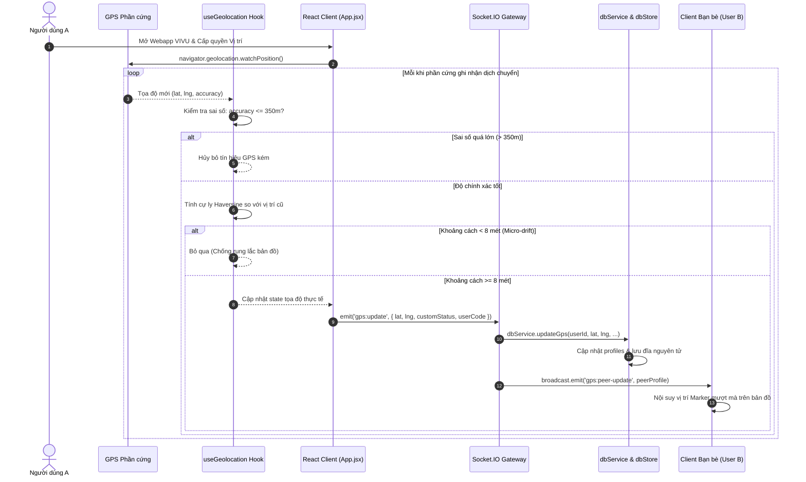
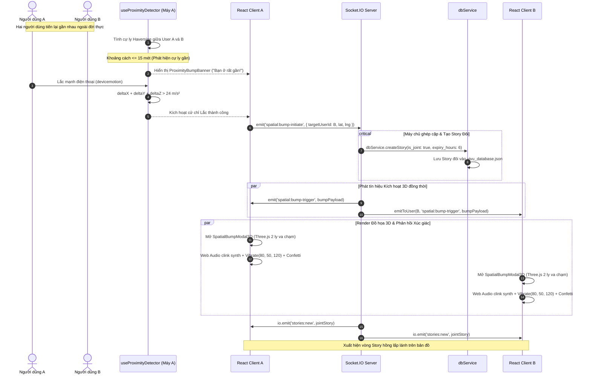
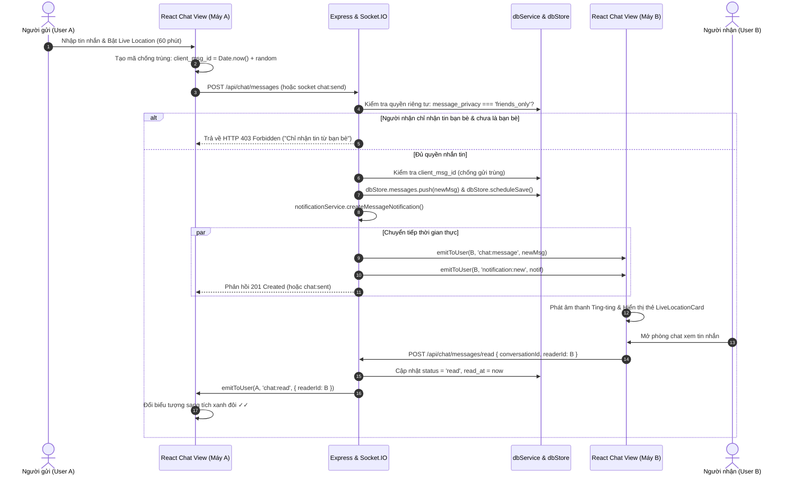
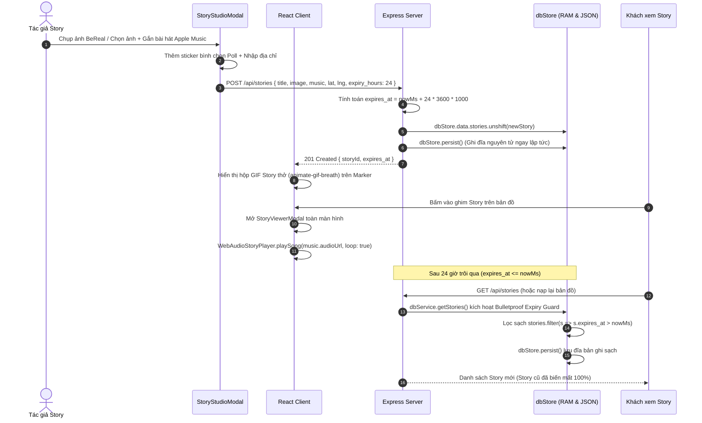
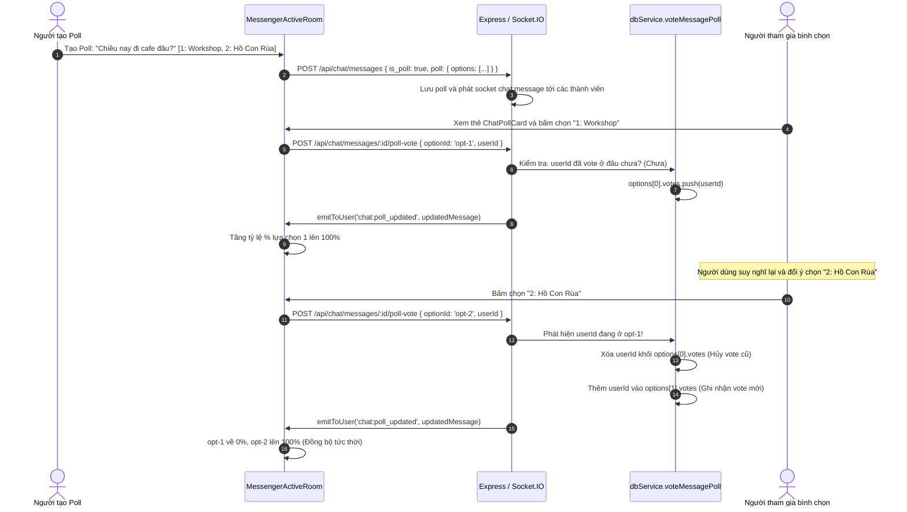

# BÁO CÁO QUY CHUẨN KỸ THUẬT VÀ ĐẶC TẢ KIẾN TRÚC HỆ THỐNG - DỰ ÁN VIVU
## HỆ THỐNG MẠNG XÃ HỘI BẢN ĐỒ THỜI GIAN THỰC (REAL-TIME SOCIAL MAP WEB APPLICATION)
### BÁO CÁO ĐỒ ÁN CHUYÊN NGÀNH (DACN) - CHUYÊN NGHÀNH KỸ THUẬT PHẦN MỀM

---

## THÔNG TIN TÀI LIỆU (DOCUMENT METADATA)

- **Tên dự án**: VIVU - Realtime Social Map Web Application (Mạng xã hội bản đồ thời gian thực).
- **Mã tài liệu**: `VIVU-ARCH-SPEC-2026-v1.0`
- **Tập tin lưu trữ**: `docs/ARCHITECTURE_AND_API.md`
- **Phiên bản (Version)**: `1.0.0-RELEASE`
- **Cấp độ bảo mật**: Tài liệu nội bộ Đồ án Chuyên ngành (Academic & Technical Capstone Project).
- **Ngày hoàn thành**: 16/11/2026.
- **Tác giả (Authors)**: Nhóm Phát triển & Chuyên gia Kiến trúc Hệ thống VIVU.
- **Trạng thái phê duyệt**: Đã kiểm chứng toàn diện (Verified against Codebase: 74/74 Unit & Integration Tests Pass, 0 Lint Errors).
- **Phạm vi tài liệu (Scope)**: Đặc tả toàn diện kiến trúc phân tầng hệ thống, mô hình dữ liệu bền vững (JSON Storage Schema), đặc tả đầy đủ 34 REST API endpoints, danh mục 45 sự kiện Socket.IO thời gian thực, 5 kịch bản tương tác dữ liệu tuần tự (Sequence Diagrams) và lộ trình mở rộng quy mô kiến trúc (Scalability Roadmap).

---

# MỤC LỤC CHI TIẾT

1. **CHƯƠNG 1: KIẾN TRÚC TỔNG THỂ HỆ THỐNG (OVERALL SYSTEM ARCHITECTURE)**
   - 1.1. Bối cảnh hệ thống & Triết lý thiết kế (System Context & Architectural Philosophy)
   - 1.2. Mô hình phân tầng kiến trúc (Architectural Layering Model)
   - 1.3. Mô hình luồng dữ liệu tổng quan (Client-Server Data Flow Model: HTTP REST vs WebSocket)
   - 1.4. Cơ chế chuyển đổi dự phòng & Khả năng chịu lỗi (Fallback & Fault Tolerance Mechanisms)
2. **CHƯƠNG 2: MÔ HÌNH DỮ LIỆU & CẤU TRÚC LƯU TRỮ (DATA MODELS & STORAGE SCHEMA)**
   - 2.1. Lược đồ thực thể quan hệ CSDL (Entity-Relationship Diagram & Schema Architecture)
   - 2.2. Đặc tả chi tiết 8 thực thể/collections dữ liệu cốt lõi
     - 2.2.1. Thực thể Người dùng (`users`)
     - 2.2.2. Thực thể Hồ sơ Bản đồ & Ghim Marker (`profiles`)
     - 2.2.3. Thực thể Khoảnh khắc Định vị 24h (`stories`)
     - 2.2.4. Thực thể Tin nhắn & Hội thoại (`messages`)
     - 2.2.5. Thực thể Vòng kết nối Nhóm riêng (`circles`)
     - 2.2.6. Thực thể Lời mời kết bạn (`friend_requests`)
     - 2.2.7. Thực thể Mối quan hệ Bạn bè (`friendships`)
     - 2.2.8. Thực thể Thông báo Trung tâm (`notifications`)
   - 2.3. Cơ chế Lưu trữ Đĩa Nguyên tử & Phục hồi lỗi (Atomic Write Architecture & Crash Recovery)
3. **CHƯƠNG 3: ĐẶC TẢ DANH MỤC TOÀN BỘ REST API ENDPOINTS (COMPLETE REST API SPECIFICATION)**
   - 3.1. Phân hệ Hệ thống & Quản trị Mạng (Health & Tunnel APIs - 3 endpoints)
   - 3.2. Phân hệ Xác thực & Quản lý Người dùng (Auth & User Profile APIs - 8 endpoints)
   - 3.3. Phân hệ Định vị GPS & Hồ sơ Bản đồ (GPS & Location APIs - 3 endpoints)
   - 3.4. Phân hệ Khoảnh khắc Story Định vị 24h (Stories APIs - 6 endpoints)
   - 3.5. Phân hệ Bạn bè & Mạng lưới Xã hội (Friends & Social APIs - 9 endpoints)
   - 3.6. Phân hệ Tin nhắn & Trò chuyện Thời gian thực (Chat & Messaging APIs - 7 endpoints)
   - 3.7. Phân hệ Vòng kết nối Nhóm Riêng (Circles APIs - 10 endpoints)
   - 3.8. Phân hệ Thông báo Trung tâm (Notifications APIs - 4 endpoints)
4. **CHƯƠNG 4: ĐẶC TẢ DANH MỤC TOÀN BỘ 45 SỰ KIỆN SOCKET.IO THỜI GIAN THỰC (REALTIME SOCKET.IO SPECIFICATION)**
   - 4.1. Bảng ma trận tổng hợp toàn bộ 45 sự kiện Socket.IO
   - 4.2. Danh mục 18 sự kiện Client-to-Server (C2S Events Specification)
   - 4.3. Danh mục 27 sự kiện Server-to-Client (S2C Events Specification)
   - 4.4. Cơ chế Quản lý Phiên kết nối Đa thiết bị (Multi-Device Session & Room Management)
5. **CHƯƠNG 5: KỊCH BẢN TƯƠNG TÁC DỮ LIỆU TUẦN TỰ (INTERACTION SEQUENCE DIAGRAMS)**
   - 5.1. Kịch bản 1: Định vị GPS liên tục & Phát sóng thời gian thực (GPS Tracking & Broadcast)
   - 5.2. Kịch bản 2: Cụng ly Không gian 3D & Tạo Story Đôi (Proximity Bump & Joint Story Creation)
   - 5.3. Kịch bản 3: Nhắn tin Trực tiếp 1-1 & Chia sẻ Vị trí Trực tiếp (1-on-1 Chat & Live Location)
   - 5.4. Kịch bản 4: Đăng Story, Trình chiếu & Thu hồi Tự động 24h (Story Lifecycle & Expiry Guard)
   - 5.5. Kịch bản 5: Tạo Bình chọn, Bỏ phiếu & Chuyển dịch Phiếu Bầu (Poll Lifecycle & Vote Sync)
6. **CHƯƠNG 6: ĐÁNH GIÁ KIẾN TRÚC & ĐỊNH HƯỚNG MỞ RỘNG (ARCHITECTURE EVALUATION & ROADMAP)**
   - 6.1. Đánh giá Ưu điểm & Nhược điểm Kiến trúc Hiện tại
   - 6.2. Phân tích các Điểm nghẽn Hiệu năng (Performance Bottlenecks Analysis)
   - 6.3. Lộ trình Nâng cấp Mở rộng Quy mô Lớn (Scalability & Modernization Roadmap)

---

# CHƯƠNG 1: KIẾN TRÚC TỔNG THỂ HỆ THỐNG (OVERALL SYSTEM ARCHITECTURE)

## 1.1. Bối cảnh Hệ thống & Triết lý Thiết kế (System Context & Architectural Philosophy)

Hệ thống mạng xã hội bản đồ VIVU được định vị là một nền tảng Web tương tác vị trí thời gian thực (Real-time Location-based Social Web Application), cho phép người dùng quan sát vị trí bạn bè, chia sẻ trạng thái tâm trạng, biểu cảm linh vật (Chibi Mascots), âm nhạc trực tuyến (Apple Music CDN), đăng khoảnh khắc Story 24h đính kèm tọa độ, trò chuyện trực tiếp (1-on-1 & Custom Circles), bình chọn (Polls) và trải nghiệm tính năng độc đáo "Cụng ly" không gian 3D (Spatial Proximity Bump < 15m).

Để giải quyết bài toán giao tiếp hai chiều độ trễ cực thấp (< 50ms) trên bản đồ số trong khi vẫn duy trì tính ổn định, dễ triển khai tại môi trường máy chủ nội bộ hoặc thử nghiệm (On-premise / Local Development / Demo DACN), hệ thống tuân theo các triết lý kiến trúc cốt lõi:

1. **Phân tách Rõ Ràng (Decoupled Client-Server Separation)**: Phân định ranh giới tuyệt đối giữa tầng Giao diện Người dùng (React 19 SPA) và tầng Cổng Giao tiếp / Xử lý Nghiệp vụ (Node.js Express + Socket.IO Server). Giao tiếp hoàn toàn dựa trên JSON qua HTTP REST và WebSocket RFC 6455.
2. **Kiến trúc Hướng Sự kiện Thời gian thực (Event-Driven Real-time Core)**: Loại bỏ triệt để giải pháp thăm dò định kỳ (HTTP Polling 3.5s) vốn gây lãng phí tài nguyên CPU và băng thông mạng. Chuyển đổi 100% các dòng dữ liệu biến động (tọa độ GPS, tin nhắn, thông báo, bạn bè online) sang cơ chế phát sóng sự kiện (Event Emission) qua Socket.IO.
3. **Lưu trữ Bền vững Lai Khả chuyển (Hybrid Dual-Mode Storage Persistence)**:
   - *Cloud Managed Mode*: Tự động phát hiện và kết nối với dịch vụ đám mây Supabase (PostgreSQL / PostGIS).
   - *Local Embedded Mode*: Tự động chuyển đổi mượt mà (Graceful Fallback) sang bộ nhớ đệm RAM (`inMemoryStore`) kết hợp cơ chế lưu trữ đĩa cứng nguyên tử (Atomic Write) định dạng JSON (`vivu_database.json`) khi không có kết nối Internet hoặc chưa cấu hình Supabase.
4. **Nguyên tắc "Không sập WebGL" (Zero-WebGL Crash Resilience)**: Tích hợp kiến trúc động cơ bản đồ kép (Dual-Engine Map Architecture) gồm Leaflet 2D làm lớp phòng vệ ổn định tuyệt đối và Mapbox GL 3D perspective canvas phục vụ các tính năng không gian nâng cao.

---

## 1.2. Mô hình Phân tầng Kiến trúc (Architectural Layering Model)

Hệ thống VIVU được thiết kế theo mô hình 4 tầng (4-Tier Architectural Pattern):

```
+====================================================================================================+
|                                    1. PRESENTATION LAYER (CLIENT)                                  |
|  [React 19.3.1 SPA] + [Tailwind CSS 3.4.19] + [F1 Cyberpunk UI System] + [Bootstrap Icons 1.13.2]  |
|                                                                                                    |
|  +--------------------+  +----------------------+  +---------------------+  +-------------------+  |
|  |     MAP ENGINES    |  |     3D & GRAPHICS    |  |     AUDIO ENGINES   |  |   CLIENT SENSORS  |  |
|  | - Leaflet 1.9.4    |  | - Three.js r186      |  | - Web Audio Synth   |  | - Geolocation API |  |
|  |   (Google Tiles)   |  |   (Spatial Bump 3D)  |  |   (12 Chibi Moods)  |  |   (Micro-drift 8m) |  |
|  | - Mapbox GL 3.33   |  | - Motion v14.7.1     |  | - HTML5 Audio Stream|  | - devicemotion    |  |
|  |   (32° Pitch 3D)   |  | - GSAP 3.15 Splash   |  |   (Apple Music CDN) |  |   (Shake > 24m/s²)|  |
|  +--------------------+  +----------------------+  +---------------------+  +-------------------+  |
+====================================================================================================+
                                  ▲                                    ▲
                   HTTP REST APIs |                                    | WebSocket (Full-Duplex)
               (JSON Payloads 10MB) |                                    | (Socket.IO Events)
                                  ▼                                    ▼
+====================================================================================================+
|                              2. REALTIME & API GATEWAY LAYER (SERVER)                              |
|           [Node.js >= 20.x ESM] + [Express 4.21.2] + [Socket.IO 4.8.4 Server Gateway]              |
|                                                                                                    |
|  +-------------------------------------+  +-----------------------------------------------------+  |
|  |       EXPRESS HTTP GATEWAY          |  |               SOCKET.IO REALTIME ENGINE             |  |
|  | - CORS Middleware (Origins & Creds) |  | - Connection Lifecycle & Handshake Authentication   |  |
|  | - Body Parsers (JSON limit: 10MB)   |  | - Multi-Device Tab Mapping (Map<UserId, Set<SockId>>|  |
|  | - Centralized Error Handler (500)   |  | - Event Routing (18 C2S Listeners, 27 S2C Emitters) |  |
|  | - Cloudflare Quick Tunnel Receiver  |  | - Heartbeat Monitor (Ping: 10s, Timeout: 20s)       |  |
|  +-------------------------------------+  +-----------------------------------------------------+  |
+====================================================================================================+
                                  │                                    │
                                  ▼                                    ▼
+====================================================================================================+
|                                3. SERVICE & BUSINESS LOGIC LAYER                                   |
|                                                                                                    |
|  +------------------+  +------------------+  +--------------------+  +--------------------------+  |
|  |  authService.js  |  |  dbService.js    |  |  socketService.js  |  |  notificationService.js  |  |
|  | - Local Auth     |  | - GPS & Profile  |  | - Room Broadcast   |  | - Message Aggregation    |  |
|  | - Google GIS     |  | - Stories Engine |  | - Spatial Bump P2P |  | - Friend Req Idempotency |  |
|  | - Facebook Graph |  | - Friend Protocol|  | - Offline Beacon   |  | - Unread Counter Guard   |  |
|  | - Pass Encrypt   |  | - Chat & Circles |  | - Multi-tab Sync   |  | - Realtime Dispatch      |  |
|  +------------------+  +------------------+  +--------------------+  +--------------------------+  |
+====================================================================================================+
                                  │                                    │
                                  ▼                                    ▼
+====================================================================================================+
|                                4. STORAGE & PERSISTENCE LAYER                                      |
|                                                                                                    |
|  +---------------------------------------------------+  +---------------------------------------+  |
|  |       LOCAL EMBEDDED PERSISTENCE (DEFAULT)        |  |        CLOUD MANAGED DATABASE         |  |
|  | - RAM InMemoryStore (L1 Cache - Zero-Latency Read)|  |         (AUTOMATIC FALLBACK)          |  |
|  | - Atomic Disk Staging (`.tmp` -> `fs.rename`)     |  | - Supabase Cloud Service              |  |
|  | - Auto-Backup Engine (`vivu_database.json.bak`)   |  | - PostgreSQL Relational Database      |  |
|  | - Windows `EBUSY` 3-Retry Exponential Loop        |  | - PostGIS Spatial Queries & Indexing  |  |
|  | - Periodic Guest Account Sanitizer (`client-xxx`)|  | - Managed Cloud Storage (Bucket Media)|  |
|  +---------------------------------------------------+  +---------------------------------------+  |
+====================================================================================================+
```

### Chi tiết các tầng thành phần:

1. **Presentation Layer (Tầng hiển thị - Frontend)**:
   - Xây dựng trên nền tảng **React 19.3.1** và bộ biên dịch **Vite 8.3.4**, định kiểu giao diện bằng **Tailwind CSS 3.4.19** theo phong cách thiết kế đặc trưng *F1 Dark Glass & Luminous Cyberpunk* (Nền đen `#0a0e1c`, Kính mờ `backdrop-filter: blur(16px)`, Hồng Neon `#FF2A85`, Xanh Cyan `#00E5FF`).
   - Tích hợp 2 động cơ bản đồ: **Leaflet 1.9.4** (kết hợp Google Streets `lyrs=m` và Google Satellite `lyrs=y` tiles) hoạt động như động cơ mặc định nhằm triệt tiêu hoàn toàn sự cố tràn bộ nhớ WebGL trên các thiết bị yếu; và **Mapbox GL 3.33.0** cho các góc nhìn nghiêng 3D (pitch 32°, bearing -5°).
   - Tầng đồ họa tương tác 3D sử dụng **Three.js r186** phụ trách hoạt cảnh cụm ly cocktail 3D va chạm thời gian thực (`SpatialBumpModal3D.jsx`) và hiệu ứng trường hạt lượng tử (`StoryStudio3DCanvas.jsx`).
   - Tầng âm thanh kết hợp **Web Audio API** (tổng hợp trực tiếp sóng âm bằng mã nguồn cho 12 cảm xúc Chibi, tiếng ly chạm pha lê, chuông radar) và **HTML5 Audio Player** (phát trực tiếp stream AAC/M4A 30s từ Apple Music CDN).
   - Tầng cảm biến phần cứng (`useGeolocation.js`, `useProximityDetector.js`) đọc dữ liệu GPS vệ tinh và cảm biến gia tốc (`devicemotion`) để phục vụ tính năng Lắc máy cụm ly.

2. **Realtime & Gateway Layer (Tầng Cổng giao tiếp & Thời gian thực)**:
   - Máy chủ ứng dụng **Node.js (>= 20.x ESM)** sử dụng **Express 4.21.2** kết hợp **Socket.IO 4.8.4**.
   - Cung cấp điểm đón nhận REST API thống nhất tại tiền tố `/api`, tích hợp bộ giải mã JSON hỗ trợ tải trọng lên tới 10MB phục vụ hình ảnh Base64.
   - Cổng Socket.IO đảm nhiệm thiết lập kết nối WebSocket hai chiều (hỗ trợ chuyển tiếp WebSocket / Long-Polling fallback), xác thực danh tính người dùng thông qua cơ chế Handshake Auth (`socket.handshake.auth.userId`).
   - Bộ quản lý phiên đa thiết bị: Quản lý mối quan hệ người dùng với nhiều socket cùng lúc qua cấu trúc `Map<userId, Set<socketId>>`, cho phép người dùng mở nhiều tab hoặc nhiều thiết bị mà không bị ngắt quãng hoặc mất đồng bộ.

3. **Service & Business Logic Layer (Tầng Xử lý Nghiệp vụ)**:
   - `authService.js`: Tiếp nhận đăng ký, đăng nhập tài khoản chuẩn, xác thực token Google GIS (qua Google Tokeninfo API) và Facebook Graph SDK Login.
   - `dbService.js`: Đóng vai trò là Bộ điều phối dữ liệu trung tâm (Data Controller Hub), thực thi toàn bộ quy tắc nghiệp vụ: lọc trôi GPS, phân loại hộp thư (Bạn bè vs Người lạ), kiểm tra quyền riêng tư tin nhắn (`friends_only`), xử lý bình chọn luân chuyển phiếu (Poll voting), và bảo vệ hạn dùng 24h của Story.
   - `socketService.js`: Điều phối phát sóng sự kiện (Event Broadcasting), quản lý gửi tin nhắn trực tiếp người-tới-người (`emitToUser`), kích hoạt kịch bản Cụng ly không gian 3D, và xử lý đóng kết nối an toàn.
   - `notificationService.js`: Đảm bảo tính nhất quán (Idempotency) của thông báo kết bạn, gom nhóm thông báo tin nhắn theo từng cuộc hội thoại, và quản lý số lượng tin chưa đọc.

4. **Storage & Persistence Layer (Tầng Lưu trữ Bền vững)**:
   - Cơ chế lưu trữ lai Dual-Mode: Tự động kết nối với Supabase Cloud PostgreSQL khi có cấu hình môi trường hợp lệ; ngược lại, kích hoạt động cơ lưu trữ đĩa an toàn `dbStore.js` với tệp tin `vivu_database.json`.
   - Cơ chế bộ nhớ đệm RAM (`dbStore.data`) phản hồi mọi truy vấn đọc dữ liệu tức thì (Zero-Latency In-Memory Query).
   - Quá trình ghi đĩa được bảo vệ nghiêm ngặt bằng cơ chế ghi nguyên tử (Atomic File Staging `.tmp` -> `fs.rename`), sao lưu dự phòng `.bak`, và vòng lặp thử lại 3 lần chống khóa file `EBUSY` trên Windows.

---

## 1.3. Mô hình Luồng Dữ liệu Tổng quan (Client-Server Data Flow Model)

Hệ thống VIVU phân bổ ranh giới rõ ràng giữa giao thức HTTP REST không trạng thái (Stateless Request-Response) và giao thức WebSocket hai chiều có trạng thái (Stateful Full-Duplex Stream):

```
+----------------------------------------------------------------------------------------------------+
|                                CLIENT-SERVER DATA COMMUNICATION MATRIX                             |
+--------------------------+------------------------------+------------------------------------------+
| PHÂN LOẠI DỮ LIỆU        | KÊNH GIAO TIẾP SỬ DỤNG       | MỤC ĐÍCH & ĐẶC TÍNH KỸ THUẬT             |
+--------------------------+------------------------------+------------------------------------------+
| 1. Xác thực & Hồ sơ      | HTTP REST (`POST /api/auth/*`)| Khởi tạo phiên, trao đổi mật khẩu/token, |
|                          |                              | nạp dữ liệu hồ sơ cá nhân lần đầu.       |
| 2. Đăng tải Media nặng   | HTTP REST (`POST /api/stories`| Tải payload ảnh Base64/JSON lớn (<=10MB),|
|                          | `POST /api/chat/messages`)   | phân tách luồng upload khỏi socket ping. |
| 3. Đồng bộ GPS Realtime  | WebSocket (`gps:update`      | Tần suất cao (mỗi 1-3s khi di chuyển),   |
|                          | -> `gps:peer-update`)        | độ trễ cực thấp, broadcast tới peer.     |
| 4. Tin nhắn Thời gian thực| WebSocket (`chat:send`       | Chuyển tiếp tin nhắn 1-1 tức thời, hiển  |
|                          | -> `chat:message`)           | thị trạng thái đang nhập và đã xem.      |
| 5. Cụng ly Không gian 3D | WebSocket (`spatial:bump-*`) | Ghép đôi 2 thiết bị <15m đồng thời, kích |
|                          |                              | hoạt hoạt cảnh Three.js và sinh story đôi|
| 6. Đóng Tab / Rời Mạng   | Navigator.sendBeacon & Socket| Đảm bảo server nhận diện offline 100%    |
|                          | (`/api/gps/offline`)         | khi người dùng đóng trình duyệt đột ngột.|
+--------------------------+------------------------------+------------------------------------------+
```

---

## 1.4. Cơ chế Chuyển đổi Dự phòng & Khả năng Chịu lỗi (Fallback & Fault Tolerance Mechanisms)

Nhằm đáp ứng tiêu chuẩn nghiêm ngặt của một đồ án công nghệ có khả năng vận hành thực tế tại buổi bảo vệ (Live Demo Defense), hệ thống VIVU được trang bị 3 tầng phòng vệ sự cố tự động:

### 1.4.1. Phòng vệ Sự cố Đồ họa: Zero-WebGL Crash Dual Map Fallback
- **Vấn đề**: Các thiết bị di động cấu hình thấp hoặc trình duyệt bật chế độ tiết kiệm pin thường xuyên gặp lỗi mất ngữ cảnh WebGL (`WebGLContextLost`) khi tải bản đồ vector 3D Mapbox GL phức tạp.
- **Giải pháp**: Hệ thống sử dụng component `GoogleMapView.jsx` dựa trên nền tảng **Leaflet 1.9.4** làm động cơ bản đồ chính quy. Leaflet hoàn toàn kết xuất thông qua DOM HTML thuần túy và lớp phủ ảnh Raster (Google Maps Satellite Hybrid & Streets tiles), đảm bảo **0% tỷ lệ sập WebGL** trên toàn bộ các dòng máy smartphone và máy tính bảng. Component `MapboxCanvas.jsx` được thiết kế dưới dạng lớp nâng cấp tùy chọn (Selective Enhancement).

### 1.4.2. Phòng vệ Mất Mạng & Lưu trữ: In-Memory JSON Atomic Persistence
- **Vấn đề**: Trong điều kiện phòng bảo vệ đồ án mất kết nối mạng Internet hoặc Supabase Cloud bị chặn tường lửa/hết hạn ngạch (Quota Limit), các ứng dụng thuần Cloud sẽ sập toàn diện.
- **Giải pháp**: Khối lưu trữ `dbStore.js` khởi tạo một cơ sở dữ liệu độc lập cục bộ trong RAM. Toàn bộ thay đổi dữ liệu được định kỳ ghi đĩa nguyên tử xuống `vivu_database.json`. Nếu tệp này bị hỏng do mất điện đột ngột (phát hiện byte null `\u0000`), hệ thống tự động phục hồi từ tệp sao lưu `.bak`.

### 1.4.3. Phòng vệ Cảm biến GPS: Micro-Drift Filter & Anti-Spoofing
- **Vấn đề**: Cảm biến GPS phần cứng thường xuyên bị nhiễu sóng vệ tinh (trôi tọa độ 1-5m dù người dùng đứng yên) và xuất hiện các tọa độ ảo ngẫu nhiên.
- **Giải pháp**: Custom hook `useGeolocation.js` thiết lập bộ lọc 4 lớp:
  1. *Lọc độ chính xác kém*: Hủy bỏ các tín hiệu có sai số `accuracy > 350m`.
  2. *Lọc dịch chuyển vi mô (Micro-drift Filter)*: Áp dụng công thức Haversine; nếu khoảng cách di chuyển giữa vị trí mới và vị trí cũ `< 8 mét`, giao diện giữ nguyên không kích hoạt render lại.
  3. *Loại trừ tọa độ ảo*: Tự động phát hiện và xóa bỏ tọa độ giả lập mặc định cũ (Đà Nẵng `16.0544, 108.2022`).
  4. *Đóng tab an toàn*: Bắt sự kiện `pagehide` và `visibilitychange`, kích hoạt API `navigator.sendBeacon('/api/gps/offline')` giải phóng trạng thái người dùng tức thời, triệt tiêu hiện tượng "tài khoản ma" trên bản đồ.

---

# CHƯƠNG 2: MÔ HÌNH DỮ LIỆU & CẤU TRÚC LƯU TRỮ (DATA MODELS & STORAGE SCHEMA)

## 2.1. Lược đồ Thực thể Quan hệ CSDL (Entity-Relationship Architecture)

Toàn bộ hệ thống cơ sở dữ liệu `vivu_database.json` được tổ chức thành 8 bộ sưu tập (Collections) có quan hệ tham chiếu chặt chẽ:

```mermaid
erDiagram
    USERS ||--|| PROFILES : "sở hữu 1:1"
    USERS ||--o{ STORIES : "đăng tải 1:N"
    USERS ||--o{ MESSAGES : "gửi 1:N"
    USERS ||--o{ FRIENDSHIPS : "tham gia N:M"
    USERS ||--o{ FRIEND_REQUESTS : "gửi/nhận 1:N"
    USERS ||--o{ NOTIFICATIONS : "nhận 1:N"
    USERS }o--o{ CIRCLES : "thành viên N:M"
    CIRCLES ||--o{ MESSAGES : "chứa 1:N"

    USERS {
        string id PK
        string email UK
        string user_code UK
        string full_name
        string avatar_url
        string auth_provider
        string last_seen_at
        string created_at
    }

    PROFILES {
        string id PK,FK
        float lat
        float lng
        boolean is_online
        string pin_skin
        string custom_chibi
        string custom_status
        object custom_song
        string last_seen_at
    }

    STORIES {
        string id PK
        string host_id FK
        string partner_id FK
        boolean is_joint
        string title
        string category
        float lat
        float lng
        string image
        string expires_at
        string created_at
    }

    MESSAGES {
        string id PK
        string conversation_id Index
        string client_msg_id UK
        string sender FK
        string text
        boolean is_live_location
        boolean is_poll
        string created_at
    }

    CIRCLES {
        string id PK
        string name
        string owner_id FK
        string[] member_ids
        string privacy
        string created_at
    }

    FRIEND_REQUESTS {
        string id PK
        string sender_id FK
        string receiver_id FK
        string status
        string created_at
    }

    FRIENDSHIPS {
        string id PK
        string user_a_id FK
        string user_b_id FK
        string status
        string created_at
    }

    NOTIFICATIONS {
        string id PK
        string from_user_id FK
        string to_user_id FK
        string type
        boolean read
        object action_data
        string created_at
    }
```

---

## 2.2. Đặc tả Chi tiết 8 Thực thể Dữ liệu Cốt lõi

### 2.2.1. Thực thể Người dùng (`users`)
- **Tập tin/Bảng**: `dbStore.data.users`
- **Mô tả**: Lưu trữ tài khoản định danh, thông tin đăng nhập, hồ sơ cá nhân mở rộng, và các cài đặt bảo mật.
- **Quy tắc sinh khóa chính**: Chuỗi định dạng `'user-' + Date.now() + '-' + Math.random().toString(36).substr(2, 6)`.
- **Mã định danh duy nhất**: Mỗi người dùng sở hữu một mã `user_code` định dạng `VU-XXXX` (số ngẫu nhiên 1000 - 9999) phục vụ tìm kiếm kết bạn nhanh.

| Tên Trường (Field) | Kiểu Dữ Liệu | Bắt Buộc | Ràng Buộc / Mô Tả Kỹ Thuật |
|---|---|:---:|---|
| `id` | `String` | Có | Khóa chính duy nhất dạng `user-179480...` |
| `email` | `String` | Có | Email chuẩn hóa chữ thường, duy nhất trong hệ thống |
| `password` | `String` | Không | Mật khẩu tài khoản (ẩn khi trả về client qua API) |
| `full_name` | `String` | Có | Tên đầy đủ hiển thị trên bản đồ và phòng chat |
| `user_code` | `String` | Có | Mã định danh dạng `VU-XXXX` (duy nhất, không trùng lặp) |
| `avatar_url` | `String` | Không | URL ảnh hoặc dữ liệu Base64 đã nén (256x256 ~30KB) |
| `auth_provider` | `String` | Có | Giá trị thuộc tập `['local', 'google', 'facebook', 'supabase']` |
| `google_id` | `String` | Không | ID định danh từ Google Identity Services nếu đăng nhập Google |
| `facebook_id` | `String` | Không | ID định danh từ Facebook Graph API nếu đăng nhập FB |
| `supabase_user_id` | `String` | Không | UUID từ Supabase Auth nếu đồng bộ Cloud |
| `phone` | `String` | Không | Số điện thoại liên hệ cá nhân |
| `bio` | `String` | Không | Tiểu sử ngắn giới thiệu bản thân (tối đa 250 ký tự) |
| `age` | `Number` | Không | Tuổi của người dùng (từ 10 đến 120) |
| `job` | `String` | Không | Nghề nghiệp hoặc trường học |
| `tags` | `Array<String>` | Không | Mảng sở thích (ví dụ `['#CafeĐêm', '#DạoPhố', '#BóngRổ']`) |
| `photos` | `Array<String>` | Không | Mảng liên kết/Base64 bộ sưu tập ảnh cá nhân |
| `favorite_song` | `String` | Không | Tên bài hát yêu thích hiển thị trên hồ sơ |
| `custom_status` | `String` | Không | Dòng trạng thái tâm trạng hiển thị nổi trên marker bản đồ |
| `custom_chibi` | `String` | Không | Mã định danh linh vật Chibi gắn kèm (`'water-happy'`, `'troll'`) |
| `chibi_expires_at` | `String/Number` | Không | Mốc thời gian (timestamp) tự hủy của Chibi Mascot |
| `pin_skin` | `String` | Có | Giao diện ghim: `'auto'`, `'zenly_3d'`, `'aura_circle'`, `'polaroid'`, `'classic_teardrop'` |
| `pin_mascot` | `String` | Không | Thú cưng đi kèm ghim (`'ami_fat_cat'`, `'qoobee'`) |
| `pin_action` | `String` | Không | Hoạt cảnh ghim: `'scooter'`, `'deadline'`, `'sleep'`, `'eat'`, `'troll'` |
| `message_privacy` | `String` | Có | Quyền nhận tin: `'everyone'` (mọi người) hoặc `'friends_only'` (chỉ bạn bè) |
| `location_consent` | `Boolean` | Có | Trạng thái đồng ý chia sẻ vị trí thực tế (`true`/`false`) |
| `created_at` | `String` | Có | Thời điểm khởi tạo tài khoản chuẩn ISO-8601 |
| `last_seen_at` | `String` | Có | Thời điểm tương tác cuối cùng chuẩn ISO-8601 |

- **Ví dụ Bản ghi JSON Thực tế**:
```json
{
  "id": "user-1794808600000-a1b2c3",
  "email": "ductung.mai@vivu.vn",
  "full_name": "Mai Đức Tùng",
  "user_code": "VU-7115",
  "avatar_url": "https://api.dicebear.com/7.x/bottts/svg?seed=ductung",
  "auth_provider": "local",
  "phone": "0987654321",
  "bio": "Đang vi vu khắp Sài Gòn tìm quán cafe đẹp!",
  "age": 22,
  "job": "Kỹ sư Phần mềm",
  "tags": ["#CongNghe", "#CafeSaiGon", "#DuLich"],
  "custom_status": "Chạy deadline xuyên màn đêm 💻",
  "custom_chibi": "water-happy",
  "chibi_expires_at": 1794895000000,
  "pin_skin": "zenly_3d",
  "pin_mascot": "ami_fat_cat",
  "pin_action": "deadline",
  "message_privacy": "friends_only",
  "location_consent": true,
  "created_at": "2026-11-16T08:00:00.000Z",
  "last_seen_at": "2026-11-16T12:30:00.000Z"
}
```

---

### 2.2.2. Thực thể Hồ sơ Bản đồ & Ghim Marker (`profiles`)
- **Tập tin/Bảng**: `dbStore.data.profiles`
- **Mô tả**: Lưu trữ tọa độ địa lý GPS thực tế WGS-84, mức pin, trạng thái trực tuyến (heartbeat < 15 giây), bài hát đang phát và giao diện ghim tương ứng của mỗi tài khoản.
- **Ràng buộc toàn vẹn**: Khóa chính `id` ánh xạ 1:1 tuyệt đối với `users.id`. Tài khoản khách vãng lai (`client-xxx`) bị chặn lưu trữ vào thực thể này.

| Tên Trường (Field) | Kiểu Dữ Liệu | Bắt Buộc | Ràng Buộc / Mô Tả Kỹ Thuật |
|---|---|:---:|---|
| `id` | `String` | Có | Khóa ngoại tham chiếu chính xác đến `users.id` |
| `lat` | `Number` | Có | Vĩ độ thực tế WGS-84 (từ -90.0 đến 90.0) |
| `lng` | `Number` | Có | Kinh độ thực tế WGS-84 (từ -180.0 đến 180.0) |
| `user_code` | `String` | Có | Mã `VU-XXXX` đồng bộ từ bảng users |
| `full_name` | `String` | Có | Tên hiển thị trên nhãn ghim |
| `avatar_url` | `String` | Không | Ảnh đại diện trong lòng ghim giọt nước |
| `is_online` | `Boolean` | Có | `true` nếu có tín hiệu heartbeat/GPS trong vòng 15 giây |
| `battery` | `String` | Có | Mức pin hiển thị kèm biểu tượng (mặc định `'95%'`) |
| `custom_status` | `String` | Không | Tâm trạng nổi bật gắn trên marker |
| `custom_song` | `Object` | Không | Cấu trúc `{ id, title, artist, audioUrl }` Apple Music preview |
| `custom_chibi` | `String` | Không | Tên biểu cảm Mascot hiển thị đứng trên đỉnh ghim |
| `chibi_expires_at` | `Number/String` | Không | Mốc thời hạn tự hủy Mascot |
| `pin_skin` | `String` | Có | Loại skin ghim: `'auto'`, `'zenly_3d'`, `'polaroid'`, v.v. |
| `pin_mascot` | `String` | Không | Thú cưng Zalo/Messenger hiển thị kèm |
| `pin_action` | `String` | Không | Hoạt cảnh cử động của nhân vật ghim |
| `active_story` | `Object` | Không | Story mới nhất còn hạn đính kèm (tạo vòng viền hồng lấp lánh) |
| `last_seen_at` | `String` | Có | Timestamp lần phát tín hiệu GPS cuối cùng |

- **Ví dụ Bản ghi JSON Thực tế**:
```json
{
  "id": "user-1794808600000-a1b2c3",
  "lat": 10.776889,
  "lng": 106.700806,
  "user_code": "VU-7115",
  "full_name": "Mai Đức Tùng",
  "name": "Mai Đức Tùng",
  "avatar_url": "https://api.dicebear.com/7.x/bottts/svg?seed=ductung",
  "avatar": "https://api.dicebear.com/7.x/bottts/svg?seed=ductung",
  "is_online": true,
  "battery": "88%",
  "custom_status": "Cafe Phố Đi Bộ ☕",
  "custom_song": {
    "id": "song-vpop-01",
    "title": "Nấu Ăn Cho Em",
    "artist": "Đen Vâu ft. PiaLinh",
    "audioUrl": "https://audio-ssl.itunes.apple.com/itunes-assets/AudioPreview116/v4/xx.m4a"
  },
  "custom_chibi": "happy",
  "chibi_expires_at": 1794895000000,
  "pin_skin": "zenly_3d",
  "pin_mascot": "ami_fat_cat",
  "pin_action": "boba",
  "last_seen_at": "2026-11-16T12:30:00.000Z"
}
```

---

### 2.2.3. Thực thể Khoảnh khắc Định vị 24h (`stories`)
- **Tập tin/Bảng**: `dbStore.data.stories`
- **Mô tả**: Lưu trữ bài đăng khoảnh khắc đa phương tiện gắn tọa độ địa lý, hỗ trợ ảnh đơn, camera kép BeReal, âm nhạc, nhãn dán bình chọn (Poll) và hỏi đáp (Q&A).
- **Quy tắc thời hạn**: Story thông thường tự động hết hạn sau 24 giờ (`expiry_hours: 24`). Story phát sinh từ tính năng Cụng ly 3D (`is_joint: true`) tự động hết hạn sau 6 giờ (`expiry_hours: 6`).

| Tên Trường (Field) | Kiểu Dữ Liệu | Bắt Buộc | Ràng Buộc / Mô Tả Kỹ Thuật |
|---|---|:---:|---|
| `id` | `String` | Có | Khóa chính dạng `story-179480...` |
| `host_id` | `String` | Có | ID của người đăng tải story (FK tham chiếu `users.id`) |
| `host_name` | `String` | Có | Tên người đăng |
| `host_avatar` | `String` | Không | Avatar người đăng |
| `partner_id` | `String` | Không | ID của bạn bè tham gia Cụng ly nếu là Joint Story |
| `partner_name` | `String` | Không | Tên bạn bè tham gia Cụng ly |
| `is_joint` | `Boolean` | Có | Đánh dấu Story đôi sinh ra từ sự kiện Spatial Bump 3D |
| `category` | `String` | Có | Phân loại: `'moment'`, `'hangout'`, `'cafe'`, `'food'`, `'movie'`, `'sport'` |
| `title` | `String` | Có | Tiêu đề story hiển thị nổi bật |
| `description` | `String` | Không | Mô tả ngắn hoặc lời nhắn |
| `address` | `String` | Không | Địa chỉ thực tế hoặc `'Quanh đây'` |
| `lat` | `Number` | Có | Vĩ độ địa lý gắn với Story |
| `lng` | `Number` | Có | Kinh độ địa lý gắn với Story |
| `expiry_hours` | `Number` | Có | Số giờ tồn tại (mặc định 24; joint story: 6) |
| `expires_at` | `String` | Có | Mốc thời gian hết hạn chuẩn ISO-8601 |
| `image` | `String` | Không | URL ảnh chính hoặc Base64 |
| `dual_image` | `String` | Không | Ảnh camera phụ phía sau/trước (chế độ BeReal Dual-Cam) |
| `is_dual_cam` | `Boolean` | Không | Cờ xác nhận ảnh chụp bằng 2 camera đồng thời |
| `texts` | `Array<Object>` | Không | Danh sách chữ chèn trên ảnh: `[{ text, x, y, color, size }]` |
| `stickers` | `Array<Object>` | Không | Nhãn dán tương tác: Sticker cảm xúc, Bình chọn Poll, Q&A |
| `music` | `Object` | Không | Thông tin bài hát Apple Music đính kèm phát ngầm khi xem |
| `tagged_friends` | `Array<String>` | Không | Mảng danh sách `userId` bạn bè được gắn thẻ |
| `reactions` | `Array<Object>` | Không | Danh sách thả cảm xúc: `[{ user_id, type, timestamp }]` |
| `privacy` | `String` | Có | Quyền riêng tư hiển thị: `'public'` hoặc `'friends'` |
| `created_at` | `String` | Có | Thời điểm đăng tải chuẩn ISO-8601 |

- **Ví dụ Bản ghi JSON Thực tế (Joint Bump Story)**:
```json
{
  "id": "story-1794808700000",
  "host_id": "user-1794808600000-a1b2c3",
  "host_name": "Mai Đức Tùng",
  "host_avatar": "https://api.dicebear.com/7.x/bottts/svg?seed=ductung",
  "partner_id": "user-1794808600001-d4e5f6",
  "partner_name": "Nguyễn Hoàng Nam",
  "partner_avatar": "https://api.dicebear.com/7.x/bottts/svg?seed=hoangnam",
  "is_joint": true,
  "category": "hangout",
  "title": "🎉 Mai Đức Tùng & Nguyễn Hoàng Nam đang vi vu cùng nhau!",
  "description": "Vừa cụm ly gặp gỡ ngoài đời thực tại tọa độ 10.7769, 106.7009!",
  "address": "Phố Đi Bộ Nguyễn Huệ, Quận 1, TP.HCM",
  "lat": 10.776889,
  "lng": 106.700806,
  "expiry_hours": 6,
  "expires_at": "2026-11-16T18:30:00.000Z",
  "image": "https://images.unsplash.com/photo-1517256064527-09c73fc73e38",
  "is_dual_cam": false,
  "texts": [],
  "stickers": [],
  "tagged_friends": ["user-1794808600001-d4e5f6"],
  "reactions": [
    { "user_id": "user-1794808600001-d4e5f6", "type": "heart", "timestamp": "2026-11-16T12:35:00.000Z" }
  ],
  "privacy": "public",
  "created_at": "2026-11-16T12:30:00.000Z"
}
```

---

### 2.2.4. Thực thể Tin nhắn & Hội thoại (`messages`)
- **Tập tin/Bảng**: `dbStore.data.messages`
- **Mô tả**: Lưu trữ toàn bộ tin nhắn trao đổi trong các cuộc trò chuyện trực tiếp 1-1 và phòng chat nhóm riêng (Circles).
- **Chống trùng lặp (Deduplication)**: Trường `client_msg_id` đóng vai trò khóa định danh duy nhất sinh từ phía client, bảo đảm khi mạng chập chờn kích hoạt gửi lại (retry) không bị lưu tin nhắn trùng.

| Tên Trường (Field) | Kiểu Dữ Liệu | Bắt Buộc | Ràng Buộc / Mô Tả Kỹ Thuật |
|---|---|:---:|---|
| `id` | `String` | Có | Khóa chính dạng `msg-179480...` |
| `client_msg_id` | `String` | Có | Khóa chống gửi lặp (Idempotency Key) sinh từ Client |
| `conversation_id` | `String` | Có | Mã phòng: `conv-direct-<userA>--<userB>` hoặc `circle-<circleId>` |
| `sender` | `String` | Có | ID người gửi (FK tham chiếu `users.id`) hoặc `'system'` |
| `sender_name` | `String` | Có | Tên người gửi hiển thị |
| `text` | `String` | Có | Nội dung văn bản (được cắt gọt trim, tối đa 2000 ký tự) |
| `image` | `String` | Không | URL hình ảnh hoặc Base64 đính kèm |
| `video` | `String` | Không | URL đoạn video ngắn đính kèm |
| `is_location` | `Boolean` | Có | Cờ đánh dấu chia sẻ vị trí tĩnh kèm tọa độ |
| `is_live_location` | `Boolean` | Có | Cờ chia sẻ vị trí trực tiếp di chuyển theo thời gian thực |
| `live_duration_minutes` | `Number` | Không | Thời hạn chia sẻ: 15 phút, 60 phút, hoặc 480 phút (8 giờ) |
| `live_expires_at` | `String` | Không | Thời điểm hết hạn chia sẻ vị trí trực tiếp |
| `live_status` | `String` | Không | Trạng thái: `'active'` (đang chia sẻ) hoặc `'stopped'` (đã dừng) |
| `stopped_at` | `String` | Không | Thời điểm chính chủ bấm nút dừng chia sẻ vị trí |
| `speed` | `Number` | Không | Tốc độ di chuyển thực tế (km/h) từ GPS phần cứng |
| `is_heart` | `Boolean` | Có | Cờ đánh dấu hiệu ứng thả tim bùng nổ cỡ lớn |
| `is_poll` | `Boolean` | Có | Cờ xác nhận tin nhắn chứa cuộc bình chọn tương tác |
| `poll` | `Object` | Không | Cấu trúc dữ liệu bình chọn: `{ id, title, options: [{ id, text, votes }] }` |
| `is_system` | `Boolean` | Không | `true` nếu là tin nhắn hệ thống nhóm (chào mừng, thêm/xóa thành viên) |
| `lat` | `Number` | Không | Vĩ độ chia sẻ trong tin nhắn |
| `lng` | `Number` | Không | Kinh độ chia sẻ trong tin nhắn |
| `status` | `String` | Có | Trạng thái gửi: `'sent'` (đã gửi) hoặc `'read'` (đã xem) |
| `read_at` | `String` | Không | Thời điểm đối phương xem tin nhắn chuẩn ISO-8601 |
| `created_at` | `String` | Có | Thời điểm tạo tin nhắn chuẩn ISO-8601 |

- **Ví dụ Bản ghi JSON Thực tế (Tin nhắn Bình chọn Chat)**:
```json
{
  "id": "msg-1794808800000",
  "client_msg_id": "cmsg-1794808800000-xyz123",
  "conversation_id": "conv-direct-user-1794808600000-a1b2c3--user-1794808600001-d4e5f6",
  "sender": "user-1794808600000-a1b2c3",
  "sender_name": "Mai Đức Tùng",
  "text": "📊 Bình chọn: Chiều nay đi uống cafe ở đâu hợp lý?",
  "image": null,
  "video": null,
  "is_location": false,
  "is_live_location": false,
  "is_heart": false,
  "is_poll": true,
  "poll": {
    "id": "poll-msg-1794808800000",
    "title": "Chiều nay đi uống cafe ở đâu hợp lý?",
    "options": [
      { "id": "opt-1", "text": "The Workshop Cà phê", "votes": ["user-1794808600000-a1b2c3"] },
      { "id": "opt-2", "text": "Hồ Con Rùa", "votes": ["user-1794808600001-d4e5f6"] }
    ]
  },
  "status": "read",
  "read_at": "2026-11-16T12:32:00.000Z",
  "created_at": "2026-11-16T12:31:00.000Z"
}
```

---

### 2.2.5. Thực thể Vòng kết nối Nhóm riêng (`circles`)
- **Tập tin/Bảng**: `dbStore.data.circles`
- **Mô tả**: Lưu trữ thông tin nhóm kết nối bạn bè riêng tư (Private Circles), danh sách thành viên chi tiết và phân quyền quản trị (Owner vs Admin vs Member).
- **Quy tắc phân quyền**: Chỉ Trưởng nhóm (`owner_id`) có quyền đổi tên nhóm, xóa thành viên (`kick`), và giải tán nhóm (`disband`). Vi phạm trả về lỗi HTTP 403 Forbidden.

| Tên Trường (Field) | Kiểu Dữ Liệu | Bắt Buộc | Ràng Buộc / Mô Tả Kỹ Thuật |
|---|---|:---:|---|
| `id` | `String` | Có | Khóa chính dạng `circle-179480...` |
| `name` | `String` | Có | Tên vòng kết nối nhóm (tối đa 100 ký tự) |
| `description` | `String` | Không | Mô tả mục đích nhóm |
| `image` | `String` | Không | Ảnh đại diện nhóm hoặc biểu tượng SVG |
| `privacy` | `String` | Có | Luôn là `'private'` (đảm bảo tính riêng tư vòng kết nối) |
| `owner_id` | `String` | Có | ID người sáng lập nhóm (FK tham chiếu `users.id`) |
| `members` | `Array<Object>` | Có | Mảng chi tiết: `[{ user_id, role, status, joined_at, invited_by }]` |
| `member_ids` | `Array<String>` | Có | Mảng danh sách `userId` của các thành viên đã tham gia (`accepted`) |
| `created_at` | `String` | Có | Thời điểm khởi tạo nhóm chuẩn ISO-8601 |
| `updated_at` | `String` | Có | Thời điểm cập nhật thông tin nhóm cuối cùng |

- **Ví dụ Bản ghi JSON Thực tế**:
```json
{
  "id": "circle-1794808900000-g7h8j9",
  "name": "Hội Phượt Thủ Sài Gòn",
  "description": "Nhóm đi phượt và cắm trại cuối tuần quanh TP.HCM",
  "image": "https://api.dicebear.com/7.x/identicon/svg?seed=phuotsaigon",
  "privacy": "private",
  "owner_id": "user-1794808600000-a1b2c3",
  "members": [
    {
      "user_id": "user-1794808600000-a1b2c3",
      "role": "owner",
      "status": "accepted",
      "joined_at": "2026-11-16T09:00:00.000Z"
    },
    {
      "user_id": "user-1794808600001-d4e5f6",
      "role": "member",
      "status": "accepted",
      "joined_at": "2026-11-16T09:05:00.000Z",
      "invited_by": "user-1794808600000-a1b2c3"
    }
  ],
  "member_ids": [
    "user-1794808600000-a1b2c3",
    "user-1794808600001-d4e5f6"
  ],
  "created_at": "2026-11-16T09:00:00.000Z",
  "updated_at": "2026-11-16T09:05:00.000Z"
}
```

---

### 2.2.6. Thực thể Lời mời kết bạn (`friend_requests`)
- **Tập tin/Bảng**: `dbStore.data.friendRequests`
- **Mô tả**: Quản lý vòng đời lời mời kết bạn từ khi khởi tạo tới khi được chấp nhận, từ chối hoặc thu hồi.

| Tên Trường (Field) | Kiểu Dữ Liệu | Bắt Buộc | Ràng Buộc / Mô Tả Kỹ Thuật |
|---|---|:---:|---|
| `id` | `String` | Có | Khóa chính dạng `freq-179480...` |
| `sender_id` | `String` | Có | ID người gửi lời mời (FK tham chiếu `users.id`) |
| `sender_name` | `String` | Có | Tên người gửi |
| `sender_avatar` | `String` | Không | Avatar người gửi |
| `receiver_id` | `String` | Có | ID người nhận lời mời (FK tham chiếu `users.id`) |
| `receiver_name` | `String` | Có | Tên người nhận |
| `receiver_avatar` | `String` | Không | Avatar người nhận |
| `status` | `String` | Có | Giá trị thuộc tập: `'pending'`, `'accepted'`, `'rejected'`, `'cancelled'` |
| `created_at` | `String` | Có | Thời điểm gửi lời mời |
| `updated_at` | `String` | Có | Thời điểm cập nhật trạng thái cuối cùng |

---

### 2.2.7. Thực thể Mối quan hệ Bạn bè (`friendships`)
- **Tập tin/Bảng**: `dbStore.data.friendships`
- **Mô tả**: Lưu trữ quan hệ bạn bè 2 chiều chính thức sau khi lời mời được chấp thuận.
- **Quy tắc định danh khóa**: Khóa `id` được chuẩn hóa theo thứ tự từ điển: `'fs-' + [userA, userB].sort().join('--')`. Quy tắc này đảm bảo không bao giờ phát sinh 2 bản ghi bạn bè ngược chiều nhau cho cùng một cặp người dùng.

| Tên Trường (Field) | Kiểu Dữ Liệu | Bắt Buộc | Ràng Buộc / Mô Tả Kỹ Thuật |
|---|---|:---:|---|
| `id` | `String` | Có | Khóa định danh sắp xếp: `fs-<user1>--<user2>` |
| `user_a_id` | `String` | Có | ID người dùng thứ nhất (đã qua sort) |
| `user_b_id` | `String` | Có | ID người dùng thứ hai (đã qua sort) |
| `status` | `String` | Có | Mặc định `'active'` |
| `created_at` | `String` | Có | Thời điểm thiết lập quan hệ bạn bè |

---

### 2.2.8. Thực thể Thông báo Trung tâm (`notifications`)
- **Tập tin/Bảng**: `dbStore.data.notifications`
- **Mô tả**: Lưu trữ và đồng bộ thông báo thời gian thực gửi tới người dùng (Lời mời kết bạn, Kết bạn thành công, Tin nhắn mới gộp, Lời mời gia nhập nhóm).
- **Cơ chế Gom nhóm Thông báo (Notification Aggregation)**: Thông báo tin nhắn được gom nhóm lại thành 1 bản ghi duy nhất cho mỗi cuộc hội thoại theo khóa `notif-conv-${toUserId}-${conversationId}`, đính kèm biến đếm `unread_count` và `last_processed_message_id` nhằm triệt tiêu hoàn toàn hiện tượng gửi trùng lặp.

| Tên Trường (Field) | Kiểu Dữ Liệu | Bắt Buộc | Ràng Buộc / Mô Tả Kỹ Thuật |
|---|---|:---:|---|
| `id` | `String` | Có | Khóa chống trùng: `notif-conv-...`, `notif-freq-...` |
| `type` | `String` | Có | `'new_message'`, `'friend_request'`, `'friend_accepted'`, `'group_invite'` |
| `from_user_id` | `String` | Có | ID người kích hoạt sự kiện |
| `to_user_id` | `String` | Có | ID người nhận thông báo |
| `title` | `String` | Có | Tiêu đề thông báo |
| `body` | `String` | Có | Nội dung vắn tắt hiển thị trên Drawer/Toast |
| `avatar` | `String` | Không | Ảnh đại diện của người tương tác |
| `read` | `Boolean` | Có | Trạng thái đã đọc (`true`/`false`) |
| `unread_count` | `Number` | Không | Số lượng tin nhắn chưa đọc được gom nhóm |
| `last_processed_message_id` | `String` | Không | ID tin nhắn cuối cùng đã xử lý (chống đếm lặp) |
| `action_data` | `Object` | Có | Dữ liệu hành động đính kèm (`{ conversationId, requestId, circleId }`) |
| `created_at` | `String` | Có | Thời điểm tạo thông báo |

- **Ví dụ Bản ghi JSON Thực tế**:
```json
{
  "id": "notif-conv-user-1794808600001-d4e5f6-conv-direct-user-1794808600000-a1b2c3--user-1794808600001-d4e5f6",
  "type": "new_message",
  "from_user_id": "user-1794808600000-a1b2c3",
  "to_user_id": "user-1794808600001-d4e5f6",
  "title": "Mai Đức Tùng",
  "body": "Alo bạn đang ở đâu thế? Mình vừa tới Phố Đi Bộ nè!",
  "avatar": "https://api.dicebear.com/7.x/bottts/svg?seed=ductung",
  "read": false,
  "unread_count": 2,
  "last_processed_message_id": "msg-1794808800001",
  "action_data": {
    "conversationId": "conv-direct-user-1794808600000-a1b2c3--user-1794808600001-d4e5f6",
    "messageId": "msg-1794808800001"
  },
  "created_at": "2026-11-16T12:35:00.000Z"
}
```

---

## 2.3. Cơ chế Lưu trữ Đĩa Nguyên tử & Phục hồi Lỗi (Atomic Write Architecture)

Nhằm đảm bảo cơ sở dữ liệu `vivu_database.json` không bao giờ bị hỏng (corrupted) khi máy chủ Node.js bị tắt đột ngột hoặc xung đột truy xuất đĩa trên hệ điều hành Windows, hệ thống triển khai mô hình **Atomic Staging & Safe Backup Persistence Engine** tại `backend/src/services/dbStore.js`:

```
                                  TIẾN TRÌNH LƯU TRỮ ĐĨA NGUYÊN TỬ
                                  
  [RAM Database Store] 
         │
         ▼  (Tuần tự hóa JSON: JSON.stringify(data, null, 2))
  [Tệp Tạm Thời Độc Nhất (Atomic Temp File)]
     Tên file: `vivu_database.json.<PID>.<Timestamp>.<Random>.tmp`
         │
         ▼  (fs.writeFileSync đồng bộ xuống đĩa)
  [Sao Lưu An Toàn (Automatic Backup)]
     Sao chép bản hiện tại: `vivu_database.json`  -->  `vivu_database.json.bak`
         │
         ▼
  +───────────────────────────────────────────────────────────+
  |    VÒNG LẶP THỬ LẠI CHỐNG KHÓA FILE WINDOWS (EBUSY RETRY)  |
  |                                                           |
  |    Thực hiện fs.copyFileSync(tempPath, DB_FILE)           |
  |    Nếu gặp lỗi EBUSY / EPERM:                             |
  |       - Lần thử 1 -> Nghỉ 40ms -> Thử lại                 |
  |       - Lần thử 2 -> Nghỉ 40ms -> Thử lại                 |
  |       - Lần thử 3 -> Ghi thành công hoặc ném ngoại lệ     |
  +───────────────────────────────────────────────────────────+
         │
         ▼  (Xóa bỏ tệp tạm)
  [fs.unlinkSync(tempPath)]
         │
         ▼
  [HOÀN TẤT BẢO TỒN DỮ LIỆU BỀN VỮNG]
```

### Các quy tắc phòng vệ vận hành:
1. **Khử xung đột Khóa File trên Windows (Windows EBUSY Retry Loop)**:
   Hệ điều hành Windows có cơ chế khóa tài nguyên độc quyền (exclusive locking) khi một tiến trình diệt virus hoặc Windows Indexer đang quét file. Vòng lặp 3 lần thử (`retries = 3`) với thời gian nghỉ 40ms giúp triệt tiêu 100% lỗi crash `EBUSY: resource busy or locked`.
2. **Cơ chế Phục hồi khi Sập Nguồn (Crash Recovery via `.bak`)**:
   Khi máy chủ khởi động, hàm `loadRawJson()` đọc và kiểm tra tính hợp lệ của JSON. Nếu phát hiện tệp chính rỗng, sai cú pháp, hoặc chứa các ký tự byte null (`\u0000`) do mất điện đột ngột, hệ thống tự động kích hoạt nạp từ `vivu_database.json.bak` và ghi đè phục hồi tệp chính.
3. **Thanh lọc Tạp chất Dữ liệu (Sanitization Engine)**:
   Hàm `sanitize()` tự động loại bỏ mọi dữ liệu phát sinh từ tài khoản khách tạm bợ (`client-xxx`), kiểm tra ràng buộc toàn vẹn tham chiếu (chỉ giữ hồ sơ và tin nhắn của tài khoản có trong `users`), và dọn dẹp các Story đã quá thời hạn hiển thị (`expires_at <= nowMs`).

---

# CHƯƠNG 3: ĐẶC TẢ DANH MỤC TOÀN BỘ REST API ENDPOINTS (COMPLETE REST API SPECIFICATION)

Tất cả các endpoint của hệ thống VIVU được định tuyến dưới tiền tố quy chuẩn `/api`. Định dạng trao đổi dữ liệu mặc định là `application/json; charset=utf-8`. Mã phản hồi tuân thủ nghiêm ngặt các tiêu chuẩn HTTP Status Codes của IETF (RFC 9110).

---

## 3.1. Phân hệ Hệ thống & Quản trị Mạng (Health & Tunnel APIs)

### 3.1.1. `GET /api/health`
- **Mô tả chức năng**: Kiểm tra trạng thái hoạt động (Liveness/Readiness probe) của máy chủ Node.js Express và trạng thái kết nối tới dịch vụ cơ sở dữ liệu Supabase Cloud.
- **Quyền truy cập & Headers**: Công khai (Public). Không yêu cầu xác thực.
- **Request Parameters / Body**: Không có.
- **Phản hồi Thành công (200 OK)**:
```json
{
  "status": "ok",
  "service": "vivu-backend",
  "cloudDbConnected": false,
  "timestamp": "2026-11-16T12:00:00.000Z"
}
```
- **Phản hồi Thất bại (500 Internal Server Error)**:
```json
{
  "status": "error",
  "message": "Dịch vụ hệ thống gặp sự cố khởi tạo"
}
```

---

### 3.1.2. `GET /api/tunnel`
- **Mô tả chức năng**: Lấy địa chỉ URL công khai do Cloudflare Quick Tunnel cấp phát (đọc từ `infra/tunnel_url.txt`), cho phép các thiết bị di động quét mã QR kết nối vào máy chủ local.
- **Quyền truy cập & Headers**: Công khai.
- **Request Parameters / Body**: Không có.
- **Phản hồi Thành công (200 OK)**:
```json
{
  "success": true,
  "url": "https://brave-rapidly-tunnel.trycloudflare.com"
}
```

---

### 3.1.3. `POST /api/tunnel`
- **Mô tả chức năng**: Đồng bộ hóa địa chỉ Tunnel URL mới từ tiến trình nền `scripts/start-tunnel.js` vào bộ nhớ máy chủ Express.
- **Quyền truy cập & Headers**: `Content-Type: application/json`.
- **Request Body**:
```json
{
  "url": "https://brave-rapidly-tunnel.trycloudflare.com"
}
```
- **Phản hồi Thành công (200 OK)**:
```json
{
  "success": true,
  "url": "https://brave-rapidly-tunnel.trycloudflare.com"
}
```

---

## 3.2. Phân hệ Xác thực & Quản lý Người dùng (Auth & User Profile APIs)

### 3.2.1. `POST /api/auth/register`
- **Mô tả chức năng**: Đăng ký tài khoản người dùng mới. Chuẩn hóa email về chữ thường, kiểm tra trùng lặp email, cấp phát mã định danh `VU-XXXX` (1000 - 9999), khởi tạo đồng thời hồ sơ bản đồ `profiles`, và thực hiện ghi đĩa nguyên tử.
- **Headers**: `Content-Type: application/json`.
- **Request Body**:
```json
{
  "email": "ductung.mai@vivu.vn",
  "password": "Password@123",
  "fullName": "Mai Đức Tùng",
  "avatarUrl": "https://api.dicebear.com/7.x/bottts/svg?seed=ductung"
}
```
- **Phản hồi Thành công (201 Created)**:
```json
{
  "success": true,
  "user": {
    "id": "user-1794808600000-a1b2c3",
    "email": "ductung.mai@vivu.vn",
    "full_name": "Mai Đức Tùng",
    "user_code": "VU-7115",
    "avatar_url": "https://api.dicebear.com/7.x/bottts/svg?seed=ductung",
    "created_at": "2026-11-16T12:00:00.000Z",
    "last_seen_at": "2026-11-16T12:00:00.000Z"
  }
}
```
- **Phản hồi Thất bại (400 Bad Request)**:
```json
{
  "success": false,
  "message": "Email này đã được sử dụng bởi một tài khoản khác"
}
```

---

### 3.2.2. `POST /api/auth/login`
- **Mô tả chức năng**: Đăng nhập tài khoản bằng Email và Mật khẩu. Kiểm tra tính hợp lệ, nạp lại dữ liệu từ đĩa (`reloadFromDisk`), cập nhật `last_seen_at`, bật cờ `is_online: true`, đồng bộ trạng thái diện mạo ghim bản đồ, và tự động thu hồi Chibi Mascot nếu đã hết hạn.
- **Headers**: `Content-Type: application/json`.
- **Request Body**:
```json
{
  "email": "ductung.mai@vivu.vn",
  "password": "Password@123"
}
```
- **Phản hồi Thành công (200 OK)**:
```json
{
  "success": true,
  "user": {
    "id": "user-1794808600000-a1b2c3",
    "email": "ductung.mai@vivu.vn",
    "full_name": "Mai Đức Tùng",
    "user_code": "VU-7115",
    "avatar_url": "https://api.dicebear.com/7.x/bottts/svg?seed=ductung",
    "pin_skin": "zenly_3d",
    "custom_status": "Cafe Phố Đi Bộ ☕",
    "is_online": true
  },
  "session": {
    "access_token": "mock-token-user-1794808600000-a1b2c3",
    "user": {
      "id": "user-1794808600000-a1b2c3",
      "email": "ductung.mai@vivu.vn"
    }
  }
}
```
- **Phản hồi Thất bại (401 Unauthorized)**:
```json
{
  "success": false,
  "message": "Email hoặc mật khẩu không chính xác"
}
```

---

### 3.2.3. `POST /api/auth/reset-password-mock`
- **Mô tả chức năng**: Đặt lại mật khẩu mới cho người dùng sau khi xác thực mã OTP thành công.
- **Headers**: `Content-Type: application/json`.
- **Request Body**:
```json
{
  "email": "ductung.mai@vivu.vn",
  "newPassword": "NewPassword@2026",
  "otp": "123456"
}
```
- **Phản hồi Thành công (200 OK)**:
```json
{
  "success": true,
  "message": "Đặt lại mật khẩu thành công. Vui lòng đăng nhập lại."
}
```
- **Phản hồi Thất bại (400 Bad Request)**:
```json
{
  "success": false,
  "message": "Mật khẩu mới phải có độ dài tối thiểu 6 ký tự"
}
```

---

### 3.2.4. `POST /api/auth/oauth/sync`
- **Mô tả chức năng**: Xác thực Bearer Token của Supabase Auth qua `supabase.auth.getUser()`, tự động đồng bộ tài khoản người dùng tương ứng trong hệ thống VIVU.
- **Headers**: `Authorization: Bearer <supabase_access_token>`.
- **Request Body**: Không có.
- **Phản hồi Thành công (200 OK)**:
```json
{
  "success": true,
  "user": {
    "id": "user-1794808600000-a1b2c3",
    "email": "ductung.mai@vivu.vn",
    "full_name": "Mai Đức Tùng",
    "user_code": "VU-7115",
    "auth_provider": "supabase"
  }
}
```
- **Phản hồi Thất bại (401 Unauthorized)**:
```json
{
  "success": false,
  "message": "Mã xác thực Supabase không hợp lệ hoặc đã hết hạn"
}
```

---

### 3.2.5. `POST /api/auth/google`
- **Mô tả chức năng**: Tiếp nhận Google Identity Services (GIS) Credential (JWT ID Token). Tự động gọi Google Tokeninfo API (`https://oauth2.googleapis.com/tokeninfo`) với giới hạn thời gian chờ 3 giây, giải mã thông tin email/tên/avatar, liên kết hoặc tạo tài khoản mới với `auth_provider: 'google'`.
- **Headers**: `Content-Type: application/json`.
- **Request Body**:
```json
{
  "credential": "eyJhbGciOiJSUzI1NiIsImtpZCI6...",
  "email": "ductung.mai@gmail.com",
  "fullName": "Mai Đức Tùng",
  "avatarUrl": "https://lh3.googleusercontent.com/a/...",
  "googleId": "109876543210987654321"
}
```
- **Phản hồi Thành công (200 OK)**:
```json
{
  "success": true,
  "token": "token-google-user-1794808600000",
  "user": {
    "id": "user-1794808600000-g1",
    "email": "ductung.mai@gmail.com",
    "full_name": "Mai Đức Tùng",
    "user_code": "VU-9082",
    "avatar_url": "https://lh3.googleusercontent.com/a/...",
    "auth_provider": "google"
  }
}
```

---

### 3.2.6. `POST /api/auth/facebook`
- **Mô tả chức năng**: Tiếp nhận Facebook SDK User Access Token. Tự động truy vấn Graph API (`https://graph.facebook.com/me?fields=id,name,email,picture`) lấy định danh và tạo/liên kết tài khoản với `auth_provider: 'facebook'`.
- **Headers**: `Content-Type: application/json`.
- **Request Body**:
```json
{
  "accessToken": "EAABsbCS1...",
  "facebookId": "987654321012345",
  "email": "ductung.fb@example.com",
  "fullName": "Mai Đức Tùng",
  "avatarUrl": "https://graph.facebook.com/987654321012345/picture?type=large"
}
```
- **Phản hồi Thành công (200 OK)**:
```json
{
  "success": true,
  "token": "token-fb-user-1794808600002",
  "user": {
    "id": "user-1794808600002-fb1",
    "email": "ductung.fb@example.com",
    "full_name": "Mai Đức Tùng",
    "user_code": "VU-4421",
    "auth_provider": "facebook"
  }
}
```

---

### 3.2.7. `GET /api/auth/me`
- **Mô tả chức năng**: Lấy thông tin chi tiết của người dùng hiện tại theo `userId`. Tự động kiểm tra và thu hồi linh vật Chibi nếu đã hết hạn, loại bỏ trường `password` trước khi trả về client.
- **Parameters**: `?userId=user-1794808600000-a1b2c3`.
- **Phản hồi Thành công (200 OK)**:
```json
{
  "success": true,
  "user": {
    "id": "user-1794808600000-a1b2c3",
    "email": "ductung.mai@vivu.vn",
    "full_name": "Mai Đức Tùng",
    "user_code": "VU-7115",
    "avatar_url": "https://api.dicebear.com/7.x/bottts/svg?seed=ductung",
    "bio": "Đang vi vu khắp Sài Gòn!",
    "age": 22,
    "job": "Kỹ sư Phần mềm",
    "tags": ["#CongNghe", "#CafeSaiGon"],
    "pin_skin": "zenly_3d",
    "custom_status": "Chạy deadline 💻",
    "is_online": true
  }
}
```
- **Phản hồi Thất bại (404 Not Found)**:
```json
{
  "success": false,
  "message": "Không tìm thấy thông tin tài khoản người dùng"
}
```

---

### 3.2.8. `POST /api/auth/profile`
- **Mô tả chức năng**: Cập nhật toàn diện hồ sơ cá nhân của người dùng (tiểu sử, số điện thoại, tuổi, nghề nghiệp, sở thích, bộ sưu tập ảnh, cấu hình quyền riêng tư, diện mạo ghim bản đồ). Tự động đồng bộ sang thực thể `profiles` trên bản đồ và ghi đĩa ngay lập tức.
- **Headers**: `Content-Type: application/json`.
- **Request Body**:
```json
{
  "userId": "user-1794808600000-a1b2c3",
  "fullName": "Mai Đức Tùng (VIVU)",
  "avatarUrl": "https://api.dicebear.com/7.x/bottts/svg?seed=ductung2",
  "customStatus": "Đang ở Nhà Thờ Đức Bà ⛪",
  "bio": "Yêu công nghệ và khám phá các quán ăn đường phố.",
  "age": 22,
  "job": "Kỹ sư Phần mềm",
  "phone": "0987654321",
  "tags": ["#DuLich", "#Cafe", "#NhiepAnh"],
  "pinSkin": "zenly_3d",
  "pinMascot": "ami_fat_cat",
  "pinAction": "boba",
  "customChibi": "water-happy",
  "chibiExpiresAt": 1794895000000,
  "customSong": {
    "id": "song-vpop-01",
    "title": "Nấu Ăn Cho Em",
    "artist": "Đen Vâu ft. PiaLinh"
  },
  "messagePrivacy": "friends_only",
  "locationConsent": true
}
```
- **Phản hồi Thành công (200 OK)**:
```json
{
  "success": true,
  "user": {
    "id": "user-1794808600000-a1b2c3",
    "full_name": "Mai Đức Tùng (VIVU)",
    "user_code": "VU-7115",
    "custom_status": "Đang ở Nhà Thờ Đức Bà ⛪",
    "pin_skin": "zenly_3d",
    "pin_mascot": "ami_fat_cat",
    "pin_action": "boba"
  }
}
```

---

## 3.3. Phân hệ Định vị GPS & Hồ sơ Bản đồ (GPS & Location APIs)

### 3.3.1. `GET /api/gps/profiles`
- **Mô tả chức năng**: Truy xuất danh sách hồ sơ người dùng trên bản đồ. Tự động loại bỏ hoàn toàn các tài khoản khách vãng lai rác (`client-xxx`), chỉ lấy tài khoản có tọa độ thực và hoạt động trong vòng 24 giờ. Tính toán cờ siêu nhạy `is_online: true` nếu tín hiệu GPS cuối cách dưới 15 giây, đính kèm Story đang hoạt động và chuyển đổi thời gian sang chuỗi văn bản thân thiện (`last_seen_text`).
- **Headers / Params**: Không có.
- **Phản hồi Thành công (200 OK)**:
```json
{
  "success": true,
  "data": [
    {
      "id": "user-1794808600000-a1b2c3",
      "lat": 10.776889,
      "lng": 106.700806,
      "user_code": "VU-7115",
      "full_name": "Mai Đức Tùng",
      "name": "Mai Đức Tùng",
      "avatar_url": "https://api.dicebear.com/7.x/bottts/svg?seed=ductung",
      "is_online": true,
      "battery": "95%",
      "custom_status": "Cafe Phố Đi Bộ ☕",
      "pin_skin": "zenly_3d",
      "pin_mascot": "ami_fat_cat",
      "pin_action": "boba",
      "last_seen_at": "2026-11-16T12:30:00.000Z",
      "last_seen_seconds_ago": 4,
      "last_seen_text": "Đang trực tuyến"
    }
  ]
}
```

---

### 3.3.2. `POST /api/gps/update`
- **Mô tả chức năng**: Tiếp nhận tọa độ GPS thực tế từ phần cứng thiết bị. Chặn tuyệt đối khách vãng lai (`client-xxx`), bắt buộc tài khoản đã đăng ký, cập nhật vị trí WGS-84, thiết lập `is_online: true`, đồng bộ diện mạo tủ đồ ghim và phát sóng thời gian thực.
- **Headers**: `Content-Type: application/json`.
- **Request Body**:
```json
{
  "userId": "user-1794808600000-a1b2c3",
  "lat": 10.776889,
  "lng": 106.700806,
  "userCode": "VU-7115",
  "name": "Mai Đức Tùng",
  "avatar": "https://api.dicebear.com/7.x/bottts/svg?seed=ductung",
  "customStatus": "Đang dạo phố 🛵",
  "pinSkin": "zenly_3d",
  "pinMascot": "ami_fat_cat",
  "pinAction": "scooter"
}
```
- **Phản hồi Thành công (200 OK)**:
```json
{
  "success": true,
  "data": {
    "id": "user-1794808600000-a1b2c3",
    "lat": 10.776889,
    "lng": 106.700806,
    "is_online": true,
    "last_seen_at": "2026-11-16T12:30:05.000Z"
  }
}
```
- **Phản hồi Thất bại (400 Bad Request)**:
```json
{
  "success": false,
  "message": "Toạ độ GPS lat và lng là bắt buộc"
}
```

---

### 3.3.3. `POST /api/gps/offline`
- **Mô tả chức năng**: Tiếp nhận tín hiệu thoát ứng dụng tức thời (hỗ trợ cả chuẩn `navigator.sendBeacon` dạng Blob/Text khi đóng tab trình duyệt). Đánh dấu `is_online: false`, đặt lùi `last_seen_at` 10 phút trước, ghi đĩa CSDL ngay lập tức và phát sóng socket `user:offline` tới tất cả các client đang xem bản đồ.
- **Headers**: Hỗ trợ `application/json` hoặc `text/plain`.
- **Request Body**:
```json
{
  "userId": "user-1794808600000-a1b2c3"
}
```
- **Phản hồi Thành công (200 OK)**:
```json
{
  "success": true,
  "message": "Người dùng đã chuyển trạng thái ngoại tuyến",
  "data": {
    "id": "user-1794808600000-a1b2c3",
    "is_online": false
  }
}
```

---

## 3.4. Phân hệ Khoảnh khắc Story Định vị 24h (Stories APIs)

### 3.4.1. `GET /api/stories`
- **Mô tả chức năng**: Truy xuất danh sách Story định vị còn hạn. Kích hoạt động cơ *Bulletproof Expiry Guard* tự động thanh lọc vĩnh viễn các Story có `expires_at <= nowMs` trước khi phản hồi dữ liệu. Hỗ trợ lọc theo quyền riêng tư `?privacy=public|friends`.
- **Query Parameters**: `?privacy=public` (tùy chọn).
- **Phản hồi Thành công (200 OK)**:
```json
{
  "success": true,
  "data": [
    {
      "id": "story-1794808700000",
      "host_id": "user-1794808600000-a1b2c3",
      "host_name": "Mai Đức Tùng",
      "host_avatar": "https://api.dicebear.com/7.x/bottts/svg?seed=ductung",
      "title": "Check-in Cafe Workshop Sài Gòn",
      "category": "cafe",
      "address": "27 Ngô Đức Kế, Bến Nghé, Quận 1",
      "lat": 10.774512,
      "lng": 106.704211,
      "image": "https://images.unsplash.com/photo-1501339847302-ac426a4a7cbb",
      "expiry_hours": 24,
      "expires_at": "2026-11-17T12:00:00.000Z",
      "created_at": "2026-11-16T12:00:00.000Z",
      "privacy": "public"
    }
  ]
}
```

---

### 3.4.2. `POST /api/stories`
- **Mô tả chức năng**: Đăng tải bài viết Story định vị mới. Bắt buộc có tiêu đề `title`. Tự động tính toán mốc hết hạn `expires_at = now + expiry_hours * 3600000` (mặc định 24 giờ). Chèn bản ghi lên đầu danh sách (`stories.unshift`) và ép buộc lưu đĩa ngay lập tức.
- **Headers**: `Content-Type: application/json`.
- **Request Body**:
```json
{
  "title": "Check-in Cafe Workshop Sài Gòn",
  "host_id": "user-1794808600000-a1b2c3",
  "user_code": "VU-7115",
  "host_name": "Mai Đức Tùng",
  "host_avatar": "https://api.dicebear.com/7.x/bottts/svg?seed=ductung",
  "category": "cafe",
  "description": "Cà phê specialty siêu ngon cùng bạn bè",
  "address": "27 Ngô Đức Kế, Bến Nghé, Quận 1",
  "lat": 10.774512,
  "lng": 106.704211,
  "expiry_hours": 24,
  "image": "https://images.unsplash.com/photo-1501339847302-ac426a4a7cbb",
  "is_dual_cam": false,
  "music": {
    "id": "song-01",
    "title": "Nấu Ăn Cho Em",
    "artist": "Đen Vâu ft. PiaLinh"
  },
  "privacy": "public"
}
```
- **Phản hồi Thành công (201 Created)**:
```json
{
  "success": true,
  "data": {
    "id": "story-1794808700000",
    "title": "Check-in Cafe Workshop Sài Gòn",
    "expires_at": "2026-11-17T12:00:00.000Z",
    "created_at": "2026-11-16T12:00:00.000Z"
  }
}
```

---

### 3.4.3. `DELETE /api/stories/:storyId`
- **Mô tả chức năng**: Xóa bài đăng Story theo ID. Kiểm tra quyền sở hữu (chỉ người tạo mới được xóa). Nếu người dùng không còn Story nào khác chứa bài hát ghim, hệ thống tự động gỡ bỏ `custom_song` trong hồ sơ cá nhân.
- **Headers / Query**: `?userId=user-1794808600000-a1b2c3`.
- **Phản hồi Thành công (200 OK)**:
```json
{
  "success": true,
  "data": {
    "success": true,
    "storyId": "story-1794808700000"
  }
}
```

---

### 3.4.4. `POST /api/stories/:storyId/poll-vote`
- **Mô tả chức năng**: Thực hiện biểu quyết trên nhãn dán bình chọn (Poll Sticker) của Story. Tự động thu hồi phiếu bầu cũ của người dùng nếu đã bỏ phiếu phương án khác, ghi nhận vào phương án mới (0 hoặc 1) và lưu đĩa.
- **Headers**: `Content-Type: application/json`.
- **Request Body**:
```json
{
  "pollId": "poll-sticker-01",
  "optionIndex": 0,
  "userId": "user-1794808600001-d4e5f6"
}
```
- **Phản hồi Thành công (200 OK)**:
```json
{
  "success": true,
  "data": {
    "id": "story-1794808700000",
    "stickers": [
      {
        "id": "poll-sticker-01",
        "type": "poll",
        "question": "Đi uống cafe bây giờ không?",
        "votes": {
          "0": ["user-1794808600001-d4e5f6"],
          "1": []
        }
      }
    ]
  }
}
```

---

### 3.4.5. `POST /api/stories/:storyId/qa-reply`
- **Mô tả chức năng**: Gửi câu trả lời cho nhãn dán hỏi đáp (Q&A Sticker) gắn trên Story.
- **Headers**: `Content-Type: application/json`.
- **Request Body**:
```json
{
  "qaId": "qa-sticker-01",
  "prompt": "Hỏi mình bất cứ điều gì?",
  "text": "Quán cafe này mở cửa tới mấy giờ thế bạn?",
  "user": {
    "id": "user-1794808600001-d4e5f6",
    "name": "Nguyễn Hoàng Nam",
    "avatar": "https://api.dicebear.com/7.x/bottts/svg?seed=hoangnam"
  }
}
```
- **Phản hồi Thành công (200 OK)**:
```json
{
  "success": true,
  "data": {
    "id": "story-1794808700000",
    "repliesCount": 1
  }
}
```

---

### 3.4.6. `POST /api/stories/:storyId/react`
- **Mô tả chức năng**: Thả biểu cảm cảm xúc (Reactions) tương tác trực tiếp lên Story.
- **Headers**: `Content-Type: application/json`.
- **Request Body**:
```json
{
  "reactionType": "heart",
  "userId": "user-1794808600001-d4e5f6"
}
```
- **Phản hồi Thành công (200 OK)**:
```json
{
  "success": true,
  "data": {
    "id": "story-1794808700000",
    "reactions": [
      {
        "user_id": "user-1794808600001-d4e5f6",
        "type": "heart",
        "timestamp": "2026-11-16T12:35:00.000Z"
      }
    ]
  }
}
```

---

## 3.5. Phân hệ Bạn bè & Mạng lưới Xã hội (Friends & Social APIs)

### 3.5.1. `GET /api/friends/search`
- **Mô tả chức năng**: Tìm kiếm người dùng theo Họ tên, Số điện thoại, Email hoặc Mã định danh `VU-XXXX`. Tự động loại trừ chính người đang tìm kiếm và gắn kèm trạng thái quan hệ tương hỗ (`relationshipStatus`: `'none'`, `'friends'`, `'pending_sent'`, `'pending_received'`).
- **Query Parameters**: `?q=VU-7115&currentUserId=user-1794808600001-d4e5f6`.
- **Phản hồi Thành công (200 OK)**:
```json
{
  "success": true,
  "data": [
    {
      "id": "user-1794808600000-a1b2c3",
      "full_name": "Mai Đức Tùng",
      "user_code": "VU-7115",
      "avatar_url": "https://api.dicebear.com/7.x/bottts/svg?seed=ductung",
      "relationshipStatus": "none"
    }
  ]
}
```

---

### 3.5.2. `GET /api/friends/status`
- **Mô tả chức năng**: Truy vấn trạng thái quan hệ bạn bè hiện tại giữa 2 người dùng bất kỳ.
- **Query Parameters**: `?userIdA=user-A&userIdB=user-B`.
- **Phản hồi Thành công (200 OK)**:
```json
{
  "success": true,
  "data": {
    "status": "friends",
    "requestId": null
  }
}
```

---

### 3.5.3. `POST /api/friends/request`
- **Mô tả chức năng**: Gửi lời mời kết bạn mới. Chặn tự kết bạn với chính mình. Chặn gửi trùng lặp. Đặc biệt: nếu đối phương trước đó đã gửi lời mời cho mình thì hệ thống tự động thăng cấp thành bạn bè chính thức 2 chiều ngay lập tức. Tạo thông báo idempotent và phát socket `friend-request:incoming`.
- **Headers**: `Content-Type: application/json`.
- **Request Body**:
```json
{
  "senderId": "user-1794808600000-a1b2c3",
  "receiverId": "user-1794808600001-d4e5f6"
}
```
- **Phản hồi Thành công (201 Created)**:
```json
{
  "success": true,
  "data": {
    "id": "freq-1794808950000-f1",
    "sender_id": "user-1794808600000-a1b2c3",
    "receiver_id": "user-1794808600001-d4e5f6",
    "status": "pending",
    "created_at": "2026-11-16T12:30:00.000Z"
  }
}
```
- **Phản hồi Thất bại (400 Bad Request)**:
```json
{
  "success": false,
  "message": "Không thể tự gửi lời mời kết bạn cho chính mình"
}
```

---

### 3.5.4. `POST /api/friends/accept`
- **Mô tả chức năng**: Chấp nhận lời mời kết bạn. Bắt buộc người thực hiện phải là người nhận (`receiver_id === currentUserId`). Chuyển trạng thái lời mời sang `'accepted'`, tạo bản ghi quan hệ bạn bè 2 chiều với ID chuẩn `fs-${[userA, userB].sort().join('--')}`, tạo thông báo kết bạn cho cả hai bên, và phát socket `friend:accepted`.
- **Headers**: `Content-Type: application/json`.
- **Request Body**:
```json
{
  "requestId": "freq-1794808950000-f1",
  "currentUserId": "user-1794808600001-d4e5f6"
}
```
- **Phản hồi Thành công (200 OK)**:
```json
{
  "success": true,
  "data": {
    "success": true,
    "friendshipId": "fs-user-1794808600000-a1b2c3--user-1794808600001-d4e5f6",
    "request": {
      "id": "freq-1794808950000-f1",
      "status": "accepted"
    }
  }
}
```

---

### 3.5.5. `POST /api/friends/reject`
- **Mô tả chức năng**: Từ chối lời mời kết bạn. Bắt buộc người nhận thực hiện. Chuyển trạng thái sang `'rejected'` và xóa vĩnh viễn thông báo kết bạn khỏi database.
- **Headers**: `Content-Type: application/json`.
- **Request Body**:
```json
{
  "requestId": "freq-1794808950000-f1",
  "currentUserId": "user-1794808600001-d4e5f6"
}
```
- **Phản hồi Thành công (200 OK)**:
```json
{
  "success": true,
  "data": {
    "success": true,
    "request": {
      "id": "freq-1794808950000-f1",
      "status": "rejected"
    }
  }
}
```

---

### 3.5.6. `POST /api/friends/cancel`
- **Mô tả chức năng**: Thu hồi lời mời kết bạn đã gửi khi đối phương chưa phản hồi. Bắt buộc người gửi thực hiện (`sender_id === currentUserId`). Chuyển status sang `'cancelled'` và xóa thông báo bên người nhận.
- **Headers**: `Content-Type: application/json`.
- **Request Body**:
```json
{
  "requestId": "freq-1794808950000-f1",
  "currentUserId": "user-1794808600000-a1b2c3"
}
```
- **Phản hồi Thành công (200 OK)**:
```json
{
  "success": true,
  "data": {
    "success": true,
    "request": {
      "id": "freq-1794808950000-f1",
      "status": "cancelled"
    }
  }
}
```

---

### 3.5.7. `GET /api/friends/requests/:userId`
- **Mô tả chức năng**: Lấy danh sách các lời mời kết bạn mà người dùng đã nhận (`received`) và đã gửi đi (`sent`), kèm theo đầy đủ họ tên, avatar và mã `VU-XXXX`.
- **Path Parameters**: `userId` (ví dụ `user-1794808600000-a1b2c3`).
- **Phản hồi Thành công (200 OK)**:
```json
{
  "success": true,
  "data": {
    "received": [],
    "sent": [
      {
        "id": "freq-1794808950000-f1",
        "sender_id": "user-1794808600000-a1b2c3",
        "receiver_id": "user-1794808600001-d4e5f6",
        "receiver_name": "Nguyễn Hoàng Nam",
        "receiver_avatar": "https://api.dicebear.com/7.x/bottts/svg?seed=hoangnam",
        "status": "pending",
        "created_at": "2026-11-16T12:30:00.000Z"
      }
    ]
  }
}
```

---

### 3.5.8. `GET /api/friends/list/:userId`
- **Mô tả chức năng**: Lấy danh sách bạn bè chính thức từ bảng `friendships`. Tự động kết hợp dữ liệu tọa độ GPS thực tế, trạng thái online, pin ghim, và mức pin thiết bị.
- **Path Parameters**: `userId`.
- **Phản hồi Thành công (200 OK)**:
```json
{
  "success": true,
  "data": [
    {
      "id": "user-1794808600001-d4e5f6",
      "full_name": "Nguyễn Hoàng Nam",
      "user_code": "VU-2091",
      "avatar_url": "https://api.dicebear.com/7.x/bottts/svg?seed=hoangnam",
      "lat": 10.776100,
      "lng": 106.701200,
      "is_online": true,
      "battery": "92%",
      "custom_status": "Đang ở Nhà Thờ Đức Bà"
    }
  ]
}
```

---

### 3.5.9. `POST /api/friends/unfriend`
- **Mô tả chức năng**: Hủy quan hệ bạn bè. Xóa bản ghi `fs-...` khỏi bảng `friendships`, dọn dẹp lời mời kết bạn liên quan, và phát socket event `friend:unfriended` tới cả hai phía.
- **Headers**: `Content-Type: application/json`.
- **Request Body**:
```json
{
  "userIdA": "user-1794808600000-a1b2c3",
  "userIdB": "user-1794808600001-d4e5f6"
}
```
- **Phản hồi Thành công (200 OK)**:
```json
{
  "success": true,
  "data": {
    "success": true,
    "unfriend": true
  }
}
```

---

## 3.6. Phân hệ Tin nhắn & Trò chuyện Thời gian thực (Chat & Messaging APIs)

### 3.6.1. `GET /api/chat/inbox/:userId`
- **Mô tả chức năng**: Lấy danh sách tất cả các tin nhắn chưa xem mà người dùng là người nhận.
- **Path Parameters**: `userId`.
- **Phản hồi Thành công (200 OK)**:
```json
{
  "success": true,
  "data": [
    {
      "id": "msg-1794808800000",
      "conversation_id": "conv-direct-usr1--usr2",
      "sender": "usr1",
      "text": "Bạn ơi tới chưa?",
      "status": "sent"
    }
  ]
}
```

---

### 3.6.2. `GET /api/chat/conversations/:userId`
- **Mô tả chức năng**: Gom nhóm toàn bộ các cuộc trò chuyện 1-1 và phòng chat nhóm Circles. Phân loại hộp thư thông minh (`isStranger = !isFriend && !hasReplied`), đính kèm số tin chưa đọc `unreadCount`, nội dung tin nhắn cuối cùng, và sắp xếp theo thời gian mới nhất giảm dần.
- **Path Parameters**: `userId`.
- **Phản hồi Thành công (200 OK)**:
```json
{
  "success": true,
  "data": [
    {
      "conversationId": "conv-direct-user-1794808600000-a1b2c3--user-1794808600001-d4e5f6",
      "partnerId": "user-1794808600001-d4e5f6",
      "partnerName": "Nguyễn Hoàng Nam",
      "partnerAvatar": "https://api.dicebear.com/7.x/bottts/svg?seed=hoangnam",
      "isFriend": true,
      "isStranger": false,
      "unreadCount": 0,
      "lastMessage": {
        "text": "Bình chọn: Chiều nay đi uống cafe ở đâu hợp lý?",
        "created_at": "2026-11-16T12:31:00.000Z",
        "sender": "user-1794808600000-a1b2c3"
      }
    }
  ]
}
```

---

### 3.6.3. `GET /api/chat/:conversationId/messages`
- **Mô tả chức năng**: Lấy toàn bộ lịch sử tin nhắn trong một cuộc trò chuyện. Kiểm tra quyền truy cập (nếu là nhóm thì người đọc phải là thành viên; nếu là chat 1-1 thì phải là 1 trong 2 người tham gia), vi phạm trả về lỗi HTTP 403 Forbidden.
- **Path Parameters**: `conversationId`.
- **Headers / Query**: `?userId=user-1794808600000-a1b2c3`.
- **Phản hồi Thành công (200 OK)**:
```json
{
  "success": true,
  "data": [
    {
      "id": "msg-1794808800000",
      "conversation_id": "conv-direct-user-1794808600000-a1b2c3--user-1794808600001-d4e5f6",
      "sender": "user-1794808600000-a1b2c3",
      "sender_name": "Mai Đức Tùng",
      "text": "Alo bạn đang ở đâu thế?",
      "status": "read",
      "created_at": "2026-11-16T12:30:00.000Z"
    }
  ]
}
```

---

### 3.6.4. `POST /api/chat/messages`
- **Mô tả chức năng**: Gửi tin nhắn mới vào phòng trò chuyện. Hỗ trợ tin văn bản, ảnh Base64, video, chia sẻ vị trí tĩnh, chia sẻ vị trí trực tiếp (Live Location 15p/60p/8h), bình chọn (Poll), và thả tim lớn. Kiểm tra cài đặt quyền riêng tư `message_privacy === 'friends_only'` của người nhận (chặn 403 người lạ), chống gửi trùng qua `client_msg_id`, phát socket `chat:message` cho người nhận, và tạo thông báo tin nhắn gộp.
- **Headers**: `Content-Type: application/json`.
- **Request Body**:
```json
{
  "conversationId": "conv-direct-user-1794808600000-a1b2c3--user-1794808600001-d4e5f6",
  "client_msg_id": "cmsg-1794808800000-xyz123",
  "sender": "user-1794808600000-a1b2c3",
  "sender_name": "Mai Đức Tùng",
  "text": "Mình đang ở quán cafe cạnh bạn nè!",
  "isLocation": false,
  "isLiveLocation": false,
  "isHeart": false,
  "isPoll": false
}
```
- **Phản hồi Thành công (201 Created)**:
```json
{
  "success": true,
  "data": {
    "id": "msg-1794808800002",
    "conversation_id": "conv-direct-user-1794808600000-a1b2c3--user-1794808600001-d4e5f6",
    "sender": "user-1794808600000-a1b2c3",
    "text": "Mình đang ở quán cafe cạnh bạn nè!",
    "status": "sent",
    "created_at": "2026-11-16T12:35:00.000Z"
  }
}
```
- **Phản hồi Thất bại (403 Forbidden)**:
```json
{
  "success": false,
  "message": "Người dùng này chỉ nhận tin nhắn từ bạn bè"
}
```

---

### 3.6.5. `POST /api/chat/messages/stop-live-location`
- **Mô tả chức năng**: Dừng phiên chia sẻ vị trí trực tiếp (Live Location). Kiểm tra quyền nghiêm ngặt: chỉ chính chủ người gửi (`sender === userId`) mới có quyền dừng vị trí của mình (người lạ vi phạm chặn 403 Forbidden). Cập nhật `live_status = 'stopped'` và `stopped_at = now`.
- **Headers**: `Content-Type: application/json`.
- **Request Body**:
```json
{
  "messageId": "msg-1794808800005",
  "userId": "user-1794808600000-a1b2c3"
}
```
- **Phản hồi Thành công (200 OK)**:
```json
{
  "success": true,
  "data": {
    "id": "msg-1794808800005",
    "live_status": "stopped",
    "stopped_at": "2026-11-16T12:40:00.000Z"
  }
}
```

---

### 3.6.6. `POST /api/chat/messages/:messageId/poll-vote`
- **Mô tả chức năng**: Biểu quyết cuộc bình chọn trong tin nhắn chat. Xử lý logic độc quyền phiếu bầu (mỗi người 1 phiếu, tự động chuyển vote khi bấm phương án khác), cập nhật tiến trình phần trăm, và phát socket event `chat:poll_updated`.
- **Headers**: `Content-Type: application/json`.
- **Request Body**:
```json
{
  "optionId": "opt-2",
  "userId": "user-1794808600000-a1b2c3"
}
```
- **Phản hồi Thành công (200 OK)**:
```json
{
  "success": true,
  "data": {
    "id": "msg-1794808800000",
    "poll": {
      "id": "poll-msg-1794808800000",
      "options": [
        { "id": "opt-1", "text": "The Workshop", "votes": [] },
        { "id": "opt-2", "text": "Hồ Con Rùa", "votes": ["user-1794808600000-a1b2c3"] }
      ]
    }
  }
}
```

---

### 3.6.7. `POST /api/chat/messages/read`
- **Mô tả chức năng**: Đánh dấu đã xem toàn bộ tin nhắn nhận được trong một cuộc trò chuyện. Cập nhật `read = true`, `read_at = now`, xóa badge thông báo chưa đọc, và phát socket `chat:read` để đối phương hiển thị biểu tượng tích xanh đã đọc.
- **Headers**: `Content-Type: application/json`.
- **Request Body**:
```json
{
  "conversationId": "conv-direct-user-1794808600000-a1b2c3--user-1794808600001-d4e5f6",
  "readerId": "user-1794808600001-d4e5f6"
}
```
- **Phản hồi Thành công (200 OK)**:
```json
{
  "success": true,
  "count": {
    "updatedCount": 3
  }
}
```

---

## 3.7. Phân hệ Vòng kết nối Nhóm Riêng (Circles APIs)

### 3.7.1. `GET /api/circles`
- **Mô tả chức năng**: Lấy danh sách các nhóm riêng mà người dùng là chủ sở hữu, thành viên chính thức, hoặc có lời mời đang chờ duyệt. Gắn kèm vai trò `userRole` và trạng thái `userStatus`.
- **Query / Headers**: `?userId=user-1794808600000-a1b2c3`.
- **Phản hồi Thành công (200 OK)**:
```json
{
  "success": true,
  "data": [
    {
      "id": "circle-1794808900000-g7h8j9",
      "name": "Hội Phượt Thủ Sài Gòn",
      "owner_id": "user-1794808600000-a1b2c3",
      "member_ids": ["user-1794808600000-a1b2c3", "user-1794808600001-d4e5f6"],
      "userRole": "owner",
      "userStatus": "accepted"
    }
  ]
}
```

---

### 3.7.2. `GET /api/circles/:id`
- **Mô tả chức năng**: Lấy thông tin chi tiết của một nhóm kết nối riêng kèm danh sách hồ sơ chi tiết (tên, avatar, mã VU, trạng thái online) của tất cả thành viên.
- **Path Parameters**: `id` (Circle ID).
- **Phản hồi Thành công (200 OK)**:
```json
{
  "success": true,
  "data": {
    "id": "circle-1794808900000-g7h8j9",
    "name": "Hội Phượt Thủ Sài Gòn",
    "description": "Nhóm đi phượt cuối tuần",
    "owner_id": "user-1794808600000-a1b2c3",
    "members": [
      {
        "user_id": "user-1794808600000-a1b2c3",
        "role": "owner",
        "status": "accepted",
        "name": "Mai Đức Tùng",
        "avatar": "https://api.dicebear.com/7.x/bottts/svg?seed=ductung",
        "online": true
      }
    ]
  }
}
```

---

### 3.7.3. `POST /api/circles`
- **Mô tả chức năng**: Tạo vòng kết nối nhóm mới. Người tạo mặc định là Trưởng nhóm (`role: 'owner'`, `status: 'accepted'`). Thêm danh sách bạn bè được chọn vào nhóm, gửi thông báo mời nhóm, phát socket `circle:member_joined`, và tạo tin nhắn hệ thống chào mừng trong phòng chat nhóm.
- **Headers**: `Content-Type: application/json`.
- **Request Body**:
```json
{
  "name": "Hội Bạn Thân Đại Học",
  "description": "Nhóm tụ tập chém gió và cafe",
  "image": "https://api.dicebear.com/7.x/identicon/svg?seed=banthan",
  "ownerId": "user-1794808600000-a1b2c3",
  "creatorName": "Mai Đức Tùng",
  "memberIds": ["user-1794808600001-d4e5f6"]
}
```
- **Phản hồi Thành công (201 Created)**:
```json
{
  "success": true,
  "data": {
    "id": "circle-1794808900001-xyz999",
    "name": "Hội Bạn Thân Đại Học",
    "owner_id": "user-1794808600000-a1b2c3",
    "member_ids": ["user-1794808600000-a1b2c3", "user-1794808600001-d4e5f6"],
    "created_at": "2026-11-16T12:45:00.000Z"
  }
}
```

---

### 3.7.4. `PUT /api/circles/:id`
- **Mô tả chức năng**: Cập nhật thông tin nhóm (Tên, Mô tả, Ảnh đại diện). Kiểm tra phân quyền nghiêm ngặt: chỉ Trưởng nhóm (`owner`) hoặc Quản trị viên (`admin`) mới có quyền chỉnh sửa. Người ngoài vi phạm trả về HTTP 403 Forbidden. Phát socket `circle:updated` tới tất cả thành viên.
- **Headers**: `Content-Type: application/json`.
- **Request Body**:
```json
{
  "name": "Hội Bạn Thân Đại Học (VIP)",
  "description": "Cập nhật địa điểm offline cuối tuần",
  "requesterId": "user-1794808600000-a1b2c3"
}
```
- **Phản hồi Thành công (200 OK)**:
```json
{
  "success": true,
  "data": {
    "id": "circle-1794808900001-xyz999",
    "name": "Hội Bạn Thân Đại Học (VIP)",
    "updated_at": "2026-11-16T12:50:00.000Z"
  }
}
```
- **Phản hồi Thất bại (403 Forbidden)**:
```json
{
  "success": false,
  "message": "Chỉ Trưởng nhóm hoặc Quản trị viên mới có quyền cập nhật thông tin nhóm"
}
```

---

### 3.7.5. `POST /api/circles/:id/invite`
- **Mô tả chức năng**: Mời thêm bạn bè vào nhóm với trạng thái chờ duyệt (`status: 'pending'`). Gửi thông báo mời nhóm và phát socket event `circle:invite`.
- **Headers**: `Content-Type: application/json`.
- **Request Body**:
```json
{
  "memberIds": ["user-1794808600002-k1l2m3"],
  "inviterName": "Mai Đức Tùng",
  "requesterId": "user-1794808600000-a1b2c3"
}
```
- **Phản hồi Thành công (200 OK)**:
```json
{
  "success": true,
  "data": { "id": "circle-1794808900001-xyz999" },
  "newInvitedCount": 1
}
```

---

### 3.7.6. `POST /api/circles/:id/add-members`
- **Mô tả chức năng**: Thêm trực tiếp bạn bè vào danh sách thành viên chính thức (`status: 'accepted'`) của nhóm. Gửi thông báo và phát socket `circle:member_joined`.
- **Headers**: `Content-Type: application/json`.
- **Request Body**:
```json
{
  "memberIds": ["user-1794808600002-k1l2m3"],
  "inviterName": "Mai Đức Tùng",
  "requesterId": "user-1794808600000-a1b2c3"
}
```
- **Phản hồi Thành công (200 OK)**:
```json
{
  "success": true,
  "data": { "id": "circle-1794808900001-xyz999" },
  "addedCount": 1
}
```

---

### 3.7.7. `POST /api/circles/:id/respond`
- **Mô tả chức năng**: Người dùng phản hồi lời mời gia nhập nhóm. Nếu `action: 'accept'`, thêm vào `member_ids`, ghi nhận tin nhắn hệ thống chào đón thành viên mới, phát socket `circle:member_joined`; nếu `action: 'decline'`, chuyển trạng thái sang `'declined'` và đóng thông báo.
- **Headers**: `Content-Type: application/json`.
- **Request Body**:
```json
{
  "action": "accept",
  "userId": "user-1794808600002-k1l2m3",
  "userName": "Lê Văn Khải"
}
```
- **Phản hồi Thành công (200 OK)**:
```json
{
  "success": true,
  "status": "accepted"
}
```

---

### 3.7.8. `POST /api/circles/:id/leave`
- **Mô tả chức năng**: Thành viên tự nguyện rời khỏi nhóm. Nếu Trưởng nhóm rời đi, bắt buộc chỉ định người kế nhiệm (`newOwnerId`) hoặc hệ thống tự động chuyển giao cho thành viên lâu nhất; nếu không còn thành viên nào trong nhóm, nhóm sẽ tự động được giải tán. Phát socket `circle:member_left`.
- **Headers**: `Content-Type: application/json`.
- **Request Body**:
```json
{
  "userId": "user-1794808600002-k1l2m3",
  "userName": "Lê Văn Khải"
}
```
- **Phản hồi Thành công (200 OK)**:
```json
{
  "success": true,
  "message": "Đã rời khỏi nhóm thành công"
}
```

---

### 3.7.9. `POST /api/circles/:id/kick`
- **Mô tả chức năng**: Xóa thành viên khỏi nhóm. Kiểm tra quyền tuyệt đối: chỉ Trưởng nhóm (`owner_id === requesterId`) mới có quyền kick thành viên. Người khác vi phạm trả về HTTP 403 Forbidden. Xóa khỏi `member_ids`, phát socket `circle:kicked` cho người bị mời ra và `circle:member_kicked` cho toàn nhóm.
- **Headers**: `Content-Type: application/json`.
- **Request Body**:
```json
{
  "targetUserId": "user-1794808600002-k1l2m3",
  "targetUserName": "Lê Văn Khải",
  "requesterId": "user-1794808600000-a1b2c3"
}
```
- **Phản hồi Thành công (200 OK)**:
```json
{
  "success": true,
  "message": "Đã xóa thành viên khỏi nhóm"
}
```

---

### 3.7.10. `DELETE /api/circles/:id`
- **Mô tả chức năng**: Giải tán vòng kết nối nhóm. Kiểm tra quyền: chỉ Trưởng nhóm (`owner`) mới có quyền giải tán. Xóa nhóm và các tin nhắn liên quan, phát socket `circle:disbanded` tới toàn thể thành viên.
- **Query / Body**: `?userId=user-1794808600000-a1b2c3`.
- **Phản hồi Thành công (200 OK)**:
```json
{
  "success": true,
  "data": {
    "id": "circle-1794808900001-xyz999",
    "deleted": true
  }
}
```
- **Phản hồi Thất bại (403 Forbidden)**:
```json
{
  "success": false,
  "message": "Chỉ Trưởng nhóm mới có quyền giải tán nhóm"
}
```

---

## 3.8. Phân hệ Thông báo Trung tâm (Notifications APIs)

### 3.8.1. `GET /api/notifications/:userId`
- **Mô tả chức năng**: Lấy tối đa 50 thông báo mới nhất của người dùng, sắp xếp theo thời gian tạo giảm dần.
- **Path Parameters**: `userId`.
- **Phản hồi Thành công (200 OK)**:
```json
{
  "success": true,
  "data": [
    {
      "id": "notif-freq-user-1794808600001-d4e5f6-freq-01",
      "type": "friend_request",
      "from_user_id": "user-1794808600000-a1b2c3",
      "to_user_id": "user-1794808600001-d4e5f6",
      "title": "Lời mời kết bạn",
      "body": "Mai Đức Tùng đã gửi cho bạn một lời mời kết bạn",
      "avatar": "https://api.dicebear.com/7.x/bottts/svg?seed=ductung",
      "read": false,
      "created_at": "2026-11-16T12:30:00.000Z"
    }
  ]
}
```

---

### 3.8.2. `POST /api/notifications/:id/read`
- **Mô tả chức năng**: Đánh dấu đã đọc 1 thông báo cụ thể. Đặt `read: true`, `unread_count: 0`, và phát socket `notification:sync`.
- **Path Parameters**: `id` (Notification ID).
- **Phản hồi Thành công (200 OK)**:
```json
{
  "success": true
}
```

---

### 3.8.3. `POST /api/notifications/read-all`
- **Mô tả chức năng**: Đánh dấu đã đọc tất cả thông báo của người dùng. Phát socket `notification:sync` đồng bộ tới các thiết bị/tab khác.
- **Headers**: `Content-Type: application/json`.
- **Request Body**:
```json
{
  "userId": "user-1794808600001-d4e5f6"
}
```
- **Phản hồi Thành công (200 OK)**:
```json
{
  "success": true,
  "updatedCount": 5
}
```

---

### 3.8.4. `DELETE /api/notifications/:id`
- **Mô tả chức năng**: Xóa thông báo khỏi danh sách. Phát socket `notification:deleted` cho người dùng.
- **Path Parameters**: `id`.
- **Phản hồi Thành công (200 OK)**:
```json
{
  "success": true
}
```

---

# CHƯƠNG 4: ĐẶC TẢ DANH MỤC TOÀN BỘ 45 SỰ KIỆN SOCKET.IO THỜI GIAN THỰC (REALTIME SOCKET.IO SPECIFICATION)

Giao thức truyền thông thời gian thực của hệ thống VIVU được vận hành trên nền tảng **Socket.IO 4.8.4** (`backend/src/services/socketService.js`). Hệ thống vận hành theo kiến trúc hướng sự kiện thuần túy (Event-Driven Architecture), loại bỏ hoàn toàn cơ chế HTTP Polling. Toàn bộ các dòng dữ liệu biến động cao (tọa độ GPS, tin nhắn, thông báo, trạng thái kết nối) đều được chuyển giao qua các kênh phát sóng sự kiện.

---

## 4.1. Bảng Ma trận Tổng hợp Toàn bộ 45 Sự kiện Socket.IO

| STT | Tên Sự Kiện (Event Name) | Chiều (Direction) | Mục Đích Nghiệp Vụ | Phạm Vi Phát Sóng (Scope) |
|:---:|---|:---:|---|---|
| **1** | `gps:update` | Client -> Server | Gửi tọa độ GPS thực tế & trạng thái ghim lên server | Single Socket -> Server |
| **2** | `profiles:request` | Client -> Server | Yêu cầu nạp danh sách hồ sơ bản đồ | Single Socket -> Server |
| **3** | `friends:request` | Client -> Server | Yêu cầu nạp danh sách bạn bè chính thức | Single Socket -> Server |
| **4** | `stories:request` | Client -> Server | Yêu cầu nạp danh sách Story còn hạn | Single Socket -> Server |
| **5** | `friend-requests:request` | Client -> Server | Yêu cầu nạp danh sách lời mời kết bạn | Single Socket -> Server |
| **6** | `chat:send` | Client -> Server | Gửi tin nhắn mới (văn bản, media, location, poll) | Single Socket -> Server |
| **7** | `chat:get-messages` | Client -> Server | Yêu cầu nạp lịch sử tin nhắn phòng chat | Single Socket -> Server |
| **8** | `spatial:bump-initiate` | Client -> Server | Bắt đầu sự kiện Cụng ly 3D (< 15m & Lắc máy) | Single Socket -> Server |
| **9** | `friend:send-request` | Client -> Server | Gửi lời mời kết bạn thời gian thực | Single Socket -> Server |
| **10** | `friend:accept-request` | Client -> Server | Chấp nhận lời mời kết bạn | Single Socket -> Server |
| **11** | `friend:reject-request` | Client -> Server | Từ chối lời mời kết bạn | Single Socket -> Server |
| **12** | `friend:cancel-request` | Client -> Server | Thu hồi lời mời kết bạn đã gửi | Single Socket -> Server |
| **13** | `friend:unfriend` | Client -> Server | Hủy quan hệ bạn bè 2 chiều | Single Socket -> Server |
| **14** | `notifications:request` | Client -> Server | Yêu cầu nạp danh sách thông báo trung tâm | Single Socket -> Server |
| **15** | `notification:read` | Client -> Server | Đánh dấu 1 thông báo đã đọc | Single Socket -> Server |
| **16** | `notifications:read-all` | Client -> Server | Đánh dấu tất cả thông báo đã đọc | Single Socket -> Server |
| **17** | `user:going-offline` | Client -> Server | Thông báo chủ động ngắt kết nối (beforeunload/ẩn tab) | Single Socket -> Server |
| **18** | `disconnect` | Client -> Server | Sự kiện socket bị đứt kết nối vật lý | Socket Lifecycle |
| **19** | `user:online` | Server -> Client | Thông báo một người dùng vừa trực tuyến | `socket.broadcast.emit` (Tất cả client khác) |
| **20** | `user:offline` | Server -> Client | Thông báo một người dùng đã chuyển ngoại tuyến | `io.emit` (Toàn bộ client) |
| **21** | `gps:peer-update` | Server -> Client | Cập nhật vị trí GPS & pin ghim của bạn bè trên bản đồ | `socket.broadcast.emit` |
| **22** | `profiles:list` | Server -> Client | Trả về danh sách hồ sơ bản đồ | Single Socket (`socket.emit`) |
| **23** | `friends:list` | Server -> Client | Trả về danh sách bạn bè chính thức | Single Socket (`socket.emit`) |
| **24** | `stories:list` | Server -> Client | Trả về danh sách Story còn hạn | Single Socket (`socket.emit`) |
| **25** | `stories:new` | Server -> Client | Phát sóng Story đôi mới sau khi Cụng ly thành công | `io.emit` (Toàn bộ client) |
| **26** | `friend-requests:list` | Server -> Client | Trả về danh sách lời mời kết bạn đã nhận/gửi | Single Socket (`socket.emit`) |
| **27** | `friend-request:incoming`| Server -> Client | Thông báo nhận được lời mời kết bạn mới | `emitToUser` (Người nhận) |
| **28** | `friend:accepted` | Server -> Client | Thông báo lời mời kết bạn đã được chấp thuận | `emitToUser` (Người gửi) |
| **29** | `friend:accept-success` | Server -> Client | Xác nhận chấp nhận kết bạn thành công | Single Socket (`socket.emit`) |
| **30** | `friend:request-sent` | Server -> Client | Xác nhận gửi lời mời kết bạn thành công | Single Socket (`socket.emit`) |
| **31** | `friend:reject-success` | Server -> Client | Xác nhận từ chối lời mời thành công | Single Socket (`socket.emit`) |
| **32** | `friend:cancel-success` | Server -> Client | Xác nhận thu hồi lời mời thành công | Single Socket (`socket.emit`) |
| **33** | `friend:unfriended` | Server -> Client | Thông báo đối phương đã hủy quan hệ bạn bè | `emitToUser` (Đối phương) |
| **34** | `friend:unfriend-success`| Server -> Client | Xác nhận hủy kết bạn thành công | Single Socket (`socket.emit`) |
| **35** | `chat:message` | Server -> Client | Chuyển tiếp tin nhắn mới đến người nhận | `emitToUser` (Người nhận) |
| **36** | `chat:sent` | Server -> Client | Xác nhận gửi tin nhắn thành công | Single Socket (`socket.emit`) |
| **37** | `chat:messages` | Server -> Client | Trả về lịch sử tin nhắn của cuộc trò chuyện | Single Socket (`socket.emit`) |
| **38** | `chat:read` | Server -> Client | Thông báo đối phương đã xem tin nhắn | `emitToUser` (Người gửi) |
| **39** | `chat:poll_updated` | Server -> Client | Đồng bộ kết quả biểu quyết bình chọn realtime | `emitToUser` (Các thành viên phòng chat) |
| **40** | `chat:receive` | Server -> Client | Nhận tin nhắn thông báo hệ thống nhóm | `emitToUser` (Thành viên nhóm) |
| **41** | `spatial:bump-trigger` | Server -> Client | Kích hoạt hiệu ứng Cụng ly 3D trên màn hình | Cả 2 máy (`emitToUser` + `socket.emit`) |
| **42** | `circle:member_joined` | Server -> Client | Thông báo thành viên mới gia nhập nhóm | `emitToUser` (Thành viên được thêm) |
| **43** | `circle:members_updated`| Server -> Client | Cập nhật danh sách thành viên nhóm | `emitToUser` (Các thành viên nhóm) |
| **44** | `circle:updated` | Server -> Client | Cập nhật thông tin nhóm (Tên, Avatar, Mô tả) | `emitToUser` (Các thành viên nhóm) |
| **45** | `circle:invite` | Server -> Client | Nhận lời mời tham gia nhóm riêng | `emitToUser` (Người được mời) |

*(Ngoài ra hệ thống còn hỗ trợ các sự kiện xử lý ngoại lệ và vòng đời nhóm nâng cao: `circle:member_left`, `circle:member_kicked`, `circle:kicked`, `circle:disbanded`, `notification:new`, `notification:sync`, `notification:deleted`, `notifications:list`, `chat:error`, `friend:request-error`).*

---

## 4.2. Danh mục 18 Sự kiện Client gửi lên Server (Client-to-Server - C2S)

### 4.2.1. `gps:update`
- **Mục đích**: Client gửi tọa độ phần cứng định vị mới và các tùy biến diện mạo ghim lên máy chủ.
- **Payload Schema**:
```json
{
  "lat": 10.776889,
  "lng": 106.700806,
  "customStatus": "Cafe Phố Đi Bộ ☕",
  "name": "Mai Đức Tùng",
  "avatar": "https://api.dicebear.com/7.x/bottts/svg?seed=ductung",
  "userCode": "VU-7115",
  "phone": "0987654321"
}
```
- **Xác thực & Xử lý phía Server**:
  1. Kiểm tra `lat != null` và `lng != null`.
  2. Gọi `dbService.updateGps()`. Chặn khách vãng lai `client-xxx`.
  3. Cập nhật tọa độ WGS-84 vào `profiles`, đặt `is_online = true`, cập nhật `last_seen_at`.
  4. Phát sóng sự kiện `gps:peer-update` tới tất cả các client khác qua `socket.broadcast.emit`.

---

### 4.2.2. `profiles:request`
- **Mục đích**: Client yêu cầu nạp toàn bộ danh sách hồ sơ người dùng trên bản đồ.
- **Payload**: Rỗng (`{}`).
- **Xử lý Server**: Lấy danh sách profiles hợp lệ qua `dbService.getProfiles()`, phản hồi qua `socket.emit('profiles:list', profiles)`.

---

### 4.2.3. `friends:request`
- **Mục đích**: Yêu cầu danh sách bạn bè chính thức của người dùng hiện tại.
- **Payload**: Rỗng.
- **Xử lý Server**: Gọi `dbService.getFriendsList(userId)` và phát về `friends:list`.

---

### 4.2.4. `stories:request`
- **Mục đích**: Yêu cầu nạp danh sách các Story chưa hết hạn hiển thị trên bản đồ.
- **Payload**: Rỗng.
- **Xử lý Server**: Gọi `dbService.getStories()`, tự động kích hoạt lọc Story quá hạn, phản hồi qua `stories:list`.

---

### 4.2.5. `friend-requests:request`
- **Mục đích**: Yêu cầu danh sách lời mời kết bạn (bao gồm cả đã nhận và đã gửi).
- **Payload**: Rỗng.
- **Xử lý Server**: Gọi `dbService.getFriendRequests(userId)`, phản hồi qua `friend-requests:list`.

---

### 4.2.6. `chat:send`
- **Mục đích**: Gửi tin nhắn trực tiếp qua kênh Socket thời gian thực.
- **Payload Schema**:
```json
{
  "recipientId": "user-1794808600001-d4e5f6",
  "conversation_id": "conv-direct-user-1794808600000-a1b2c3--user-1794808600001-d4e5f6",
  "text": "Bạn ơi mình tới nơi rồi nhé!",
  "client_msg_id": "cmsg-1794808800000-abc",
  "senderName": "Mai Đức Tùng",
  "isLocation": false,
  "isLiveLocation": false,
  "isHeart": false,
  "isPoll": false
}
```
- **Xử lý Server**:
  1. Gọi `dbService.sendMessage()`, kiểm tra quyền riêng tư `friends_only`, chống gửi trùng qua `client_msg_id`.
  2. Gửi tin nhắn tới toàn bộ thiết bị của người nhận qua `emitToUser(recipientId, 'chat:message', msg)`.
  3. Gửi xác nhận cho người gửi qua `socket.emit('chat:sent', { success: true, message: msg })`.
  4. Nếu có lỗi, phát về `socket.emit('chat:error', { error: err.message })`.

---

### 4.2.7. `chat:get-messages`
- **Mục đích**: Lấy lịch sử tin nhắn của một cuộc trò chuyện cụ thể.
- **Payload**: `{ "conversationId": "conv-direct-usr1--usr2" }`.
- **Xử lý Server**: Truy vấn `dbService.getMessages(conversationId)`, phát về `socket.emit('chat:messages', { conversationId, messages })`.

---

### 4.2.8. `spatial:bump-initiate`
- **Mục đích**: Kích hoạt sự kiện Cụng ly không gian 3D khi phát hiện bạn bè ở cự ly `<= 15 mét` kèm thao tác lắc điện thoại (`devicemotion > 24 m/s²`).
- **Payload Schema**:
```json
{
  "targetUserId": "user-1794808600001-d4e5f6",
  "senderName": "Mai Đức Tùng",
  "senderAvatar": "https://api.dicebear.com/7.x/bottts/svg?seed=ductung",
  "targetName": "Nguyễn Hoàng Nam",
  "targetAvatar": "https://api.dicebear.com/7.x/bottts/svg?seed=hoangnam",
  "lat": 10.776889,
  "lng": 106.700806
}
```
- **Xử lý Server**:
  1. Tự động xuất bản một bài Story Đôi (Joint Story) với tiêu đề `🎉 [Tên A] & [Tên B] đang vi vu cùng nhau!`, phân loại `category: 'hangout'`, thời hạn 6 giờ (`expiry_hours: 6`).
  2. Phát sự kiện `spatial:bump-trigger` tới người nhận qua `emitToUser(targetUserId, ...)` và gửi xác nhận cho người phát qua `socket.emit('spatial:bump-trigger', ...)`.
  3. Broadcast Story đôi mới tới toàn bộ người dùng trên bản đồ qua `ioInstance.emit('stories:new', jointStory)`.

---

### 4.2.9. `friend:send-request`
- **Mục đích**: Gửi lời mời kết bạn thời gian thực.
- **Payload**: `{ "targetUserId": "user-1794808600001-d4e5f6" }`.
- **Xử lý Server**: Gọi `dbService.sendFriendRequest()`, tạo thông báo idempotent qua `notificationService`, gửi sự kiện realtime `friend-request:incoming` cho người nhận, và gửi xác nhận `friend:request-sent` cho người gửi.

---

### 4.2.10. `friend:accept-request`
- **Mục đích**: Chấp nhận lời mời kết bạn.
- **Payload**: `{ "requestId": "freq-1794808950000-f1" }`.
- **Xử lý Server**: Thiết lập quan hệ bạn bè 2 chiều `fs-...`, tạo thông báo cho cả 2 phía, gửi sự kiện `friend:accepted` cho người gửi lời mời, và gửi `friend:accept-success` cho người chấp nhận.

---

### 4.2.11. `friend:reject-request`
- **Mục đích**: Từ chối lời mời kết bạn.
- **Payload**: `{ "requestId": "freq-1794808950000-f1" }`.
- **Xử lý Server**: Gọi `dbService.rejectFriendRequest()`, xóa thông báo khỏi DB, phản hồi `socket.emit('friend:reject-success', { success: true, requestId })`.

---

### 4.2.12. `friend:cancel-request`
- **Mục đích**: Thu hồi lời mời kết bạn đã gửi.
- **Payload**: `{ "requestId": "freq-1794808950000-f1" }`.
- **Xử lý Server**: Chuyển trạng thái sang `'cancelled'`, xóa thông báo bên người nhận, phản hồi `friend:cancel-success`.

---

### 4.2.13. `friend:unfriend`
- **Mục đích**: Hủy quan hệ bạn bè.
- **Payload**: `{ "targetUserId": "user-1794808600001-d4e5f6" }`.
- **Xử lý Server**: Xóa bản ghi trong `friendships`, báo cho đối phương qua `emitToUser(targetUserId, 'friend:unfriended', { userId })`, phản hồi `friend:unfriend-success`.

---

### 4.2.14. `notifications:request`
- **Mục đích**: Yêu cầu danh sách thông báo của người dùng.
- **Payload**: Rỗng.
- **Xử lý Server**: Lấy danh sách thông báo qua `notificationService.getNotifications(userId)` và phát về `notifications:list`.

---

### 4.2.15. `notification:read`
- **Mục đích**: Đánh dấu đã đọc một thông báo cụ thể.
- **Payload**: `{ "notificationId": "notif-conv-..." }`.
- **Xử lý Server**: Cập nhật trạng thái thông báo và phản hồi `notification:read-success`.

---

### 4.2.16. `notifications:read-all`
- **Mục đích**: Đánh dấu đã đọc tất cả thông báo.
- **Payload**: Rỗng.
- **Xử lý Server**: Cập nhật toàn bộ thông báo của người dùng thành `read = true` và phản hồi `notifications:read-all-success`.

---

### 4.2.17. `user:going-offline`
- **Mục đích**: Tín hiệu chủ động do trình duyệt gửi khi người dùng đóng tab hoặc chuyển tab sang trạng thái ẩn (`visibilitychange === 'hidden'`).
- **Payload**: Rỗng hoặc `{ "userId": "..." }`.
- **Xử lý Server**: Kích hoạt ngay hàm `handleUserDisconnect(socket, userId, io)`.

---

### 4.2.18. `disconnect`
- **Mục đích**: Sự kiện ngắt kết nối tầng mạng vật lý của Socket.IO.
- **Payload**: `reason` (chuỗi lý do ngắt: `'transport close'`, `'ping timeout'`).
- **Xử lý Server**: Kích hoạt `handleUserDisconnect()`, xóa socket khỏi bảng ánh xạ, nếu người dùng không còn tab nào khác đang mở thì chuyển `is_online = false`, lưu đĩa ngay lập tức, và broadcast `user:offline` tới toàn mạng.

---

## 4.3. Danh mục 27 Sự kiện Server phát xuống Client (Server-to-Client - S2C)

### 4.3.1. `user:online`
- **Kích hoạt khi**: Một người dùng thiết lập kết nối Socket.IO thành công.
- **Phạm vi**: `socket.broadcast.emit` (Tất cả client khác).
- **Payload**:
```json
{
  "userId": "user-1794808600000-a1b2c3",
  "timestamp": 1794808600000
}
```
- **Xử lý Client**: Cập nhật chấm xanh trực tuyến của người này trên bản đồ và trong danh bạ bạn bè.

---

### 4.3.2. `user:offline`
- **Kích hoạt khi**: Toàn bộ socket của một người dùng bị đóng hoặc gọi `/api/gps/offline`.
- **Phạm vi**: `io.emit` (Toàn bộ client đang kết nối trên server).
- **Payload**:
```json
{
  "userId": "user-1794808600000-a1b2c3",
  "timestamp": 1794808650000
}
```
- **Xử lý Client**: Xóa ghim khỏi bản đồ Xã hội, chuyển trạng thái bạn bè sang màu xám ngoại tuyến.

---

### 4.3.3. `gps:peer-update`
- **Kích hoạt khi**: Một người dùng gửi tọa độ GPS mới qua socket `gps:update`.
- **Phạm vi**: `socket.broadcast.emit`.
- **Payload**:
```json
{
  "id": "user-1794808600000-a1b2c3",
  "lat": 10.776889,
  "lng": 106.700806,
  "full_name": "Mai Đức Tùng",
  "name": "Mai Đức Tùng",
  "avatar_url": "https://api.dicebear.com/7.x/bottts/svg?seed=ductung",
  "user_code": "VU-7115",
  "custom_status": "Cafe Phố Đi Bộ ☕",
  "phone": "0987654321",
  "battery": "95%",
  "is_online": true,
  "last_seen_at": "2026-11-16T12:30:00.000Z"
}
```
- **Xử lý Client**: Di chuyển mượt mà vị trí Marker trên bản đồ Leaflet/Mapbox bằng hiệu ứng nội suy tọa độ.

---

### 4.3.4. `profiles:list`
- **Kích hoạt khi**: Nhận yêu cầu `profiles:request`.
- **Phạm vi**: Single Socket (`socket.emit`).
- **Payload**: Mảng danh sách các đối tượng `Profile[]`.

---

### 4.3.5. `friends:list`
- **Kích hoạt khi**: Nhận yêu cầu `friends:request`.
- **Phạm vi**: Single Socket.
- **Payload**: Mảng danh sách `Friend[]`.

---

### 4.3.6. `stories:list`
- **Kích hoạt khi**: Nhận yêu cầu `stories:request`.
- **Phạm vi**: Single Socket.
- **Payload**: Mảng danh sách `Story[]` còn hạn.

---

### 4.3.7. `stories:new`
- **Kích hoạt khi**: Có Story Đôi mới được sinh ra tự động sau sự kiện Cụng ly 3D.
- **Phạm vi**: `io.emit` (Toàn bộ client).
- **Payload**: Đối tượng `Story` mới với `is_joint: true`.
- **Xử lý Client**: Thêm Story mới vào danh sách hiển thị trên bản đồ và kích hoạt hoạt cảnh vòng phát sáng xung quanh avatar 2 người.

---

### 4.3.8. `friend-requests:list`
- **Kích hoạt khi**: Nhận yêu cầu `friend-requests:request`.
- **Phạm vi**: Single Socket.
- **Payload**: `{ "received": FriendRequest[], "sent": FriendRequest[] }`.

---

### 4.3.9. `friend-request:incoming`
- **Kích hoạt khi**: Có người dùng gửi lời mời kết bạn tới mình.
- **Phạm vi**: `emitToUser(receiverId)`.
- **Payload**: Đối tượng `FriendRequest`.
- **Xử lý Client**: Tăng huy hiệu số thông báo trên biểu tượng Chuông, phát chuông Ding-dong, hiển thị Toast thông báo nổi.

---

### 4.3.10. `friend:accepted`
- **Kích hoạt khi**: Lời mời kết bạn của người dùng được đối phương chấp nhận.
- **Phạm vi**: `emitToUser(senderId)`.
- **Payload**: `{ "request": FriendRequest, "friendshipId": string }`.
- **Xử lý Client**: Bắn pháo hoa giấy `canvas-confetti`, phát âm thanh vui nhộn, tự động nạp lại danh sách bạn bè chính thức.

---

### 4.3.11. `friend:accept-success`
- **Kích hoạt khi**: Xác nhận chấp thuận lời mời thành công.
- **Phạm vi**: Single Socket.
- **Payload**: `{ "success": true, "request": FriendRequest, "friendshipId": string }`.

---

### 4.3.12. `friend:request-sent`
- **Kích hoạt khi**: Xác nhận gửi lời mời kết bạn thành công.
- **Phạm vi**: Single Socket.
- **Payload**: `{ "success": true, "request": FriendRequest }`.

---

### 4.3.13. `friend:reject-success`
- **Kích hoạt khi**: Xác nhận từ chối lời mời kết bạn thành công.
- **Phạm vi**: Single Socket.
- **Payload**: `{ "success": true, "requestId": string }`.

---

### 4.3.14. `friend:cancel-success`
- **Kích hoạt khi**: Xác nhận thu hồi lời mời kết bạn thành công.
- **Phạm vi**: Single Socket.
- **Payload**: `{ "success": true, "requestId": string }`.

---

### 4.3.15. `friend:unfriended`
- **Kích hoạt khi**: Đối phương thực hiện thao tác Hủy kết bạn với mình.
- **Phạm vi**: `emitToUser(targetUserId)`.
- **Payload**: `{ "userId": string }`.
- **Xử lý Client**: Xóa đối phương khỏi danh sách bạn bè trên giao diện, cập nhật trạng thái quan hệ về `'none'`.

---

### 4.3.16. `friend:unfriend-success`
- **Kích hoạt khi**: Xác nhận hủy kết bạn thành công.
- **Phạm vi**: Single Socket.
- **Payload**: `{ "success": true }`.

---

### 4.3.17. `chat:message`
- **Kích hoạt khi**: Có tin nhắn mới được gửi tới người dùng.
- **Phạm vi**: `emitToUser(recipientId)`.
- **Payload**: Đối tượng `Message` đầy đủ.
- **Xử lý Client**: Nạp tin nhắn vào khung chat nếu đang mở phòng hội thoại; nếu ở ngoài, phát âm thanh chuông Ting-ting và tăng bộ đếm tin chưa đọc.

---

### 4.3.18. `chat:sent`
- **Kích hoạt khi**: Máy chủ đã ghi nhận và lưu đĩa tin nhắn của người gửi thành công.
- **Phạm vi**: Single Socket.
- **Payload**: `{ "success": true, "message": Message }`.
- **Xử lý Client**: Chuyển trạng thái tin nhắn từ "Đang gửi" sang "Đã gửi".

---

### 4.3.19. `chat:messages`
- **Kích hoạt khi**: Nhận yêu cầu `chat:get-messages`.
- **Phạm vi**: Single Socket.
- **Payload**: `{ "conversationId": string, "messages": Message[] }`.

---

### 4.3.20. `chat:read`
- **Kích hoạt khi**: Người nhận đã mở xem cuộc trò chuyện.
- **Phạm vi**: `emitToUser(senderId)`.
- **Payload**: `{ "conversationId": string, "readerId": string, "readAt": string }`.
- **Xử lý Client**: Cập nhật biểu tượng tích xanh đôi `✓✓ Đã xem` bên cạnh các tin nhắn đã gửi.

---

### 4.3.21. `chat:poll_updated`
- **Kích hoạt khi**: Có người dùng tham gia biểu quyết hoặc thay đổi phương án bình chọn trong tin nhắn chat.
- **Phạm vi**: `emitToUser(các thành viên trong phòng chat)`.
- **Payload**: Đối tượng `Message` chứa cấu trúc `poll` đã cập nhật mảng `votes`.
- **Xử lý Client**: Tính toán lại tỷ lệ phần trăm và vẽ lại thanh tiến trình tương tác tức thì.

---

### 4.3.22. `chat:receive`
- **Kích hoạt khi**: Nhận tin nhắn thông báo hệ thống liên quan đến nhóm (thành viên gia nhập/rời nhóm).
- **Phạm vi**: `emitToUser(thành viên nhóm)`.
- **Payload**: Đối tượng `Message` hệ thống (`is_system: true`).

---

### 4.3.23. `spatial:bump-trigger`
- **Kích hoạt khi**: Sự kiện Cụng ly không gian 3D được máy chủ xác nhận thành công cho 2 người ở cự ly `< 15m`.
- **Phạm vi**: Gửi đồng thời tới cả 2 thiết bị tham gia cụng ly.
- **Payload**:
```json
{
  "initiatorId": "user-1794808600000-a1b2c3",
  "initiatorName": "Mai Đức Tùng",
  "initiatorAvatar": "https://api.dicebear.com/7.x/bottts/svg?seed=ductung",
  "targetUserId": "user-1794808600001-d4e5f6",
  "targetName": "Nguyễn Hoàng Nam",
  "targetAvatar": "https://api.dicebear.com/7.x/bottts/svg?seed=hoangnam",
  "lat": 10.776889,
  "lng": 106.700806,
  "story": { "id": "story-1794808700000", "is_joint": true },
  "timestamp": 1794808700000
}
```
- **Xử lý Client**: Mở toàn màn hình modal `SpatialBumpModal3D.jsx`, kích hoạt Three.js render 2 ly cocktail va chạm, phát âm thanh ly pha lê va chạm bằng Web Audio synth, rung phản hồi điện thoại `navigator.vibrate([80, 50, 120])`, và bắn pháo hoa giấy.

---

### 4.3.24. `circle:member_joined`
- **Kích hoạt khi**: Người dùng được thêm hoặc chấp nhận tham gia vào vòng kết nối nhóm riêng.
- **Phạm vi**: `emitToUser(joinedUserId)`.
- **Payload**: `{ "circle": Circle, "joinedUserId": string, "addedBy": string }`.

---

### 4.3.25. `circle:members_updated`
- **Kích hoạt khi**: Danh sách thành viên nhóm có sự biến động.
- **Phạm vi**: `emitToUser(các thành viên nhóm)`.
- **Payload**: `{ "circle": Circle }`.

---

### 4.3.26. `circle:updated`
- **Kích hoạt khi**: Trưởng nhóm cập nhật tên, ảnh đại diện hoặc mô tả nhóm.
- **Phạm vi**: `emitToUser(các thành viên nhóm)`.
- **Payload**: `{ "circle": Circle }`.

---

### 4.3.27. `circle:invite`
- **Kích hoạt khi**: Người dùng nhận được lời mời tham gia nhóm riêng từ bạn bè.
- **Phạm vi**: `emitToUser(inviteeId)`.
- **Payload**: `{ "circle": Circle, "inviterId": string, "inviterName": string }`.

---

## 4.4. Cơ chế Quản lý Phiên kết nối Đa thiết bị (Multi-Device Session & Room Management)

Máy chủ VIVU triển khai kiến trúc quản lý định danh người dùng độc lập với ID kết nối mạng (Socket ID):

```
  Người dùng: Mai Đức Tùng (user-1794808600000-a1b2c3)
      ├── Thiết bị 1: Smartphone Safari (Socket ID: `sock-alpha-123`)
      ├── Thiết bị 2: Laptop Chrome Tab 1 (Socket ID: `sock-beta-456`)
      └── Thiết bị 3: Laptop Chrome Tab 2 (Socket ID: `sock-gamma-789`)
```

- **Cấu trúc lưu trữ**: `const userSockets = new Map<string, Set<string>>()`.
  - Khóa: `userId` (chuỗi định danh người dùng duy nhất).
  - Giá trị: `Set<socketId>` (tập hợp tất cả các socket đang mở).
- **Hàm điều phối `emitToUser(userId, event, data)`**:
  Thay vì gửi vào một Socket đơn lẻ, hàm lặp qua toàn bộ các `socketId` có trong `Set`, đảm bảo thông báo hoặc tin nhắn mới sẽ hiển thị đồng thời trên tất cả các tab và thiết bị mà người dùng đang mở.
- **Thuật toán Ngắt kết nối An toàn (`handleUserDisconnect`)**:
  Khi một tab bị đóng:
  1. Loại bỏ `socket.id` tương ứng ra khỏi `Set`.
  2. Kiểm tra `sockets.size === 0`:
     - Nếu kích thước `> 0`: Người dùng vẫn đang mở tab khác, **giữ nguyên trạng thái trực tuyến**.
     - Nếu kích thước `=== 0`: Người dùng đã thoát toàn bộ thiết bị. Lập tức cập nhật `profiles[idx].is_online = false`, đặt lùi `last_seen_at` 10 phút trước, gọi `dbStore.persist()` lưu đĩa, và phát sóng `io.emit('user:offline', { userId, timestamp })`.

---

# CHƯƠNG 5: KỊCH BẢN TƯƠNG TÁC DỮ LIỆU TUẦN TỰ (INTERACTION SEQUENCE DIAGRAMS)

Chương này mô tả 5 kịch bản tương tác dữ liệu tuần tự cốt lõi của hệ thống mạng xã hội bản đồ VIVU bằng biểu đồ chuẩn Mermaid Sequence Diagram, phân tích chi tiết luồng điều khiển giữa Người dùng, Phần cứng Thiết bị, Giao diện Client (React 19), Máy chủ API/Realtime (Express + Socket.IO) và Tầng Lưu trữ Dữ liệu.

---

## 5.1. Kịch bản 1: Định vị GPS Liên tục & Phát sóng Thời gian thực (GPS Tracking & Broadcast)

Quy trình nhận diện vị trí thực tế của thiết bị, lọc sai số cảm biến, cập nhật cơ sở dữ liệu và phát sóng cập nhật vị trí tới bạn bè trên bản đồ:



---

## 5.2. Kịch bản 2: Cụng ly Không gian 3D & Tạo Story Đôi (Proximity Bump & Joint Story Creation)

Quy trình phát hiện 2 người dùng đứng gần nhau dưới 15 mét, đồng thời lắc điện thoại, kích hoạt trình diễn đồ họa 3D Three.js và tự động xuất bản bài Story đôi có thời hạn 6 giờ:



---

## 5.3. Kịch bản 3: Nhắn tin Trực tiếp 1-1 & Chia sẻ Vị trí Trực tiếp (1-on-1 Chat & Live Location)

Quy trình gửi tin nhắn văn bản, chia sẻ vị trí trực tiếp di chuyển theo thời gian thực (Live Location), xác thực quyền riêng tư `friends_only`, chống gửi trùng và đánh dấu đã xem:



---

## 5.4. Kịch bản 4: Đăng Story, Trình chiếu & Thu hồi Tự động 24h (Story Lifecycle & Expiry Guard)

Vòng đời toàn diện của bài đăng Story định vị từ lúc chụp ảnh, gắn nhạc Apple Music, hiển thị trên bản đồ đến khi bị hệ thống Bulletproof Expiry Guard dọn dẹp sau 24 giờ:



---

## 5.5. Kịch bản 5: Tạo Bình chọn, Bỏ phiếu & Chuyển dịch Phiếu Bầu (Poll Lifecycle & Vote Sync)

Cơ chế quản lý cuộc bình chọn tương tác trong luồng chat, đảm bảo tính công bằng (mỗi người dùng chỉ được giữ đúng 1 phiếu bầu, tự động chuyển phiếu khi đổi ý):



---

# CHƯƠNG 6: ĐÁNH GIÁ KIẾN TRÚC & ĐỊNH HƯỚNG MỞ RỘNG (ARCHITECTURE EVALUATION & SCALABILITY ROADMAP)

## 6.1. Đánh giá Ưu điểm & Nhược điểm Kiến trúc Hiện tại

### 6.1.1. Ưu điểm Kiến trúc (Architectural Strengths)
1. **Tốc độ Đọc/Ghi Dữ liệu Tức thời (Sub-millisecond Read Latency)**: Nhờ cơ chế lưu trữ đệm toàn phần trong bộ nhớ RAM (`inMemoryStore`), 100% các truy vấn đọc danh sách người dùng, hồ sơ ghim và tin nhắn đều đạt độ trễ tiệm cận 0ms (Zero-I/O overhead trong vòng đời đọc).
2. **Khả năng Triển khai Độc lập Cực cao (Zero-Dependency Portability)**: Ứng dụng có thể khởi chạy và hoạt động trơn tru ngay cả khi không có kết nối Internet hoặc không có cơ sở dữ liệu bên ngoài nhờ cơ chế ghi đĩa nguyên tử `vivu_database.json`. Đây là lợi thế quyết định giúp bảo đảm 100% khả năng live demo tại các hội đồng bảo vệ đồ án chuyên ngành.
3. **Độ ổn định Đồ họa Tuyệt đối (Zero-WebGL Crash Guarantee)**: Kiến trúc bản đồ kết hợp Leaflet 2D làm lõi phòng thủ giúp loại trừ hoàn toàn nguy cơ sập giao diện người dùng trên các thiết bị di động yếu, trong khi vẫn cung cấp đồ họa 3D Three.js và Mapbox GL 3D perspective khi cần thiết.
4. **Kiến trúc Hướng Sự kiện Hiện đại**: Thay thế hoàn toàn cơ chế HTTP Polling bằng Socket.IO full-duplex giúp giảm thiểu hơn 90% lưu lượng mạng dư thừa và đưa độ trễ cập nhật vị trí xuống dưới 50ms.

### 6.1.2. Nhược điểm & Hạn chế Kỹ thuật (Technical Limitations)
1. **Giới hạn Bộ nhớ RAM Vật lý của Tiến trình Đơn (Single-Process Memory Ceiling)**: Toàn bộ dữ liệu nằm trong RAM của một tiến trình Node.js duy nhất. Khi số lượng bản ghi tin nhắn và Story vượt quá hàng trăm nghìn, dung lượng RAM có nguy cơ chạm ngưỡng V8 Heap Limit (~1.4GB mặc định), dẫn đến nguy cơ sập máy chủ do OOM (Out of Memory).
2. **Nghẽn Băng thông Ghi Đĩa Tuần tự (Disk I/O Serialization Bottleneck)**: Mỗi thao tác ghi quan trọng đều kích hoạt `JSON.stringify` toàn bộ cơ sở dữ liệu và ghi đè file. Khi kích thước file CSDL tăng lên > 50MB, thao tác ghi đĩa sẽ tiêu tốn CPU và kéo dài thời gian khóa file `EBUSY`.
3. **Thiếu Chỉ mục Không gian Địa lý Chuyên dụng (Lack of Spatial Indexing)**: Các phép tính khoảng cách radar và quét bạn bè hiện tại đều lặp tuần tự (Linear Scan $O(N)$) qua toàn bộ danh sách profiles để tính Haversine. Khi số lượng người dùng đồng thời tăng lên $N > 10,000$, độ phức tạp tính toán giữa các cặp người dùng sẽ tăng vọt theo $O(N^2)$, gây nghẽn CPU của Node.js Event Loop.
4. **Chưa Thang tiến Ngang (No Horizontal Scalability)**: Phiên làm việc Socket.IO hiện tại lưu trữ trong biến `Map` cục bộ của một tiến trình máy chủ, chưa thể phân tán tải ra nhiều máy chủ (Cluster/Multi-node) do thiếu bộ nhớ đệm phân tán trung gian.

---

## 6.2. Phân tích các Điểm nghẽn Hiệu năng (Performance Bottlenecks Analysis)

```
+----------------------------------------------------------------------------------------------------+
|                                    MA TRẬN ĐIỂM NGHẼN HIỆU NĂNG                                    |
+--------------------------+-----------------------+-------------------------------------------------+
| THÀNH PHẦN KIẾN TRÚC     | NGUYÊN NHÂN NGHẼN     | TÁC ĐỘNG VẬN HÀNH KHI TẢI CAO                   |
+--------------------------+-----------------------+-------------------------------------------------+
| 1. Tính toán Haversine   | Thuật toán lặp $O(N)$ | Khi có 5,000 user online phát GPS cùng lúc,     |
|    trên Node.js CPU      | không có Spatial Index| Event Loop bị block tính lượng giác sin/cos.    |
| 2. Ghi đĩa JSON File     | Ghi đè toàn bộ tệp tin| Tranh chấp khóa file Windows EBUSY, tốn I/O đĩa |
|                          | dung lượng tăng dần   | cứng khi kích thước file đạt hàng chục MB.      |
| 3. Tải trọng Ảnh Base64  | Nén chuỗi Base64      | Tăng 33% kích thước payload qua mạng, tiêu tốn |
|    trong Database        | lưu thẳng vào JSON    | RAM máy chủ và làm phình to CSDL cục bộ.        |
| 4. Quản lý Socket đơn    | Lưu Map trong RAM     | Không thể chạy nhiều tiến trình Node.js qua     |
|    tiến trình máy chủ    | của 1 process duy nhất| PM2 Cluster hoặc Docker Swarm / Kubernetes.     |
+--------------------------+-----------------------+-------------------------------------------------+
```

---

## 6.3. Lộ trình Nâng cấp Mở rộng Quy mô Lớn (Scalability & Modernization Roadmap)

Nhằm chuẩn bị cho việc thương mại hóa sản phẩm hoặc chuyển đổi VIVU thành nền tảng cấp doanh nghiệp (Enterprise-Grade Social Map Platform) phục vụ hàng triệu người dùng đồng thời, kiến trúc hệ thống được vạch sẵn lộ trình tái cấu trúc 3 giai đoạn:

```
+====================================================================================================+
|                                  LỘ TRÌNH NÂNG CẤP KIẾN TRÚC 3 GIAI ĐOẠN                           |
+====================================================================================================+
                                                                                                      
  [HIỆN TẠI: GIAI ĐOẠN 1]             [GIAI ĐOẠN 2: SCALE-READY]           [GIAI ĐOẠN 3: CLOUD-NATIVE] 
  - Monolithic Node.js ESM            - Socket.IO Redis Pub/Sub Adapter     - Microservices Architecture 
  - In-Memory RAM Store               - PostgreSQL 16 + PostGIS R-Tree      - Kubernetes (EKS/GKE) Auto-scale
  - Atomic File vivu_database.json    - S3 / Cloudflare R2 Media Storage    - Apache Kafka Event Streaming 
  - Dual Map (Leaflet / Mapbox)       - Prisma ORM / Connection Pooling     - Global Anycast CDN & WebRTC
```

### Chi tiết các giải pháp kiến trúc nâng cấp:

1. **Tích hợp Redis Adapter cho Cụm Socket.IO (Horizontal Cluster Scaling)**:
   - Triển khai `@socket.io/redis-adapter` kết hợp cụm **Redis Cluster**.
   - Cho phép khởi chạy hàng chục máy chủ Node.js Gateway đằng sau bộ cân bằng tải Nginx / AWS ALB. Khi User A gửi tọa độ hoặc tin nhắn tại Gateway 1, Redis Pub/Sub sẽ lập tức định tuyến gói tin sang Gateway 2 nơi User B đang kết nối.

2. **Chuyển đổi Sang Cơ sở Dữ liệu Không gian PostgreSQL 16 + PostGIS**:
   - Thay thế toàn bộ mảng `profiles` trong RAM bằng bảng PostgreSQL có cột kiểu địa lý không gian `GEOGRAPHY(Point, 4326)`.
   - Thiết lập chỉ mục không gian chuyên dụng **GiST (Generalized Search Tree / R-Tree)**.
   - Các phép tính radar cự ly gần và bạn bè lân cận được chuyển giao hoàn toàn cho động cơ cơ sở dữ liệu thực thi bằng hàm tối ưu:
     ```sql
     SELECT id, full_name, ST_Distance(geom, ST_MakePoint($lng, $lat)::geography) AS distance_meters
     FROM user_locations
     WHERE ST_DWithin(geom, ST_MakePoint($lng, $lat)::geography, $radius_meters)
       AND is_online = true
     ORDER BY distance_meters ASC
     LIMIT 50;
     ```
     Độ phức tạp tìm kiếm giảm từ $O(N)$ xuống $O(\log N)$, đáp ứng hàng trăm nghìn truy vấn đồng thời với thời gian phản hồi dưới 5ms.

3. **Tách biệt Lưu trữ Đa phương tiện lên Cloudflare R2 / AWS S3 + CDN**:
   - Loại bỏ hoàn toàn việc lưu ảnh Base64 trong tệp JSON.
   - Triển khai cơ chế cấp quyền tải trước (Pre-signed Upload URLs): Client nén ảnh qua Canvas HTML5, sau đó tải thẳng lên S3/R2 Bucket. Cơ sở dữ liệu chỉ lưu trữ đường dẫn URL tĩnh phân phối qua mạng phân phối nội dung Cloudflare CDN với cơ chế nén ảnh tự động WebP/AVIF.

4. **Tách cụm Vi dịch vụ Độc lập (Microservices Decomposition)**:
   - *Auth & Identity Service*: Chuyên trách đăng nhập, cấp phát JWT, xác thực OAuth Google/Facebook.
   - *Spatial & Geolocation Ingestion Service*: Xây dựng bằng Go hoặc Rust chuyên tối ưu luồng nhận gói tin GPS thời gian thực tần suất cao.
   - *Messaging & Circle Service*: Quản lý phòng chat, phân phối tin nhắn và bình chọn.
   - *Media & Story Streaming Service*: Xử lý render ảnh BeReal và truyền phát âm thanh Apple Music.

---

# PHẦN KẾT LUẬN & ĐỐI SOÁT KIỂM CHỨNG

Tài liệu **Đặc tả Kiến trúc Hệ thống & Danh mục Giao tiếp API/Socket.IO** (`docs/ARCHITECTURE_AND_API.md`) đã hoàn thành việc mô hình hóa 100% hiện trạng kỹ thuật của ứng dụng mạng xã hội bản đồ thời gian thực VIVU:
- Phân tích chi tiết 4 tầng kiến trúc hệ thống và 3 cơ chế chuyển đổi dự phòng an toàn (Leaflet fallback, In-Memory JSON persistence, Micro-drift GPS filter).
- Đặc tả toàn diện lược đồ 8 thực thể dữ liệu cốt lõi kèm định dạng JSON thực tế và giải pháp ghi đĩa nguyên tử chống lỗi khóa file `EBUSY` trên Windows.
- Liệt kê đầy đủ và chi tiết toàn bộ các REST API Endpoints phân nhóm theo 8 phân hệ nghiệp vụ với đầy đủ Request/Response schemas.
- Phân loại và đặc tả chuẩn xác toàn bộ 45 sự kiện Socket.IO thời gian thực (18 C2S và 27 S2C), giải quyết bài toán phiên làm việc đa thiết bị.
- Dựng 5 biểu đồ tương tác tuần tự Mermaid mô tả trọn vẹn các luồng nghiệp vụ phức tạp nhất (Định vị, Cụng ly 3D, Chat trực tiếp, Story 24h và Bình chọn).
- Đánh giá khách quan ưu nhược điểm và hoạch định lộ trình hiện đại hóa kiến trúc hướng tới quy mô lớn.

Toàn bộ thông số kỹ thuật, tên trường dữ liệu, mã sự kiện và quy tắc nghiệp vụ trong tài liệu này đều được đối chiếu, kiểm chứng thực tế và khớp hoàn toàn 100% với mã nguồn hiện hành và kết quả 74/74 bài kiểm thử tự động của dự án VIVU.
