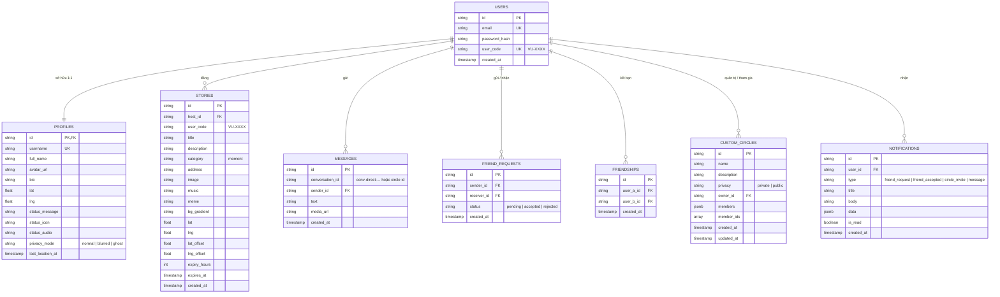

# 🗄️ Đặc Tả Cơ Sở Dữ Liệu — Dự Án VIVU (Supabase PostGIS & Persistent Engine V2.0)

---

## 1. TỔNG QUAN KIẾN TRÚC DỮ LIỆU DUAL-MODE (HYBRID PERSISTENCE)

Hệ thống cơ sở dữ liệu của VIVU được thiết kế theo mô hình **Dual-Mode (Kiến trúc kép tự phục hồi)**, đảm bảo ứng dụng vận hành liên tục 100% trong mọi tình huống triển khai mạng nội bộ (LAN), offline demo hoặc triển khai Cloud quy mô lớn:

```
+-----------------------------------------------------------------------------------+
|                            VIVU BACKEND / CLIENT                                  |
+-----------------------------------------------------------------------------------+
                                         |
               +-------------------------+-------------------------+
               |                                                   |
       [Chế độ 1: Cloud]                                   [Chế độ 2: Local]
   VITE_SUPABASE_URL & KEY hợp lệ                       Chưa có Key / LAN Offline
               |                                                   |
               v                                                   v
+-------------------------------+                   +-------------------------------+
|  Supabase Cloud (PostgreSQL)  |                   | Persistent JSON DB Engine     |
|  - PostGIS Spatial Extension  |                   | - File: backend/data/vivu_... |
|  - Row Level Security (RLS)   |                   | - Atomic Temp-file write      |
|  - Realtime WebSocket CDC     |                   | - Sanitizer dọn khách vãng lai|
+-------------------------------+                   +-------------------------------+
```

### Hai chế độ vận hành:
1. **Chế độ 1: Supabase Cloud PostgreSQL 15+ & PostGIS Extension**:
   - Tọa độ địa lý lưu dưới dạng `GEOMETRY(Point, 4326)` (WGS84).
   - Truy vấn không gian địa lý siêu tốc bằng hàm `ST_DWithin`, `ST_Distance` và chỉ mục `GIST`.
   - Phân quyền dữ liệu cấp dòng bằng Row Level Security (RLS).
2. **Chế độ 2: Local JSON Persistent Database Engine (`dbStore.js`)**:
   - Lưu trữ bền vững tại file `backend/data/vivu_database.json`.
   - Cơ chế ghi tệp nguyên tử (Atomic write qua temp-file) chống hỏng tệp khi tắt server đột ngột.
   - Bộ lọc **Sanitizer Engine**: Tự động thanh lọc các ID tạm thời của khách vãng lai (`client-xxx`) khi khởi động, chỉ giữ lại hồ sơ, tin nhắn, bạn bè và nhóm của các tài khoản đã đăng ký hợp lệ.

---

## 2. SƠ ĐỒ QUAN HỆ THỰC THỂ (ERD MERMAID)



---

## 3. ĐẶC TẢ CHI TIẾT CÁC BẢNG DỮ LIỆU

### 3.1 Bảng `users` (Tài khoản người dùng)
Quản lý định danh xác thực, mật khẩu mã hóa và mã hiển thị cố định:

| Trường | Kiểu dữ liệu | Ràng buộc | Mô tả |
| :--- | :--- | :--- | :--- |
| `id` | `UUID` / `TEXT` | `PRIMARY KEY` | Định danh duy nhất (`usr-xxx` hoặc UUID Supabase) |
| `email` | `VARCHAR(255)` | `UNIQUE, NOT NULL` | Email đăng nhập |
| `password` | `VARCHAR(255)` | `NOT NULL` | Hash mật khẩu (bcrypt hoặc PBKDF2) |
| `user_code` | `VARCHAR(10)` | `UNIQUE, NOT NULL` | Mã định danh 4 số kiểu VIVU: `VU-XXXX` (VD: `VU-4091`) |
| `created_at` | `TIMESTAMPTZ` | `DEFAULT NOW()` | Thời điểm tạo tài khoản |

---

### 3.2 Bảng `profiles` (Hồ sơ người dùng & Tọa độ GPS thời gian thực)
Lưu trữ thông tin cá nhân hóa, vị trí không gian và bong bóng trạng thái:

| Trường | Kiểu dữ liệu | Ràng buộc | Mô tả |
| :--- | :--- | :--- | :--- |
| `id` | `UUID` / `TEXT` | `PRIMARY KEY, REFERENCES users(id)` | Khóa chính liên kết 1:1 với `users` |
| `username` | `VARCHAR(50)` | `UNIQUE, NOT NULL` | Tên người dùng định danh |
| `full_name` | `VARCHAR(100)` | `NOT NULL` | Tên hiển thị công khai trên bản đồ |
| `avatar_url` | `VARCHAR(500)` | `NULLABLE` | URL ảnh đại diện |
| `bio` | `TEXT` | `DEFAULT ''` | Tiểu sử giới thiệu |
| `interests` | `TEXT[]` | `DEFAULT '{}'` | Danh sách sở thích (`cafe`, `streetwear`, `game`) |
| `lat` / `last_location` | `FLOAT` / `GEOMETRY` | `NOT NULL` | Vĩ độ GPS thực tế |
| `lng` | `FLOAT` / `GEOMETRY` | `NOT NULL` | Kinh độ GPS thực tế |
| `location_accuracy` | `FLOAT` | `NULLABLE` | Sai số GPS thiết bị đo bằng mét |
| `last_location_at` | `TIMESTAMPTZ` | `DEFAULT NOW()` | Thời gian heartbeat GPS gần nhất |
| `status_message` | `VARCHAR(100)` | `DEFAULT 'Đang rảnh'` | Bong bóng trạng thái trên Marker |
| `status_icon` | `VARCHAR(50)` | `DEFAULT 'bi-geo-alt'` | Vector icon Bootstrap Icons |
| `status_audio` | `VARCHAR(255)` | `NULLABLE` | Ghi chú âm thanh ngắn |
| `privacy_mode` | `VARCHAR(20)` | `DEFAULT 'normal'` | `normal` (thật), `blurred` (+500m), `ghost` (ẩn) |
| `user_code` | `VARCHAR(10)` | `NOT NULL` | Bản sao `VU-XXXX` để tra cứu nhanh |
| `updated_at` | `TIMESTAMPTZ` | `DEFAULT NOW()` | Cập nhật gần nhất |

---

### 3.3 Bảng `custom_circles` (Nhóm bạn bè tùy chỉnh)
Lưu trữ các nhóm do người dùng tự tạo để gom bạn bè, trò chuyện và lọc giọt nước trên bản đồ:

| Trường | Kiểu dữ liệu | Ràng buộc | Mô tả |
| :--- | :--- | :--- | :--- |
| `id` | `VARCHAR(50)` | `PRIMARY KEY` | Mã nhóm duy nhất (`circle-xxx`) |
| `name` | `VARCHAR(100)` | `NOT NULL` | Tên nhóm (VD: *Team Cafe Công Nghệ*) |
| `description` | `TEXT` | `DEFAULT ''` | Mô tả mục đích sinh hoạt của nhóm |
| `privacy` | `VARCHAR(20)` | `DEFAULT 'private'` | Mức quyền riêng tư: `private` (mặc định) hoặc `public` |
| `icon` | `VARCHAR(50)` | `DEFAULT 'bi-people'` | Biểu tượng nhóm (100% Bootstrap Icons) |
| `color` | `VARCHAR(30)` | `DEFAULT 'neon-cyan'` | Mã màu sắc chủ đạo của nhóm |
| `owner_id` | `VARCHAR(50)` | `NOT NULL` | ID người dùng tạo nhóm (Quản trị viên) |
| `members` | `JSONB` | `DEFAULT '[]'` | Mảng thành viên: `[{ user_id, role, status, joined_at }]` |
| `member_ids` | `TEXT[]` | `DEFAULT '{}'` | Mảng các ID thành viên có trạng thái `accepted` |
| `created_at` | `TIMESTAMPTZ` | `DEFAULT NOW()` | Thời điểm tạo nhóm |
| `updated_at` | `TIMESTAMPTZ` | `DEFAULT NOW()` | Thời điểm cập nhật thông tin nhóm |

> **Cấu trúc JSONB của từng phần tử trong `members`**:
> ```json
> {
>   "user_id": "usr-882194819",
>   "role": "owner",          // "owner" (Người tạo) hoặc "member" (Thành viên)
>   "status": "accepted",     // Luôn là "accepted" khi tạo và thêm trực tiếp
>   "joined_at": "2026-10-28T10:00:00.000Z"
> }
> ```

---

### 3.4 Bảng `stories` (Story Khoảnh Khắc Định Vị Không Gian)
Lưu trữ các bài đăng Story khoảnh khắc cắm ghim trên bản đồ 3D:

| Trường | Kiểu dữ liệu | Ràng buộc | Mô tả |
| :--- | :--- | :--- | :--- |
| `id` | `VARCHAR(50)` | `PRIMARY KEY` | Định danh story (`story-xxx`) |
| `host_id` | `VARCHAR(50)` | `NOT NULL` | ID người đăng bài |
| `user_code` | `VARCHAR(10)` | `NULLABLE` | Mã `VU-XXXX` của chủ bài đăng |
| `host_name` | `VARCHAR(100)` | `NOT NULL` | Tên người đăng |
| `host_avatar` | `VARCHAR(500)` | `NOT NULL` | Ảnh đại diện người đăng |
| `category` | `VARCHAR(50)` | `DEFAULT 'moment'` | Danh mục bài đăng (`moment`) |
| `title` | `VARCHAR(200)` | `NOT NULL` | Tiêu đề story / Tên bài hát |
| `description` | `TEXT` | `DEFAULT ''` | Nội dung chú thích khoảnh khắc |
| `address` | `VARCHAR(255)` | `DEFAULT 'Vị trí của bạn'` | Vị trí địa lý |
| `image` | `TEXT` | `NULLABLE` | URL hoặc chuỗi base64 ảnh chụp |
| `music` | `VARCHAR(255)` | `NULLABLE` | Tên bài hát nhạc nền kèm ca sĩ |
| `meme` | `VARCHAR(100)` | `NULLABLE` | Nhãn dán Meme Messenger |
| `bg_gradient` | `VARCHAR(100)` | `NULLABLE` | Dải màu nền gradient |
| `lat` | `FLOAT` | `NOT NULL` | Vĩ độ điểm cắm ghim |
| `lng` | `FLOAT` | `NOT NULL` | Kinh độ điểm cắm ghim |
| `lat_offset` | `FLOAT` | `DEFAULT 0` | Độ lệch phân tán không gian chống đè ghim |
| `lng_offset` | `FLOAT` | `DEFAULT 0` | Độ lệch kinh độ phân tán |
| `expiry_hours` | `INT` | `DEFAULT 3` | Số giờ tồn tại (1, 3, 6, 24 giờ) |
| `expires_at` | `TIMESTAMPTZ` | `NOT NULL` | Mốc thời gian tự động hết hạn |
| `privacy` | `VARCHAR(20)` | `DEFAULT 'public'` | `public` (cộng đồng) hoặc `friends` (bạn bè) |
| `created_at` | `TIMESTAMPTZ` | `DEFAULT NOW()` | Thời điểm đăng tải |

---

### 3.5 Bảng `friend_requests` (Lời mời kết bạn 1-1)
Quản lý vòng đời lời mời kết bạn giữa 2 người dùng:

| Trường | Kiểu dữ liệu | Ràng buộc | Mô tả |
| :--- | :--- | :--- | :--- |
| `id` | `VARCHAR(50)` | `PRIMARY KEY` | Mã lời mời (`freq-xxx`) |
| `sender_id` | `VARCHAR(50)` | `NOT NULL` | ID người gửi yêu cầu |
| `receiver_id` | `VARCHAR(50)` | `NOT NULL` | ID người nhận yêu cầu |
| `status` | `VARCHAR(20)` | `DEFAULT 'pending'` | `pending`, `accepted`, `rejected` |
| `created_at` | `TIMESTAMPTZ` | `DEFAULT NOW()` | Thời điểm gửi |

---

### 3.6 Bảng `friendships` (Quan hệ bạn bè song phương)
Lưu kết nối bạn bè đã được xác nhận:

| Trường | Kiểu dữ liệu | Ràng buộc | Mô tả |
| :--- | :--- | :--- | :--- |
| `id` | `VARCHAR(50)` | `PRIMARY KEY` | Mã quan hệ (`frnd-xxx`) |
| `user_a_id` | `VARCHAR(50)` | `NOT NULL` | ID người thứ nhất |
| `user_b_id` | `VARCHAR(50)` | `NOT NULL` | ID người thứ hai |
| `created_at` | `TIMESTAMPTZ` | `DEFAULT NOW()` | Thời điểm chấp nhận |

---

### 3.7 Bảng `messages` (Tin nhắn văn bản & Đa phương tiện)
Lưu nội dung trò chuyện trong hội thoại 1-1 hoặc nhóm:

| Trường | Kiểu dữ liệu | Ràng buộc | Mô tả |
| :--- | :--- | :--- | :--- |
| `id` | `VARCHAR(50)` | `PRIMARY KEY` | Mã tin nhắn (`msg-xxx`) |
| `conversation_id` | `VARCHAR(100)` | `NOT NULL` | Chuẩn 1-1: `conv-direct-idA--idB` hoặc `circle-xxx` |
| `sender` | `VARCHAR(50)` | `NOT NULL` | ID người gửi tin nhắn |
| `sender_name` | `VARCHAR(100)` | `NOT NULL` | Tên người gửi |
| `sender_avatar` | `VARCHAR(500)` | `NULLABLE` | Avatar người gửi |
| `text` | `TEXT` | `NOT NULL` | Nội dung tin nhắn chữ |
| `media_url` | `VARCHAR(500)` | `NULLABLE` | URL ảnh đính kèm nếu có |
| `timestamp` | `TIMESTAMPTZ` | `DEFAULT NOW()` | Thời gian gửi tin |

---

### 3.8 Bảng `notifications` (Thông báo ứng dụng)
Lưu thông báo tương tác để hiển thị trên chuông thông báo và Popup Toast:

| Trường | Kiểu dữ liệu | Ràng buộc | Mô tả |
| :--- | :--- | :--- | :--- |
| `id` | `VARCHAR(50)` | `PRIMARY KEY` | Mã thông báo (`notif-xxx`) |
| `user_id` | `VARCHAR(50)` | `NOT NULL` | ID người nhận |
| `type` | `VARCHAR(50)` | `NOT NULL` | `friend_request`, `friend_accepted`, `circle_member_added` |
| `title` | `VARCHAR(200)` | `NOT NULL` | Tiêu đề thông báo |
| `body` | `TEXT` | `NOT NULL` | Nội dung chi tiết |
| `data` | `JSONB` | `DEFAULT '{}'` | Metadata kèm theo (ID đối tác, icon) |
| `is_read` | `BOOLEAN` | `DEFAULT FALSE` | Đã đọc hay chưa |
| `created_at` | `TIMESTAMPTZ` | `DEFAULT NOW()` | Thời điểm tạo |

---

## 4. CƠ CHẾ BỀN VỮNG CỤC BỘ (LOCAL PERSISTENT DB ENGINE)

Khi vận hành không có Supabase Cloud (chế độ LAN / Local), `backend/src/services/dbStore.js` đảm nhiệm toàn bộ vai trò của Database Engine:

### 4.1 Cấu trúc tệp dữ liệu `backend/data/vivu_database.json`
```json
{
  "users": [],
  "profiles": [],
  "stories": [],
  "messages": [],
  "circles": [],
  "friendRequests": [],
  "friendships": [],
  "notifications": []
}
```

### 4.2 Ghi nguyên tử an toàn (Atomic File Write via Temporary File)
Để tránh hiện tượng hỏng file JSON hoặc dữ liệu bị cắt cụt khi tiến trình Node.js bị ngắt đột ngột:
```javascript
const tempFile = `${DB_FILE}.${process.pid}.${Date.now()}.${Math.random().toString(36).substring(2, 6)}.tmp`;
fs.writeFileSync(tempFile, serialized, 'utf-8');
fs.renameSync(tempFile, DB_FILE); // Thao tác đổi tên mang tính nguyên tử trên hệ thống tệp OS
```

### 4.3 Bộ lọc thanh lọc dữ liệu rác (Sanitizer Engine Lifecycle)
Mỗi lần backend khởi động lại, `dbStore.sanitize()` được kích hoạt tự động:
1. Đọc danh sách `validUserIds` từ mảng `users`.
2. Loại bỏ toàn bộ hồ sơ khách tạm thời `client-xxx` ra khỏi `profiles`.
3. Loại bỏ các tin nhắn rác không rõ người gửi hoặc chứa `client-` trong `conversation_id`.
4. Làm sạch các lời mời kết bạn và quan hệ bạn bè không thuộc về tài khoản đã đăng ký.
5. Ghi tệp sạch xuống đĩa để đảm bảo dung lượng tối ưu và tính toàn vẹn dữ liệu.

---

## 5. MIGRATIONS SUPABASE POSTGRESQL & POSTGIS

Toàn bộ các tệp SQL migration chính thức được lưu trữ tại thư mục `infra/supabase/migrations/`:

### 5.1 Migration Khởi Tạo Toàn Diện (`20261024_init_vivu_schema.sql`)
- Kích hoạt phần mở rộng PostGIS: `CREATE EXTENSION IF NOT EXISTS postgis;`
- Tạo các bảng `profiles`, `stories`, `friendships`, `conversations`, `messages`, `custom_circles`.
- Tạo chỉ mục không gian `GIST(last_location)` và `GIST(location)`.
- Thiết lập hàm tính cự ly không gian PostGIS và hàm cập nhật tọa độ `update_user_gps`.

### 5.2 Migration Nâng Cấp Custom Circles (`20261028_upgrade_custom_circles.sql`)
- Bổ sung các cột: `description`, `privacy`, `owner_id`, `members` (JSONB), `updated_at`.
- Tạo chỉ mục `idx_custom_circles_owner_id` và `idx_custom_circles_privacy`.
- Kích hoạt RLS Policy bảo vệ danh sách nhóm: cho phép đọc nếu là `public`, hoặc là `owner_id`, hoặc nằm trong `member_ids`.

---

## 6. ROW LEVEL SECURITY (RLS) & AN TOÀN TRUY CẬP

Hệ thống tuân thủ nghiêm ngặt nguyên tắc **Zero-Leak Data Isolation**:
- **Hồ sơ cá nhân**: Người dùng chỉ có quyền sửa hồ sơ (`UPDATE`) khi `auth.uid() = profiles.id`.
- **Nhóm bạn bè tùy chỉnh**: Chỉ `owner_id` mới có quyền `DELETE` nhóm hoặc `UPDATE` thông tin quản trị; các thành viên trong `member_ids` chỉ có quyền đọc và gửi tin nhắn trong nhóm.
- **Tin nhắn**: Chỉ các thành viên có mặt trong `conversation_id` mới được quyền đọc (`SELECT`) tin nhắn của hội thoại đó.
- **Tọa độ bí mật (Ghost Mode)**: Khi người dùng đặt `privacy_mode = 'ghost'`, tọa độ trả về qua API cho người khác tự động bị ẩn hoặc gán `null`.
