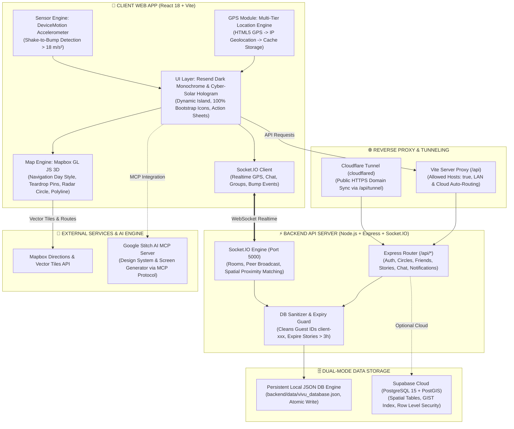
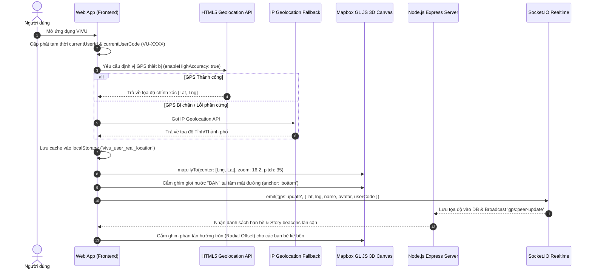
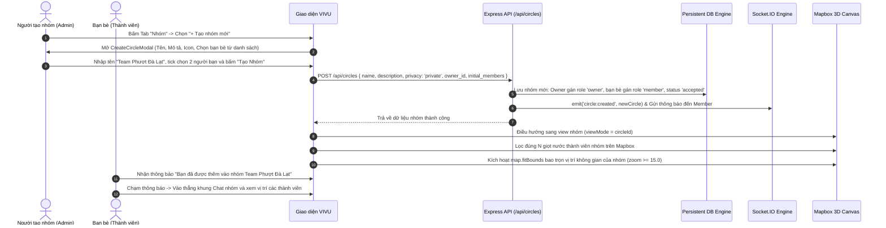
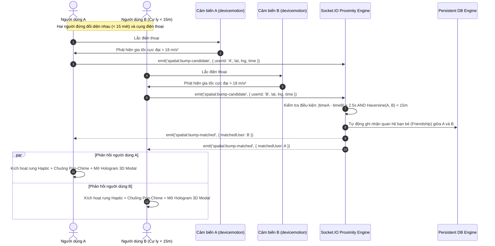
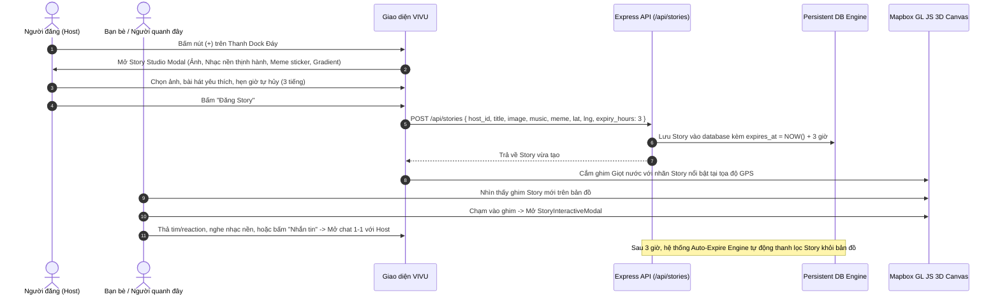

# 📊 Đặc Tả Sơ Đồ Hệ Thống (Diagrams Spec) — Dự Án VIVU V2.0

---

## 1. SYSTEM ARCHITECTURE DIAGRAM (KIẾN TRÚC TỔNG THỂ FULLSTACK)



---

## 2. SEQUENCE DIAGRAMS (LUỒNG NGHIỆP VỤ CỐT LÕI)

### 2.1 Luồng Định Vị Không Gian Đa Tầng & Khởi Động Bản Đồ (Multi-Tier Location Engine)



---

### 2.2 Luồng Tạo Nhóm & Quản Lý Thành Viên Trực Tiếp (Custom Circles 2-Tier)



---

### 2.3 Luồng Chạm Điện Thoại Kết Bạn Siêu Tốc (Spatial Shake-to-Bump 3D)



---

### 2.4 Luồng Đăng Khoảnh Khắc Story & Tương Tác Bản Đồ (Story Studio Lifecycle)



---

## 3. FRONTEND COMPONENT ARCHITECTURE (KIẾN TRÚC PHẦN MỀM GIAO DIỆN)

```mermaid
graph TD
    App[App.jsx - Shell điều phối trạng thái cấp cao]
    
    App --> Header[UnifiedDynamicIsland.jsx\nDynamic Island Glass, Radar Slider 0.5-15km, Notifications, User Code VU-XXXX]
    App --> MapCanvas[MapboxCanvas.jsx\nMapbox GL JS 3D, Teardrop Marker, Ground Ripple, Directions Polyline]
    App --> BottomDock[VivuBottomDock.jsx\n4 Tabs + FAB: Xã Hội, Bạn Bè, (+), Tin Nhắn, Tôi]
    
    App --> StoryStudio[StoryStudioModal.jsx\nĐăng ảnh, Nhạc nền thịnh hành, Meme sticker, Nền gradient]
    App --> StoryInteractive[StoryInteractiveModal.jsx\nXem Story tương tác, Nghe nhạc, Thả tim, Nhắn tin]
    App --> CreateCircle[CreateCircleModal.jsx\nTạo nhóm, Thêm bạn bè trực tiếp, Phân quyền Owner]
    App --> GroupMembers[GroupMembersModal.jsx\nQuản trị viên xóa thành viên / Thêm bạn bè / Xem trên Map]
    App --> BumpModal[SpatialBumpModal3D.jsx\nHiệu ứng Hologram 3D Chạm kết bạn cự ly gần < 15m]
    App --> ChatView[MessengerChatView.jsx\nTin nhắn 1-1 & Nhóm, Bình chọn Poll, Gọi thoại, Audio Chime]
    App --> FriendSheet[FriendDetailSheet.jsx\nChi tiết bạn bè, Pin, Khoảng cách, Chỉ đường Mapbox]
    App --> AuthModal[AuthGateView.jsx\nĐăng nhập / Đăng ký Modal lớp phủ không xâm lấn bản đồ]
```
