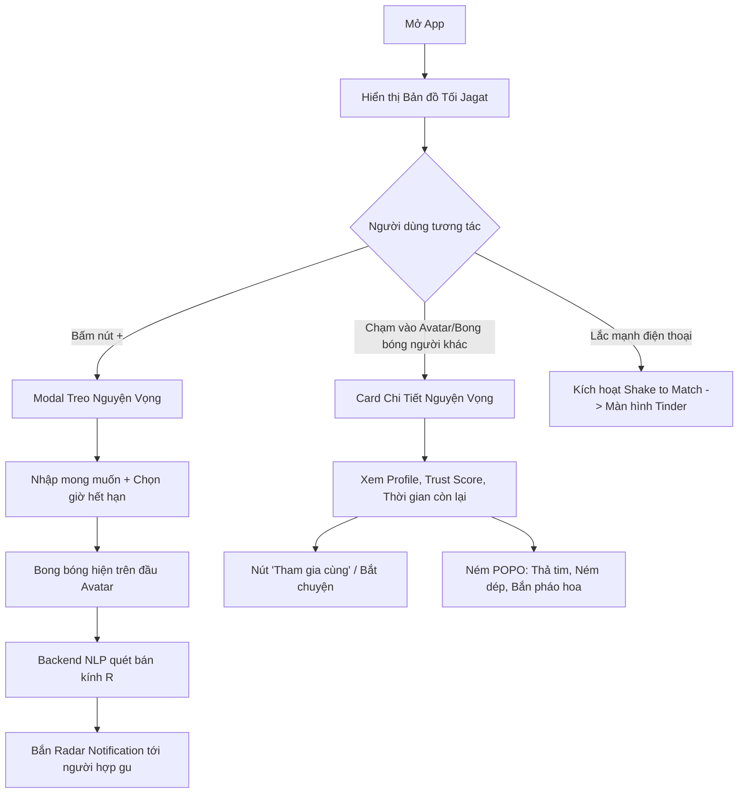

# VIVU HOME — ĐẶC TẢ CHỨC NĂNG BẢN ĐỒ MẠNG XÃ HỘI (JAGAT SOCIAL MAP)

**Mã tài liệu:** VIVU-SPEC-HOME-002  
**Phiên bản:** 2.0 (Cập nhật kiến trúc Bản đồ AI Jagat)  
**Phạm vi:** Màn hình chính (Home Screen) của ứng dụng di động Vivu

---

## 1. MỤC ĐÍCH & TẦM NHÌN SẢN PHẨM

Trang chủ là linh hồn của Vivu, được thiết kế theo phong cách **Social Map thế hệ mới (lấy cảm hứng từ Jagat & Zenly)**. Khi mở ứng dụng, người dùng không đối diện với một bảng tin (feed) tĩnh nhàm chán, mà bước ngay vào một **bản đồ thế giới thực sống động**:

- Thấy được vị trí của bản thân với hiệu ứng sóng Radar tỏa ra.
- Thấy bạn bè và cộng đồng xung quanh đang làm gì, đang ở đâu.
- Thấy các **Bong bóng Nguyện vọng (NOW Beacon)** đang lơ lửng trên đầu mỗi người.
- Nhận thông báo tức thì khi gần mình có người phát ra nguyện vọng khớp với sở thích.

---

## 2. BỐ CỤC GIAO DIỆN (UI LAYOUT)

1. **Bản đồ nền (Interactive Map Canvas):**
   - Chiếm trọn 100% diện tích màn hình.
   - Giao diện phong cách Tối/Neon hiện đại (Dark Mode), giảm chói mắt và tôn vinh các avatar màu sắc.
   - Hỗ trợ cử chỉ: Thu phóng (Pinch to zoom), Xoay (Rotate), Kéo (Pan).

2. **Avatar Pin của Bản thân (My Avatar Pin):**
   - Tọa lạc tại tọa độ GPS hiện tại.
   - Vòng tròn đồng tâm phát sóng Radar (Radar Ripple Effect) phát sáng nhẹ nhàng theo chu kỳ để thể hiện máy đang hoạt động.
   - Nút định vị nhanh về vị trí hiện tại (GPS Recenter Button) ở góc phải dưới.

3. **Avatar Pin của Người khác & Bạn bè:**
   - Avatar tròn cắt viền sắc nét, hiển thị huy hiệu trạng thái:
     - 🔋 Mức pin điện thoại (theo phong cách Jagat).
     - 🏃 Vận tốc / Chế độ di chuyển (Đi bộ, Đi xe, Đang dừng chân).
     - 🟢 Chấm xanh Online thời gian thực.

4. **Bong bóng Nguyện vọng tức thì (Thought Bubble / NOW Beacon):**
   - Treo lơ lửng ngay phía trên đầu Avatar của những người vừa đăng nguyện vọng.
   - Chứa Icon cảm xúc (🍔, ☕, 🏸, 📚) và câu ngắn tóm tắt (VD: *"Ai cafe 21h không?"*).
   - Có vòng viền đếm ngược thời gian hết hạn (Time-to-Live).

5. **Nút Tạo Nguyện Vọng Nổi (Floating Action Button - FAB):**
   - Nút bấm tròn lớn, phát sáng Gradient nổi bật ở giữa cạnh dưới bản đồ.
   - Bấm vào mở nhanh Bottom Sheet để tạo nguyện vọng mới.

6. **Thanh công cụ đỉnh màn hình (Header Overlay):**
   - Bên trái: Logo VIVU + Bộ lọc chủ đề nhanh (Tất cả, Ăn uống, Cafe, Thể thao).
   - Bên phải: Nút Tìm kiếm địa điểm/bạn bè + Nút Thông báo Radar.

---

## 3. CÁC TÍNH NĂNG VÀ LUỒNG NGƯỜI DÙNG (USER FLOWS)

### 3.1. Luồng Treo Nguyện Vọng (Create NOW Beacon)
1. Người dùng ấn vào nút `+` ở giữa dưới màn hình.
2. Bottom Sheet trượt lên với các trường nhập liệu tối giản:
   - **Nội dung:** Ô nhập text ngắn (tối đa 100 ký tự, VD: *"Tìm cạ đánh cầu lông sân X chiều nay"*).
   - **Biểu tượng cảm xúc (Emoji/Tag):** Chọn nhanh icon đại diện.
   - **Thời hạn tồn tại (TTL):** Người dùng chọn 1 giờ, 3 giờ, 6 giờ hoặc 24 giờ.
3. Bấm **"Phát tín hiệu lên Map"**:
   - Vị trí GPS hiện tại được gắn tự động.
   - Bong bóng xuất hiện ngay trên đầu avatar của người dùng.
   - Hết thời gian quy ước, bài đăng tự động biến mất không để lại rác dữ liệu.

### 3.2. Luồng Radar Báo Động Lân Cận (Proximity Radar Alert)
1. Khi có người đăng nguyện vọng mới trong bán kính cấu hình (mặc định 3km).
2. Backend gọi mô hình **NLP Semantic Matching** so sánh nội dung bài đăng với Hồ sơ/Sở thích của người dùng lân cận.
3. Nếu độ tương đồng **Cosine Similarity >= 0.8**:
   - Một vòng sóng Radar màu cam/tím phát ra trên bản đồ hướng về vị trí người đăng.
   - Xuất hiện thông báo Popup nhỏ (Banner Toast): *"Cách bạn 800m, [Tên] đang muốn [Nội dung], xem ngay!"*.

### 3.3. Tương tác Vui nhộn Thời gian thực (Jagat POPO)
1. Bấm vào một avatar bạn bè trên bản đồ.
2. Chọn menu POPO: Thả tim 💖, Ném dép 🩴, Bắn pháo hoa 🎆.
3. Thông qua WebSocket (`chat.gateway`), điện thoại người nhận sẽ rung (Haptic Feedback) và hiệu ứng icon tương ứng nổ tung màn hình.

---

## 4. BẢNG YÊU CẦU CHỨC NĂNG CHI TIẾT (FUNCTIONAL REQUIREMENTS)

| Mã yêu cầu | Tên chức năng | Mô tả chi tiết | Mức ưu tiên |
|:---|:---|:---|:---|
| **HOME-01** | Bản đồ GPS Thời gian thực | Hiển thị vị trí GPS chính xác của người dùng với sai số < 15m; tự động cập nhật khi di chuyển. | **P0** |
| **HOME-02** | Avatar Pin & Hiệu ứng Radar | Vẽ avatar tròn có viền phát sáng và hiệu ứng vòng tròn tỏa sóng radar định kỳ. | **P0** |
| **HOME-03** | Đăng Nguyện Vọng Phù Du (NOW) | Cho phép nhập nguyện vọng, chọn thời gian hết hạn (1h/3h/6h) và ghim lên tọa độ hiện tại. | **P0** |
| **HOME-04** | Hiển thị Bong bóng Suy nghĩ | Render bong bóng status lơ lửng trên pin bản đồ; tự động ẩn khi bài đăng hết hạn. | **P0** |
| **HOME-05** | Quét và Bắn Thông Báo Lân Cận | Thuật toán Spatial Search + NLP lọc ra người dùng hợp gu trong bán kính R để gửi thông báo tức thì. | **P0** |
| **HOME-06** | Card Xem Nhanh & Tham gia | Chạm vào avatar hiển thị Popup thông tin tóm tắt: Tên, Tuổi, Nguyện vọng, Nút kết nối/nhắn tin. | **P0** |
| **HOME-07** | Nhận diện Cử chỉ Lắc máy | Tích hợp cảm biến gia tốc kế để kích hoạt chuyển cảnh sang màn hình Tinder Swipe. | **P0** |
| **HOME-08** | Hiển thị Trạng thái Pin & Tốc độ | Đọc mức pin thiết bị và vận tốc di chuyển hiển thị badge phụ trên Avatar chuẩn Jagat. | **P1** |
| **HOME-09** | Tương tác Ném POPO | Gửi hiệu ứng tương tác thời gian thực nổ tung trên màn hình đối phương qua Socket.io. | **P1** |
| **HOME-10** | Chế độ Bóng Ma (Ghost Mode) | Cho phép người dùng chuyển trạng thái: Vị trí chính xác (Precise), Làm mờ (Blurred), Đóng băng (Frozen). | **P1** |

---

## 5. TIÊU CHÍ NGHIỆM THU (ACCEPTANCE CRITERIA)

1. Mở ứng dụng là bản đồ lập tức hiển thị vị trí người dùng trong vòng **< 1.5 giây**.
2. Đăng nguyện vọng thành công thì bong bóng xuất hiện ngay trên bản đồ mà không cần tải lại trang (Zero-refresh).
3. Sau khi hết thời gian quy ước (TTL), bài đăng biến mất hoàn toàn khỏi bản đồ và cơ sở dữ liệu.
4. Khi nhận thông báo Radar lân cận, chạm vào thông báo sẽ tự động di chuyển tâm bản đồ (Pan/Animate Camera) đến ngay vị trí của người đăng.
