# 📋 SRS — Software Requirements Specification
# Dự án: VIVU — Nền Tảng Mạng Xã Hội Bản Đồ Thời Gian Thực (Map-Centric Social Web App)

> **Phiên bản tài liệu**: 3.0 (Đồng bộ 100% mã nguồn thực tế & Thanh lọc toàn diện)  
> **Trạng thái**: Đang vận hành chính thức (Active Living Document)  
> **Kiến trúc**: Fullstack Dual-Mode (React + Vite + Node.js Express + Mapbox GL JS + Supabase PostGIS + Socket.IO)

---

## 1. GIỚI THIỆU & ĐỊNH HƯỚNG NỀN TẢNG

### 1.1 Mục đích tài liệu
Tài liệu này xác định chi tiết và chuẩn xác các yêu cầu kỹ thuật, kiến trúc hệ thống và chức năng của **VIVU** — nền tảng Web App mạng xã hội bản đồ thời gian thực (Map-Centric Social Web App). Ứng dụng tập trung vào trải nghiệm kết nối không gian thực tế:
- **Đăng khoảnh khắc Story định vị GPS trên bản đồ 3D**: Chụp ảnh Camera Pro (Single & Dual Camera PIP), chèn nhạc thịnh hành Web Audio API thật, nhãn dán Meme Messenger, bộ lọc màu, tự hủy linh hoạt 1h - 24h.
- **Trình xem Story phân đoạn (Segmented Multi-Story Viewer)**: Xem từng story một của tác giả, điều hướng chạm Trái/Phải, xem ảnh Full Màn Hình tràn viền Lightbox (Zoom in/out/1:1/Pan/ESC), xóa Story 2 chế độ (Gỡ khỏi Bản đồ vs Xóa vĩnh viễn).
- **Hồ sơ cá nhân & Kho Lưu Trữ (Profile, Archive & Highlights)**: Avatar chuẩn mực (nền trắng với icon người xám khi chưa có ảnh), hàng Tin Nổi Bật (Highlights) với nút `(+) Mới`, tab chuyển đổi "Thư Viện Ảnh" <---> "Kho Lưu Trữ" quản lý media đã đăng.
- **Quét radar không gian (Dynamic Island Radar)**: Điều chỉnh bán kính quét 0.5km - 15km, nhận diện bạn bè trực tuyến kề bên.
- **Lắc điện thoại kết nối cự ly gần (Spatial Bump 3D)**: Quét cự ly < 15m, cảm biến gia tốc `DeviceMotionEvent`, hiệu ứng va chạm 3D & âm thanh Pop-Chime riêng biệt.
- **Trò chuyện Messenger & Quản lý Nhóm riêng (Custom Circles)**: Chat 1-1 Canonical ID, Chat nhóm thời gian thực, bình chọn Poll, nhóm riêng thêm trực tiếp thành viên và đồng bộ lọc 1:1 trên Mapbox 3D.
- **Dẫn đường Mapbox Directions**: Chỉ đường di chuyển thực tế từ vị trí người dùng đến bạn bè hoặc điểm hẹn.

### 1.2 Phạm vi hệ thống & Định hướng nền tảng
- **Loại hình ứng dụng**: **Web App (Single Page Application — React + Vite)**, tối ưu công thái học cảm ứng di động (Mobile-First Touch Ergonomics) và màn hình lớn máy tính (Desktop Multi-Column).
- **Trải nghiệm vào thẳng bản đồ (Zero-Flash Direct Guest Map — Rule 22)**: Bất kỳ thiết bị nào khi mở webapp đều vào thẳng Bản đồ 3D ngay lập tức, tự động cấp mã định danh `user_code` (`VU-XXXX`) và cắm ghim giọt nước "BẠN", không chặn cứng bằng màn hình đăng nhập.
- **Bản đồ là trung tâm (Map-Centric Architecture)**: 90% tương tác cốt lõi diễn ra trên canvas Mapbox 3D toàn màn hình hoặc qua các lớp phủ nổi (Dynamic Island, Floating Action Dock, Bottom Sheets).
- **Thẩm mỹ Resend Dark Monochrome & Cyber Neon**: Nền than chì sâu (`#07090E`, `#0E0E10`, `#121520`, `#151619`), viền siêu mỏng `border-white/10`, màu nhấn công nghệ Hyper Lime (`#10FFA0`), Cyber Cyan (`#00E5FF`), Sunset Pink (`#FF2A85`), và **100% Vector Bootstrap Icons (Anti-Emoji — Rule 5)**.

---

## 2. KIẾN TRÚC TỔNG THỂ HỆ THỐNG (FULLSTACK DUAL-MODE)

Ứng dụng vận hành theo mô hình kiến trúc phân hệ độc lập:

```mermaid
flowchart TD
    subgraph Frontend ["CLIENT WEB APP (frontend/)"]
        A["React 19 + Vite + Tailwind CSS v4 + Mapbox GL JS"]
        A1["Unified Dynamic Island<br/>(Radar 0.5 - 15km, Notifs, Friends Pill)"]
        A2["Mapbox 3D Hologram Canvas<br/>(Wireframe Pins, Laser Ripple, Radial Dispersion)"]
        A3["Story Studio Pro & Multi-Viewer<br/>(Dual Camera, Segmented Bars, Lightbox Fullscreen)"]
        A4["Profile Page, Archive & Highlights<br/>(Avatar White-Base, Archive Tab, Highlights Bar)"]
        A5["Messenger Chat & Circles<br/>(Canonical 1-1 ID, Polls, 1:1 Mapbox Sync)"]
        A6["Spatial Bump 3D<br/>(< 15m Proximity, DeviceMotionEvent, Pop-Chime)"]
    end

    subgraph Backend ["API SERVER (backend/)"]
        B["Node.js + Express + Socket.IO (Port 5000)"]
        B1["REST Controllers: Auth, Stories, Chat, Circles, Friends, GPS, Notifs, Tunnel"]
        B2["Realtime Engine: Socket.IO Server (GPS broadcast, Chat, Circles)"]
        B3["Persistence Engine (dbStore.js): Local JSON Database (Zero-Leak)"]
        B4["Unified Reverse Proxy (Vite /api proxy & Cloudflare Tunnel)"]
    end

    subgraph Integrations ["CLOUD & EXTERNAL SERVICES"]
        C1["Supabase Cloud: PostgreSQL 15 + PostGIS (ST_DWithin, ST_Distance)"]
        C2["Mapbox APIs: Vector Tiles v11 + Directions API v5 (Lộ trình di chuyển)"]
        C3["Cloudflare Quick Tunnel: Public HTTPS URL cho thiết bị di động"]
    end

    Frontend <-->|HTTP REST & WebSockets| Backend
    Backend <-->|Dual-Mode Fallback| Integrations
```

---

## 3. CÁC PHÂN HỆ CHỨC NĂNG CỐT LÕI

### 3.1 Phân hệ Bản Đồ Không Gian 3D (Mapbox GL JS)
1. **Ghim Lăng Kính Hologram Wireframe 3D**:
   - Khung hình học xoay 45 độ, phát quang viền laser neon (Cyan: Online, Pink: Story, Amber: Kề cận < 60m).
   - Chóp nhọn cắm chuẩn xác vào mặt đất (`anchor: 'bottom'` — Rule 5).
   - Vòng tròn laser phát xung tiếp đất (Ground Ripple Pulse) tại chân giọt nước người dùng.
2. **Bộ Nhớ Đệm Marker Tức Thời (`Map<id, Marker>`)**:
   - Cập nhật tọa độ in-place qua `marker.setLngLat(coords)` trong các chu kỳ polling GPS 3.5s.
   - Triệt tiêu hiện tượng tạo/hủy DOM marker gây chớp nháy và giật lag bản đồ.
3. **Tự Động Tách Cụm Giọt Nước Trùng Tọa Độ (Radial Dispersion — Rule 16)**:
   - Khi 2 hay nhiều người dùng đứng cùng tọa độ (< 60m), hệ thống tự động phân tán hướng tròn bán kính $\ge 200$m theo hash ID đối phương, gắn nhãn `[GẦN BẠN]` và nâng `z-index: 30` đảm bảo không bị đè lấp.
4. **Bộ Lọc Chống Rung Lắc Cảm Biến (Anti-Jitter Filter — Rule 20)**:
   - Bỏ qua dịch chuyển micro-drift < 8m khi người dùng ở trong nhà hoặc đứng yên.
5. **Khóa Chặn Camera (Spatial Camera Clamping — Rule 24)**:
   - Nghiêm cấm camera tự ý zoom out ra xa vũ trụ (< 14.5); tự động kẹp góc zoom cận cảnh `zoom: 16.2`, `pitch: 35` mượt mà về tâm người dùng.

---

### 3.2 Phân hệ Đảo Nổi VIVU (Unified Dynamic Island)
1. **Thiết kế Kính Lỏng (Liquid Glassmorphism)**:
   - Nằm chính giữa đỉnh màn hình, viền ánh sáng quét liên tục **Border Beam**.
2. **Hợp nhất đa tính năng**:
   - **Avatar người dùng**: Viền sáng nhịp thở Hyper Lime kèm mã số `VU-XXXX`.
   - **Trình chọn bán kính Radar**: Menu dropdown trực quan kèm thanh trượt mượt mà (0.5km - 15km) và các nút preset nhanh (1km, 3km, 5km, 10km, Tất cả).
   - **Chuông Thông Báo**: Huy hiệu số lượng chưa đọc, mở Drawer lịch sử tương tác 2 chiều.
   - **Nút Bạn Bè**: Hiển thị số lượng bạn bè và yêu cầu kết bạn đang chờ.
3. **Hiệu ứng Biến Hình Đàn Hồi (Elastic Morphing)**:
   - Tự động co giãn bung rộng khi có tin nhắn mới hoặc phát hiện bạn bè gần < 15m, tự thu gọn sau 4 giây.

---

### 3.3 Phân hệ Kết Nối Không Gian Siêu Gần (Spatial Bump 3D)
1. **Nhận Diện Cự Ly Siêu Gần (< 15m)**:
   - Tự động tính toán khoảng cách Haversine giữa tọa độ GPS của người dùng với các peer trực tuyến.
2. **Cảm Biến Lắc Điện Thoại (Shake-to-Bump)**:
   - Sử dụng Web `DeviceMotionEvent` API đo gia tốc chuyển động. Khi phát hiện thao tác chạm nhẹ hoặc lắc điện thoại trong phạm vi < 15m, modal tương tác 3D mở ra tức thì.
3. **Hiệu ứng Cụm Ly 3D & Pop-Chime**:
   - Hai giọt nước va chạm đàn hồi 3D, kích hoạt pháo hoa giấy Confetti và phát âm thanh Pop-Chime Web Audio API tần số cao (E6 -> A6) dứt khoát 0.2s.

---

### 3.4 Phân hệ Khoảnh Khắc (Story Studio, Multi-Viewer & Archive)
1. **Story Studio Modal (`StoryStudioModal.jsx`)**:
   - Chụp ảnh với **Camera Pro**: Hỗ trợ Single Cam và **Dual Camera PIP** (chụp đồng thời camera trước/sau, chạm đảo chiều PIP). Hỗ trợ tải ảnh từ thiết bị với fallback máy ảnh di động (Rule 18).
   - **Chỉnh sửa ảnh chuyên nghiệp**: Điều chỉnh độ sáng, tương phản, bão hòa, vignette; áp dụng bộ lọc màu phong phú.
   - **Chèn văn bản & Sticker Meme**: Nhãn dán Meme Messenger (Cần Cafe Gấp, 10 Điểm Ko Nhưng, Hết Cứu, Chill Đêm, Năng Lượng 100%...).
   - **Âm nhạc thịnh hành**: Chọn bài hát và phát thử âm thanh thật qua Web Audio API (`storyAudioPlayer`).
   - **Hẹn giờ tự hủy linh hoạt**: 1 giờ, 3 giờ, 6 giờ, 12 giờ, 24 giờ.
   - **Quyền riêng tư**: Công khai (Public) hoặc Chỉ Bạn Bè (Friends Only).
2. **Trình Xem Story Từng Cái Một (Segmented Multi-Story Viewer — `StoryViewerModal.jsx`)**:
   - **Gom chuỗi Story**: Khi người dùng đăng nhiều bài, hệ thống gom toàn bộ bài đăng của người đó thành một chuỗi liên tục.
   - **Thanh vạch phân đoạn (Segmented Bars)**: Đỉnh màn hình hiển thị $N$ vạch ngang; vạch đã xem sáng trắng, vạch đang xem phát sáng Laser Lime (`#10FFA0`), vạch chưa xem mờ 25%.
   - **Điều hướng mượt mà**: Chạm nửa trái hoặc bấm mũi tên trái (`bi bi-chevron-left`) để lùi; chạm nửa phải hoặc bấm mũi tên phải (`bi bi-chevron-right`) để tiến.
   - **Không tự động tắt bất ngờ**: Loại bỏ hoàn toàn bộ đếm tự đóng ngoài ý muốn, cho phép xem thoải mái bao lâu tùy thích.
   - **Xem ảnh Full Màn Hình tràn viền (`StoryFullscreenLightbox.jsx`)**: Chạm 1 lần vào ảnh hoặc bấm icon phóng to để mở chế độ tràn viền 100% viewport trên nền đen mờ 95%, hỗ trợ Zoom In, Zoom Out, Reset 1:1, Pan/kéo ảnh khi phóng to, và phím `ESC` đóng nhanh.
   - **Xóa Story 2 chế độ thông minh**:
     - *Chỉ gỡ khỏi Bản đồ (Giữ trong Kho Lưu Trữ)*: Gỡ khỏi Mapbox 3D và server nhưng vẫn lưu giữ ảnh/video trong Kho Lưu Trữ của Hồ sơ cá nhân.
     - *Xóa vĩnh viễn tất cả*: Loại bỏ hoàn toàn cả trên bản đồ, máy chủ và trong kho lưu trữ.
3. **Kho Lưu Trữ Khoảnh Khắc (Story Media Archive)**:
   - Tích hợp trong trang cá nhân cạnh Thư Viện Ảnh.
   - Tự động lưu mọi ảnh/video người dùng đã đăng, kèm thời gian tạo.
   - Cho phép xem lại toàn màn hình, xóa vĩnh viễn khỏi kho, hoặc chọn ảnh đưa lên Tin Nổi Bật.

---

### 3.5 Phân hệ Hồ Sơ Cá Nhân & Tin Nổi Bật (Profile & Highlights)
1. **Giao Diện Hồ Sơ Cá Nhân Chuẩn Mực (`ProfilePageView.jsx`)**:
   - **Avatar chuẩn mực**: Nền trắng sạch sẽ với icon người xám (`bi bi-person-fill`) nếu người dùng chưa cập nhật avatar, xóa bỏ hoàn toàn ảnh đại diện giả định.
   - **Tải & Đổi Avatar**: Tải trực tiếp ảnh từ thiết bị, có nút xóa avatar nhanh.
   - **Thông Tin Cá Nhân Thực Tế**: Họ và tên, Mã định danh duy nhất (`VU-XXXX`), Trạng thái hoạt động, Tuổi, Nghề nghiệp, Số điện thoại, Tiểu sử (Bio).
   - **Đăng Xuất Nổi Bật**: Nút đăng xuất có hộp thoại xác nhận an toàn.
2. **Hàng Tin Nổi Bật (Story Highlights — `ProfileStoryHighlights.jsx`)**:
   - **Nút (+) Mới**: Tạo nhóm tin nổi bật mới, đặt tên và chọn ảnh bìa (có dải chọn ảnh nhanh trực tiếp từ Kho Lưu Trữ).
   - **Vòng tròn Highlights**: Viền gradient công nghệ rực rỡ (`#10FFA0` -> `#00E5FF` -> `#FF2A85`). Khi bấm vào sẽ mở trực tiếp `StoryViewerModal` xem chuỗi khoảnh khắc nổi bật đó.
3. **Tab Chuyển Đổi Media Section**:
   - **Thư Viện Ảnh Thật** (`bi bi-images`): Quản lý các ảnh đời thường do người dùng tự đăng tải lên hồ sơ.
   - **Kho Lưu Trữ** (`bi bi-archive-fill`): Quản lý các ảnh và video từ Story đã đăng.

---

### 3.6 Phân hệ Tin Nhắn Messenger & Nhóm Riêng (Custom Circles)
1. **Định Danh Hội Thoại 1-1 Chuẩn Hóa (Canonical ID — Rule 17)**:
   - ID hội thoại trực tiếp: `conv-direct-` + `[userIdA, userIdB].sort().join('--')`, đảm bảo tính nhất quán 100% qua mọi thiết bị (PC, Laptop, Điện thoại di động).
2. **Khung Chat Messenger Hiện Đại**:
   - Tin nhắn văn bản, hình ảnh, video, vị trí GPS trực tiếp, phản ứng cảm xúc nhanh, thông báo tin nhắn mới qua âm Pop-Chime riêng biệt.
3. **Widget Bình Chọn (Interactive Poll Widget)**:
   - Tạo và bình chọn câu hỏi/địa điểm ngay trong khung chat, hiển thị tỷ lệ phiếu bầu thời gian thực.
4. **Thẻ Chốt Lịch Trình (Confirmed Itinerary Card)**:
   - Thẻ lịch hẹn với nút "Xem trên Bản Đồ" và "Chỉ Đường" liên kết trực tiếp sang Mapbox Directions API.
5. **Quản Lý Nhóm Riêng (Custom Circles — Rules 9 & 27)**:
   - **Tạo nhóm trực tiếp (Rule 27)**: Thêm bạn bè vào nhóm ngay khi tạo, nhóm có hiệu lực tức thì.
   - **Phân quyền 2 tầng**: Trưởng nhóm (đổi thông tin, thêm thành viên, kick thành viên, giải tán nhóm) / Thành viên (xem, chat, thêm bạn bè, tự rời nhóm).
   - **Đồng bộ không gian 1:1 Mapbox (Rule 9)**: Khi chọn xem nhóm trên bản đồ, bản đồ chỉ lọc hiển thị đúng các thành viên nhóm đó kèm `fitBounds` bao trọn.

---

## 4. QUY CHUẨN KỸ THUẬT & YÊU CẦU PHI CHỨC NĂNG

| Tiêu chuẩn | Yêu cầu kỹ thuật bắt buộc |
|---|---|
| **Module Hóa Component (Rule 7)** | Mọi file JSX tuyệt đối không vượt quá **450 dòng**, phân tách theo feature components. |
| **Độ Tương Phản Màu Sắc (Rule 12)** | Mọi trường nhập liệu (`input`, `textarea`, `select`) phải dùng nền `#151619` hoặc `#1A1A1E`, viền `border-white/10`, chữ `text-white font-medium` chống trùng màu chữ. |
| **An Toàn Tọa Độ GPS (Rule 11)** | Luôn áp dụng nullish coalescing đa tầng: `location?.lat ?? location?.latitude ?? 10.7769`. |
| **Anti-Emoji Mandate (Rule 5)** | 100% biểu tượng trong ứng dụng dùng font vector Bootstrap Icons (`bi bi-...`), cấm ký tự Unicode Emoji. |
| **Định Tuyến Cổng Hợp Nhất (Rule 25)** | Frontend proxy `/api` sang backend cổng 5000 kèm `allowedHosts: true`, tương thích 100% cả localhost, mạng LAN và Cloudflare Tunnel công khai. |
| **Lưu Trữ Bền Vững (Rule 26)** | Sử dụng `dbStore.js` ghi đĩa `vivu_database.json`, không lưu biến RAM tạm bợ làm mất dữ liệu khi khởi động lại server. |
| **Hiệu Năng & Độ Trễ** | Mapbox render 60fps; Polling GPS 3.5s; Polling tin nhắn 1.5s; Socket.IO độ trễ < 50ms. |
| **Kiểm Thử Cú Pháp (Rule 2)** | Chạy `npm run build` trong `frontend/` đạt **0 lỗi cú pháp JSX** trước khi bàn giao. |
