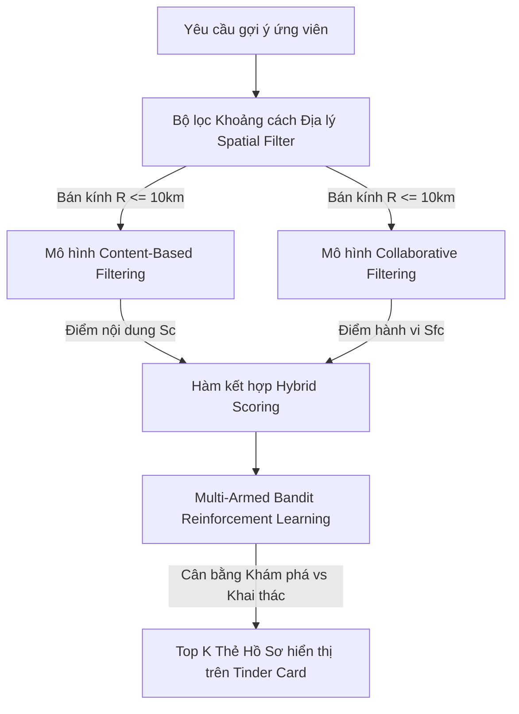
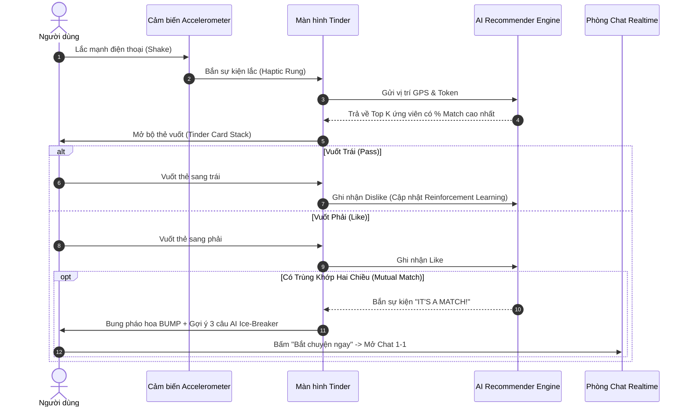

# VIVU MATCHING — ĐẶC TẢ CHỨC NĂNG GHÉP BẠN BẰNG AI & LẮC ĐIỆN THOẠI (SHAKE TO MATCH)

**Mã tài liệu:** VIVU-SPEC-MATCH-002  
**Phiên bản:** 2.0 (Cập nhật cơ chế Vuốt Tinder, Lắc máy & Thuật toán Gợi ý AI)  
**Phạm vi:** Hệ thống Ghép đôi thông minh (Matching Engine) và Màn hình Tinder Swipe

---

## 1. MỤC ĐÍCH & TẦM NHÌN SẢN PHẨM

Tính năng Matching của Vivu kết hợp sự kích thích của **cơ chế vuốt (Tinder Swipe)** với **cảm biến chuyển động (Shake)** và **sức mạnh của Trí tuệ Nhân tạo (Hybrid Recommender System)**:

- Khi người dùng muốn tìm bạn bè mới quanh mình: chỉ cần **Lắc nhẹ điện thoại**.
- Ứng dụng tự động kích hoạt Radar và mở ra **Bộ thẻ vuốt Tinder (Card Stack)** chứa các ứng viên sáng giá nhất đã được thuật toán AI chấm điểm.
- Người dùng xem hồ sơ trực quan (ảnh lớn, bio, điểm tương thích AI, các sở thích chung) để quyết định **Vuốt Phải (Thích)** hoặc **Vuốt Trái (Bỏ qua)**.
- Khi có **Trùng khớp hai chiều (Mutual Match)**: Hệ thống bung pháo hoa BUMP và mở ngay phòng chat kèm câu mở lời gợi ý từ AI.

---

## 2. KIẾN TRÚC THUẬT TOÁN AI GỢI Ý (HYBRID RECOMMENDER SYSTEM)

Để đáp ứng tiêu chuẩn khắt khe của một đồ án tốt nghiệp Trí tuệ Nhân tạo, danh sách ứng viên không được lấy ngẫu nhiên mà phải tính toán qua hệ thống gợi ý lai 3 lớp:

### 2.1. Lớp 1: Content-Based Filtering (Lọc theo nội dung hồ sơ)
- **Đầu vào:** Vector hóa các trường thông tin của User A và User B:
  - Vector sở thích $V_{interest}$ (âm nhạc, thể thao, đồ ăn, phim ảnh).
  - Khoảng cách độ tuổi $\Delta_{age}$.
  - Vết chân lối sống $V_{lifestyle}$ (các địa điểm thường xuyên ghé thăm từ DBSCAN).
- **Công thức tính điểm tương đồng:**
  $$S_{content}(A, B) = w_1 \cdot \text{Cosine}(V_A, V_B) + w_2 \cdot \text{LifestyleOverlap}(A, B) - w_3 \cdot \frac{\text{Distance}(A, B)}{R_{max}}$$

### 2.2. Lớp 2: Collaborative Filtering (Lọc cộng tác theo hành vi)
- Dựa vào ma trận tương tác vuốt (Swipe Interaction Matrix).
- Nếu User A và User C có hành vi vuốt tương tự nhau (cùng thích User X, User Y), thì những người mà User C đã thích sẽ được ưu tiên đề xuất cho User A.

### 2.3. Lớp 3: Multi-Armed Bandit (Học tăng cường thời gian thực)
- Giải quyết bài toán **Exploration vs. Exploitation** (Khám phá người mới vs Khai thác gu chắc chắn thích).
- Thuật toán áp dụng chính sách **$\epsilon$-Greedy hoặc UCB (Upper Confidence Bound)**:
  - $90\%$ thời gian: Hiển thị người có điểm số Match cao nhất.
  - $10\%$ thời gian: Hiển thị một ứng viên tiềm năng mới để đánh giá phản ứng của người dùng, tránh hiện tượng "bong bóng lọc" (filter bubble).
- Khi người dùng vuốt Trái (Dislike): Thuật toán phạt (penalty) trọng số của các thuộc tính tương đồng của người đó, giúp danh sách các lượt sau càng lúc càng sát gu thực tế.

---

## 3. GIAO DIỆN & CÁC BƯỚC TƯƠNG TÁC (UI/UX FLOW)

### 3.1. Cảm biến Lắc điện thoại (Shake Trigger)
- Ứng dụng theo dõi dữ liệu cảm biến gia tốc `expo-sensors`:
  $$\sqrt{a_x^2 + a_y^2 + a_z^2} > \text{Threshold} \quad (g \approx 1.8)$$
- Khi phát hiện rung lắc trong khoảng thời gian 400ms:
  - Máy rung phản hồi xúc giác (Haptic Notification).
  - Bản đồ nền tối mờ đi (Blur backdrop).
  - Bộ thẻ vuốt trượt từ dưới lên chiếm trọng tâm màn hình.

### 3.2. Cấu trúc Thẻ Vuốt (Tinder Card Anatomy)
1. **Ảnh đại diện lớn (Full Card Visual):**
   - Tỉ lệ 3:4 chất lượng cao.
   - Nhấn vào bên phải ảnh để chuyển sang ảnh tiếp theo trong album; nhấn bên trái để quay lại.
2. **Huy hiệu AI Match Badge:**
   - Huy hiệu tròn phát sáng Gradient ở góc trên bên phải: `🔥 Match 94%`.
3. **Thông tin nhân khẩu học:**
   - Tên thật + Tuổi (VD: *"Hải Yến, 21"*).
   - Khoảng cách GPS thực tế (VD: *"Cách bạn 1.2 km"*).
   - Điểm Uy Tín (Trust Score): Huy hiệu xanh lá (VD: *"🛡️ 95đ uy tín"*).
4. **Bio & Điểm chung nổi bật:**
   - Dòng tiểu sử ngắn gọn.
   - Các Chips sở thích: Các tag trùng với người xem được highlight màu nổi bật (VD: `[Cầu lông]`, `[Acoustic Cafe]`, `[Nhiếp ảnh]`).
5. **Hàng nút điều khiển nhanh (Quick Actions):**
   - ❌ Nút Đỏ tròn: Bỏ qua (Pass - Vuốt trái).
   - ⭐ Nút Xanh dương: Super Like (Tạo thông báo đặc biệt).
   - 💚 Nút Xanh lá: Thích (Like - Vuốt phải).

### 3.3. Màn hình Chúc Mừng Trùng Khớp (It's a Match!)
- Khi có Double Match:
  - Hai avatar hút vào nhau kèm hiệu ứng BUMP pháo hoa rực rỡ.
  - Dòng chữ lớn: *"Hai bạn đã tìm thấy nhau!"*.
  - **AI Ice-Breaker Generator:** Hệ thống hiển thị 3 bong bóng tin nhắn gợi ý bắt chuyện thông minh (dựa vào sở thích chung), người dùng chỉ cần chạm 1 chạm là tin nhắn tự gửi đi.

---

## 4. BẢNG YÊU CẦU CHỨC NĂNG CHI TIẾT

| Mã yêu cầu | Tên chức năng | Mô tả chi tiết | Mức ưu tiên |
|:---|:---|:---|:---|
| **MATCH-01** | Bắt sự kiện Lắc điện thoại | Sử dụng gia tốc kế `expo-sensors` kích hoạt màn hình Swipe với độ trễ < 200ms. | **P0** |
| **MATCH-02** | Bộ thẻ vuốt (Tinder Card Stack) | Hỗ trợ thao tác kéo vuốt mượt mà 60fps sử dụng Reanimated & Gesture Handler. | **P0** |
| **MATCH-03** | Thuật toán AI Gợi ý Lai | Kết hợp Content-based + Collaborative Filtering xếp hạng ứng viên chuẩn xác. | **P0** |
| **MATCH-04** | Xử lý Trùng khớp (Mutual Match) | Phát hiện khi 2 người dùng thích lẫn nhau, lưu trữ quan hệ Match trong CSDL. | **P0** |
| **MATCH-05** | Gợi ý Mở lời bằng AI | Sinh tự động 3 câu Ice-breaker dựa trên điểm chung của 2 bên. | **P0** |
| **MATCH-06** | Album ảnh đại diện đa phương tiện | Cho phép người dùng duyệt qua lại nhiều ảnh trong một hồ sơ cá nhân. | **P0** |
| **MATCH-07** | Nhận diện Chạm mặt (BUMP) | Khi 2 điện thoại ở khoảng cách < 5m (qua GPS/BLE), hiển thị hiệu ứng chạm ly/lửa. | **P1** |
| **MATCH-08** | Lọc theo Tiêu chí Nâng cao | Cho phép chỉnh khoảng cách tìm kiếm tối đa (1km - 50km) và khoảng tuổi. | **P1** |

---

## 5. TIÊU CHÍ NGHIỆM THU

1. Lắc điện thoại phản hồi rung xúc giác và mở thẻ vuốt tức thì.
2. Thao tác vuốt Trái/Phải không bị giật lag trên cả Android và iOS.
3. Người dùng có nhiều điểm chung về sở thích và vị trí luôn xuất hiện ở những thẻ đầu tiên.
4. Mọi tương tác vuốt đều được lưu vào CSDL để làm tập dữ liệu huấn luyện (Training dataset) cho mô hình học máy.
