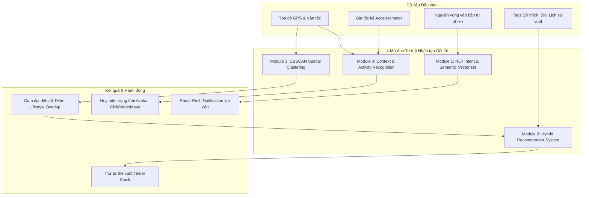
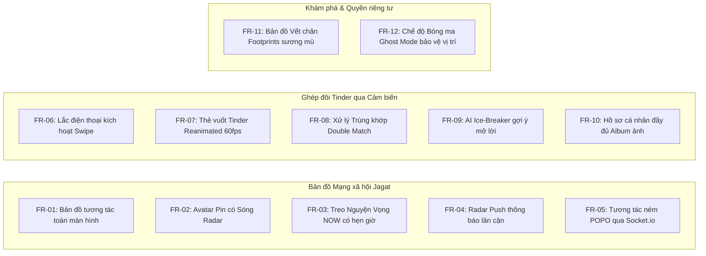

# SOFTWARE REQUIREMENTS SPECIFICATION (SRS) — VIVU
## ĐỒ ÁN TRÍ TUỆ NHÂN TẠO: LOCATION-BASED AI SOCIAL DISCOVERY (LBSD)

**Mã tài liệu:** VIVU-SRS-002  
**Phiên bản:** 2.0 (Kiến trúc Mạng xã hội Bản đồ Jagat & Ghép đôi AI Tinder)  
**Trạng thái:** Đặc tả chính thức cho Đồ án Tốt nghiệp / Nghiên cứu  
**Ngày cập nhật:** 2026-09-30  
**Lĩnh vực:** Trí tuệ Nhân tạo (AI), Hệ thống Gợi ý (Recommender Systems), Xử lý Ngôn ngữ Tự nhiên (NLP), Dữ liệu Không gian (Spatial Data Mining)

---

## 1. GIỚI THIỆU TỔNG QUAN

### 1.1. Mục đích tài liệu
Tài liệu SRS này xác định toàn diện các yêu cầu chức năng, yêu cầu phi chức năng, kiến trúc kỹ thuật và mô hình thuật toán Trí tuệ Nhân tạo của hệ thống **VIVU**. Tài liệu phục vụ cho công tác thiết kế hệ thống, lập trình, kiểm thử và làm báo cáo khoa học cho Đồ án tốt nghiệp chuyên ngành Trí tuệ Nhân tạo.

### 1.2. Tầm nhìn sản phẩm (Product Vision)
**VIVU** là một nền tảng mạng xã hội khám phá theo vị trí (Location-Based Social Discovery - LBSD) đột phá, giải quyết bài toán "kết nối người dùng có nhu cầu thực tế ngoài đời trong cùng một không gian và thời gian". 

Hệ thống kết hợp 2 triết lý tương tác dẫn đầu xu hướng Gen Z:
1. **Bản đồ Mạng xã hội thời gian thực (Cảm hứng từ Jagat & Zenly):** Đưa bản đồ làm giao diện chính, hiển thị avatar sống động, trạng thái di chuyển/pin, các bong bóng nguyện vọng tức thì (NOW Beacon) và bản đồ dấu chân khám phá (Footprints).
2. **Ghép đôi Tức thì bằng Cảm biến & Vuốt (Cảm hứng từ Tinder & AirDrop):** Cho phép người dùng lắc điện thoại (Shake) để mở bộ thẻ hồ sơ vuốt Trái/Phải được cá nhân hóa cao độ bằng thuật toán AI.

---

## 2. KIẾN TRÚC CÁC THUẬT TOÁN TRÍ TUỆ NHÂN TẠO (AI CORE MODULES)

Hệ thống tích hợp 4 mô-đun AI đóng vai trò xương sống trong việc xử lý dữ liệu và ra quyết định:

### 2.1. Mô-đun 1: NLP Semantic Matching (Khớp nối Nguyện vọng Tự nhiên)
- **Vấn đề:** Người dùng đăng nguyện vọng bằng ngôn ngữ tự nhiên (VD: *"Tìm người đánh cầu lông chiều nay"*, *"Ai cafe acoustic không"*). Tìm kiếm từ khóa truyền thống (Keyword match) sẽ thất bại hoàn toàn khi người khác đăng: *"Giao lưu cầu lông"* hoặc *"Ngồi quán nước nghe nhạc sống"*.
- **Giải pháp AI:**
  1. Sử dụng mô hình **Word/Sentence Embeddings** biến đổi chuỗi văn bản thành vector $n$-chiều: $\vec{V}_{desire} \in \mathbb{R}^d$.
  2. Vector hóa danh sách các Tags sở thích và hồ sơ của người dùng trong bán kính địa lý lân cận: $\vec{V}_{user} \in \mathbb{R}^d$.
  3. Tính toán **Độ tương đồng Cosine (Cosine Similarity)**:
     $$\text{Cosine}(\vec{V}_{desire}, \vec{V}_{user}) = \frac{\vec{V}_{desire} \cdot \vec{V}_{user}}{\|\vec{V}_{desire}\| \|\vec{V}_{user}\|}$$
  4. Nếu $\text{Cosine} \ge 0.8$ và khoảng cách địa lý $\le 3\text{km}$: Kích hoạt WebSocket bắn thông báo Radar tức thì.

### 2.2. Mô-đun 2: Hybrid Recommender System (Hệ thống Gợi ý Lai cho Tinder Swipe)
- **Vấn đề:** Khi người dùng lắc máy để vuốt thẻ Tinder, hệ thống phải đề xuất những hồ sơ có khả năng được "Like" cao nhất để tối đa hóa tỷ lệ ghép đôi thành công.
- **Giải pháp AI:**
  - **Content-Based Filtering:** Tính toán khoảng cách giữa vector đặc trưng người dùng (độ tuổi, trường học, danh sách sở thích, cụm lối sống).
  - **Collaborative Filtering:** Dựa vào lịch sử ma trận tương tác của những người có hành vi tương đồng.
  - **Reinforcement Learning (Multi-Armed Bandit):** Cân bằng giữa Khám phá (Exploration - 10%) và Khai thác (Exploitation - 90%). Khi người dùng vuốt Trái (Dislike), thuật toán tự động phạt và điều chỉnh vector trọng số để các đề xuất tiếp theo chính xác hơn.

### 2.3. Mô-đun 3: Spatial AI (DBSCAN Clustering cho Vết chân & Điểm nóng)
- **Vấn đề:** Bản đồ có thể bị quá tải điểm (cluttering) khi nhiều người đăng cùng lúc; đồng thời cần phát hiện thói quen di chuyển từ dữ liệu tọa độ GPS lịch sử.
- **Giải pháp AI:** Thuật toán phân cụm dựa trên mật độ **DBSCAN (Density-Based Spatial Clustering of Applications with Noise)**:
  - Tham số: $\epsilon$ (khoảng cách bán kính quét, ví dụ 150m) và $\text{MinPts}$ (số điểm tối thiểu để tạo cụm, ví dụ 5 điểm).
  - **Ứng dụng 1 - Gom cụm Điểm nóng (Hotspot Discovery):** Tự động gộp 10 nguyện vọng ăn uống trong 1 khu phố thành 1 icon ngọn lửa phát sáng: *"Khu vực này đang có 10 người muốn tụ tập"*.
  - **Ứng dụng 2 - Lifestyle Overlap:** Phân cụm các địa điểm người dùng hay ghé qua (nhà ở, nơi học, quán cafe quen) để so sánh độ tương đồng phong cách sống với người khác.

### 2.4. Mô-đun 4: Activity & Context Recognition (Nhận diện Trạng thái bằng Học máy)
- **Vấn đề:** Tự động phát hiện trạng thái thực tế của người dùng giống Jagat (ngủ, đi xe, rảnh rỗi) mà không cần người dùng nhập tay.
- **Giải pháp AI:** Mô hình phân loại học máy (Decision Tree / Random Forest) dựa trên 4 thuộc tính:
  - Cảm biến gia tốc kế (Accelerometer Magnitude: $M = \sqrt{a_x^2 + a_y^2 + a_z^2}$).
  - Vận tốc di chuyển GPS ($v$ tính bằng km/h).
  - Thời gian dừng tại một tọa độ cố định ($T_{stay}$).
  - Khung giờ trong ngày ($H \in [0, 23]$).
  - **Nhãn phân loại:** `Free & Chilling` (ở quán cafe, $v \approx 0, M \text{ nhỏ}$), `Deep Work` ($T_{stay} > 2h$ tại trường học), `Moving` ($v > 20\text{km/h}$), `Sleeping` ($H \in [23h, 6h], M \approx 0$).

---

## 3. CÁC YÊU CẦU CHỨC NĂNG HỆ THỐNG (FUNCTIONAL REQUIREMENTS)

---

## 4. YÊU CẦU PHI CHỨC NĂNG (NON-FUNCTIONAL REQUIREMENTS)

### 4.1. Hiệu năng & Tối ưu hóa (Performance)
- **Độ trễ phản hồi cảm biến lắc (Shake Latency):** Phản hồi rung và mở màn hình vuốt trong vòng **< 200ms**.
- **Tốc độ tải bản đồ:** Render bản đồ và các pins xung quanh trong vòng **< 1.5 giây**.
- **Độ mượt mà của cử chỉ vuốt thẻ (Swipe Frame Rate):** Đạt chuẩn **60 fps** ổn định thông qua thư viện native-driven Reanimated 3 và Gesture Handler.
- **Tiết kiệm pin:** Hệ thống GPS chỉ cập nhật với tần suất cao khi ứng dụng đang mở (Foreground); khi chạy nền (Background) chuyển sang chế độ Significant-Change Location Service để không làm hao pin người dùng.

### 4.2. Bảo mật & Quyền riêng tư (Privacy & Security)
- **Chế độ Bóng Ma (Ghost Mode):** Người dùng có toàn quyền điều chỉnh mức độ chia sẻ vị trí:
  - *Chính xác (Precise):* Chia sẻ vị trí thực tế trong bán kính 10m.
  - *Làm mờ (Blurred):* Chỉ hiển thị vị trí ngẫu nhiên trong bán kính 1km (bảo vệ quyền riêng tư cá nhân).
  - *Đóng băng (Frozen):* Cố định vị trí tại một điểm cuối cùng.
- **Bảo mật dữ liệu:** Mọi thông tin truyền tải qua HTTPS/WSS và được mã hóa JWT.

---

## 5. MÔI TRƯỜNG KỸ THUẬT & CÔNG NGHỆ ÁP DỤNG

| Tầng kiến trúc | Công nghệ sử dụng | Vai trò |
|:---|:---|:---|
| **Mobile App (Frontend)** | React Native (Expo SDK 57), TypeScript | Ứng dụng di động đa nền tảng (Android/iOS/Web). |
| **Bản đồ (Maps Engine)** | Mapbox GL / `react-native-maps` | Hiển thị bản đồ vector, custom pins và radar waves. |
| **Cảm biến (Sensors)** | `expo-sensors` (Accelerometer), `expo-location` | Bắt cử chỉ lắc máy và định vị tọa độ địa lý. |
| **Hiệu ứng đồ họa (Animations)** | `react-native-reanimated`, `react-native-gesture-handler` | Hiệu ứng vuốt thẻ Tinder mượt mà 60fps. |
| **Backend API** | Node.js (Express), TypeScript | Cung cấp RESTful APIs và điều phối logic nghiệp vụ. |
| **Thời gian thực (Realtime)** | Socket.io | Truyền phát vị trí, ném POPO và thông báo Radar tức thì. |
| **Lưu trữ CSDL & Cache** | MongoDB (dữ liệu lâu dài), Redis (GEO Spatial Cache & In-Memory Fallback) | Lưu trữ người dùng, bài đăng nguyện vọng và điểm địa lý. |
| **Mô hình Trí tuệ Nhân tạo** | Python / Node.js AI Engine (Sentence-BERT, DBSCAN, Multi-Armed Bandit) | Tính toán độ tương đồng ngữ nghĩa, phân cụm và gợi ý ghép đôi. |
